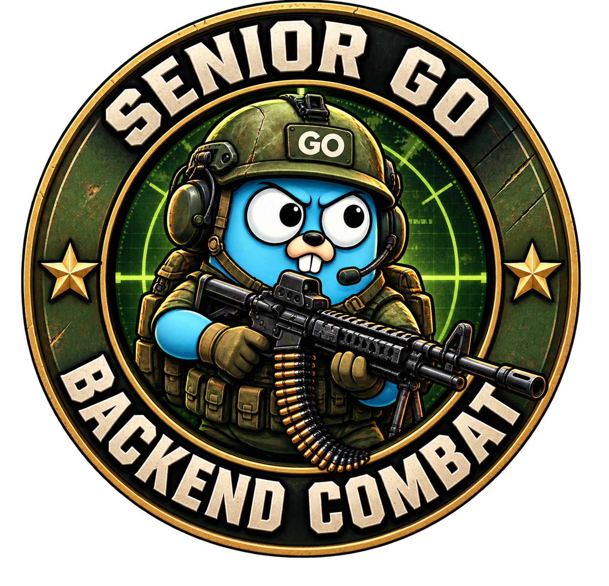

# 🔥 Senior Go Backend Combat

> **От «я немного писал на Python» — к своему backend на Go и уверенному разговору на собеседовании.**
>
> 24 недели. Один растущий проект. Живые объяснения. Ревью с ментором. **500 вопросов с настоящих интервью.**

Открываешь задачу. Вроде всё понятно. Открываешь пустую папку — и уже не очень.

Что писать первым? Зачем нужны эти папки? Почему у других десять технологий, а у тебя пока одна функция, которая хотя бы запускается?

С этой точки и начнём. Разберёмся, что вообще значит написать программу, как превратить просьбу человека в последовательность действий и как проверить, что получилось задуманное. Дальше будут Go, сеть, база данных и фоновая работа. У каждого инструмента появится своя причина.

**Курс рассчитан на небольшой опыт.** Если ты видел несколько API, написал пару функций и пока не чувствуешь системы — ты по адресу. Знание другого языка на хорошем уровне для старта не требуется.

## 🧭 Куда идти

- **[Первый урок: а что вообще такое программирование?](student/01_FIRST_PROGRAM.md)** — начинаем разговор и пишем первую программу.
- **[Все 24 недели](course/README.md)** — маршрут, практика и опоры для ментора.
- **[500 вопросов с интервью](interview/README.md)** и [маршрут подготовки](interview/route.md) — учимся отвечать по мере освоения тем.
- **[Первый запуск](docs/START_HERE.md)** — выбираем свою ОС, разбираем команды и частые затруднения.
- **[Как заниматься и сдавать ДЗ](docs/WORKFLOW.md)** — подсказки, ревью, эталоны и самостоятельная проверка.

## 🔧 Первая часть: учимся думать и действовать

[Четыре первых занятия](course/README.md#первая-часть-инженерная-опора-и-язык): превращаем просьбу в требования, защищаем инварианты, считаем нагрузку, разбираем границы и выделяем функции. К каждому есть SVG-плакат и практика с понятным результатом.

[Git с конфликтами и восстановлением](docs/GIT.md) · [Карта большого проекта и контрактов](docs/PROJECT_FLOW.md)

## 🛠 Следующий шаг: от списка дел к живому окружению

[Уроки 05–09](course/README.md#следующая-часть-данные-уверенность-и-рабочее-окружение): храним несколько дел, разбираемся с копиями и ошибками, учимся проверять обещания программы. Затем собираем своё приложение в Docker и поднимаем PostgreSQL через Compose — **до SQL**, чтобы на новой теме заниматься запросами, а не установкой базы.

На 14 подключаем pgxpool/v5 и встроенный Goose: код и SQL путешествуют одной сборкой. На 21 учимся выпускать и останавливать уже знакомый сервис. [Как устроено окружение](docs/ENVIRONMENT.md).

[Следующая часть 10–15](course/README.md#от-сети-к-заменяемому-хранилищу) связывает HTTP, JSON, SQL и интерфейсы: прослеживаем одну просьбу через всю программу, объясняем ошибки и меняем хранилище без ремонта API. Внутренние Task-контракты 11–24 уже приведены к единому pkg; внешний формат HTTP сохранён.

## 🎯 Что ты будешь уметь

Читать задачу и задавать уточняющие вопросы. Разбивать работу на шаги. Писать и читать Go-код. Исследовать ошибку. Работать с Git. Принимать HTTP-запросы, хранить данные в PostgreSQL, проверять поведение тестами и выполнять ограниченное число фоновых задач.

А ещё — объяснять свои решения: что хотел получить, что попробовал, почему выбрал этот вариант и где у него границы. Это пригодится и в команде, и на собеседовании.

**Цель основного маршрута — подготовка к первой работе Go junior/junior+.** В конце будут оформленный проект, резюме, практика ответов и пробное техническое интервью. Следующие шаги определим по тому, что уже получается самостоятельно.

## 🥊 Наш проект — JobFlow

Сначала это программа, которая показывает одно дело. Потом — список дел, с которым можно работать. Затем у списка появляется сетевой вход и постоянная память. А ближе к концу приложение учится выполнять небольшую фоновую работу и показывать её результат.

Так появится собственный backend, историю которого ты понимаешь от первой строчки. Заодно будет что рассказать работодателю: где ошибся, как нашёл причину, что улучшил и как проверил.

## 🤝 Как мы учимся

Одна встреча в неделю: 50 минут работы и 10 минут на вопросы. Нагрузка между встречами указана в каждом ДЗ: в обновлённой первой части — **от 1, 5–2, 5 до 3–4 часов**, включая чтение, попытки, Git и исправления.

На занятии разговариваем, предсказываем результат, пишем, запускаем и разбираемся. После — самостоятельный шаг проекта с подсказками и граничными примерами. Ментор смотрит каждую работу. Открытые проверки помогают увидеть расхождение, а эталоны позволяют сравнить решения. У каждого задания есть добровольная творческая часть **★**.

Первая неудачная попытка — хороший материал для следующего шага. Приноси её на разбор вместе с вопросами.

## 🚀 Когда захочется глубже

Название **Senior Go Backend Combat** сохраняет характер курса и направление роста. После основного маршрута можно продолжить [распределённый JobFlow](advanced/jobflow/README.md): четыре сервиса, Kafka, Redis, CQRS и собственный бинарный протокол.

Рабочие инженерные материалы сохранены. Вход в них начинается с [моста из основного курса](advanced/README.md).

## 🛠 Для автора и ментора

[Методика](docs/TEACHING.md) · [Поддержка репозитория](docs/CONTRIBUTING.md) · [История исходных материалов](legacy/README.md) · [Проверка переработки](docs/VALIDATION.md)

Тексты уроков редактируются вручную. Автоматизация поддерживает навигацию и проверки; авторский голос остаётся в тексте.
