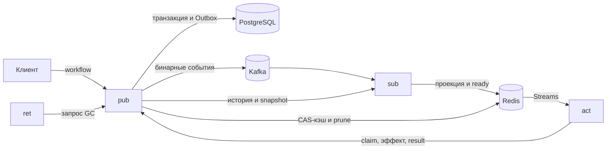
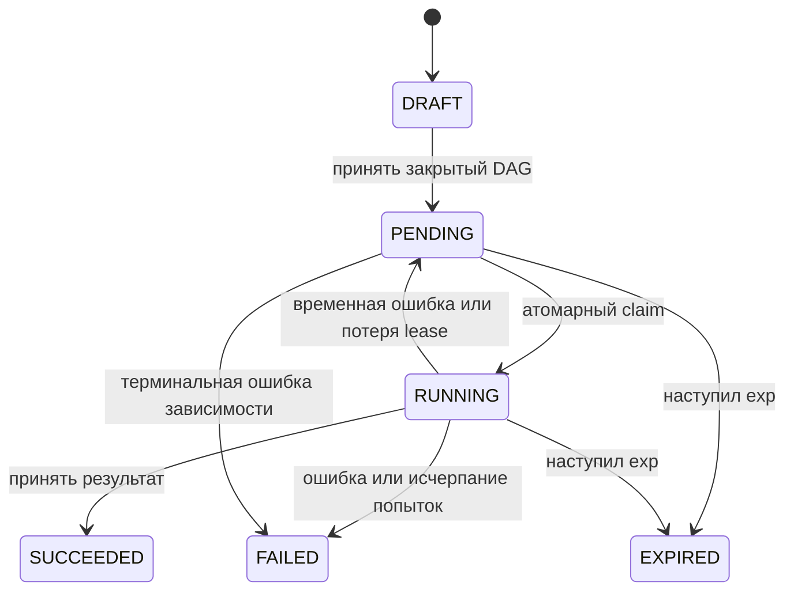

# JobFlow v1 — состояние, границы и API

## Владение

`pub` принимает черновики и workflow, владеет PostgreSQL и выдаёт попытки. В его процессе работают Outbox relay и ограниченный maintenance. `sub` строит Redis-проекцию и планирует сигналы. `act` исполняет зарегистрированные обработчики. `ret` запрашивает очистку у pub. Прямое изменение чужого состояния между сервисами не используется.

PostgreSQL хранит подтверждённые тела, задачи, события, fingerprints и receipts. Redis хранит восстанавливаемые проекции, CAS-копии и ready Stream. Kafka доставляет события с повторами. История компактных метаданных позволяет восстановиться после потери проекции независимо от сохранности Kafka retention.

## Поток данных

Стрелки показывают данные. Историю и snapshot sub запрашивает у pub по HTTP; право на попытку act получает у pub отдельным запросом.

## Жизненный цикл

Черновик можно изменять и удалять. Принятые вход и связи неизменяемы. Направление ребра — задача → её зависимость. Все зависимости должны успешно завершиться. Локальный DAG передаётся целиком; внешний dep адресует уже принятую задачу другого workflow. Внешний отказ переводит ожидающих потомков в FAILED.

Повтор того же workflow сравнивает fingerprints всех входных фреймов. Изменённое тело, адрес, время, квота или связь при прежних ID возвращают конфликт. Часть уже принятого workflow не принимается как новый workflow.

Claim блокирует строку и проверяет состояние, время и зависимости в одной SQL-транзакции. Сигнал Redis полномочий не даёт. Token и lease защищают запись результата и эффекта. Времена lease и проверки серверные; клиент не присылает now.

## HTTP-контракт

Модуль учебного проекта называется `jobflow`. Пакеты адаптеров предоставляют интерфейсы, используемые открытыми [проверками](../checks/README.md). JSON использует нижний регистр полей из эталона; `[]byte` передаётся Base64.

| Метод и путь | Запрос | Успех |
|---|---|---|
| POST `/drafts` | Task: id, kind, body, необязательные nbf/exp/quotas | 201, id |
| GET `/drafts` | — | 200, список по ID |
| GET `/drafts/{id}` | — | 200, Task |
| PUT `/drafts/{id}` | редактируемые поля Task; ID берётся из пути | 200, id |
| DELETE `/drafts/{id}` | — | 204 |
| POST `/workflows` | последовательность полных бинарных фреймов, application/octet-stream | 202, массив принятых Task |
| GET `/tasks/{id}` | — | 200, принятая Task и доступный результат |
| POST `/tasks/{id}/claim` | пустое тело | 200, Task с token и lease_until |
| POST `/tasks/{id}/result` | token, body Base64, error, retryable | 200, Task |
| POST `/tasks/{id}/effects` | token, slot, delta | 200, value |
| GET `/payloads/{key}` | — | 200, исходные байты |
| GET `/internal/events?after=N` | курсор seq, начиная с 0 | 200, до 500 событий |
| GET `/internal/tasks` | — | 200, snapshot без body/result |
| POST `/internal/gc` | пустое тело | 200, removed и tasks (id/workflow) |
| GET `/healthz` | — | 200, liveness процесса |
| GET `/metrics` | — | Prometheus-текст по состояниям задач |

ErrInvalid → 400; ErrNotFound → 404; ErrConflict/ErrNotReady/ErrStale → 409; ErrExpired → 410; ErrQuota → 422; отмена/таймаут → 408; прочие отказы → 500 без раскрытия внутренних ошибок. Внутренние endpoint предназначены для локального учебного окружения.

## События и доставка

Event содержит `seq`, UUIDv7 `id`, snapshot Task без тела/результата и `prefix` (128 байт и связи). `seq` — курсор истории, `version` внутри Task — порядок одной задачи. Пробелы в seq допустимы после отката транзакции. UUID и время не заменяют version.

Kafka topic по умолчанию `job.events`. Key — workflow ID. Value — полный фрейм. Заголовок Kafka `event` содержит JSON Event без prefix; sub получает prefix из Value. Relay подтверждает доставку после публикации. `sub` применяет только более новую version и затем коммитит offset. Повтор одного event безопасен.

В Redis используются ключи с `JF_NAMESPACE`: `task:<id>` — hash version/doc, `tasks` — индекс, `ready` — Stream, `signal:<id>:<version>` — краткоживущий маркер, `cas:<key>` — кэш тела. Группа Streams — `act`; ACK выполняется после принятого результата. Сигналы разрешено повторять.

## Попытки и эффект

Lease — 5 секунд, штатный обработчик получает 2 секунды кооперативного времени. Максимум три попытки; после временной ошибки задержка 1 и 2 секунды. После потери lease maintenance назначает следующую доступность не раньше чем через секунду. После исчерпания попыток — FAILED.

`counter` демонстрирует защищённый эффект: `(Task ID, slot)` уникален. Изменение счётчика и запись ответа ledger выполняются вместе. Повтор с тем же delta возвращает сохранённый ответ, с другим — конфликт. Receipt `(Task ID, token)` аналогично защищает повтор result. Приём эффекта проверяет действующий token и срок до обращения к ledger.

Повтор кода обработчика допускается. Гарантия счётчика обеспечивается участвующим получателем, а не хэшем тела или одним Redis-маркером. Другой внешний получатель должен предоставить собственный контракт идемпотентности.

## Очистка и пределы выпуска

Retention тела после терминального состояния — один час. Ссылки снимаются только при отсутствии недоставленных событий и живых зависимых задач. CAS удаляется после исчезновения всех ссылок на входы и результаты. Redis-копии убираются повторяемым проходом. После очистки GET задачи сохраняет состояние и идентичность, но тело/результат могут отсутствовать.

Компактная история, fingerprints, receipts и терминальные состояния в v1 сохраняются. Архивация этих метаданных не входит в учебный выпуск. Максимум 128 задач в одном workflow и 8 MiB в запросе, каждый фрейм до 1 MiB. Ограничения относятся к локальной учебной системе; горизонтальное масштабирование pub/relay и выполнение произвольного кода не заявлены.

Первая миграция — черновики и локальные намерения. Вторая — CAS, принятые задачи и события. Третья — receipts и демонстрационный эффект. Уже применённые миграции не редактируются. Открытые этапы сохраняют старые файлы миграций при добавлении новых.
