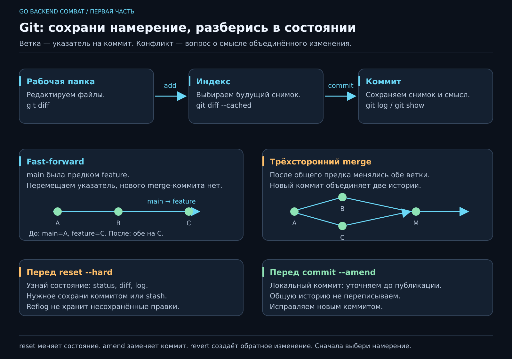

# Git: рабочий стол, история и выход из неприятностей

Git особенно нужен в тот момент, когда хочется сказать: «Вчера работало, я ничего такого не делал». Он помогает увидеть конкретное изменение, сохранить осмысленный шаг и собрать работу нескольких людей.

Пройди главу за четыре первых занятия: первый коммит → ветка и fast-forward → конфликт → восстановление. Лаборатории выполняй **в отдельной папке `git-playground`**, рядом со своим JobFlow. Команды здесь — материал практикума; к папке курса их применять не нужно.



[Открыть SVG](../posters/core/GIT_WORKFLOW.svg). Сначала разберём верхние три состояния; к графам вернёмся после первого коммита.

## Что именно сохраняет Git

**Репозиторий** — файлы проекта и история в `.git`. **Коммит** — снимок выбранного состояния с родителем и пояснением. **Ветка** — перемещаемое имя, указывающее на коммит. **HEAD** обозначает текущую позицию: обычно через имя текущей ветки.

У файлов три важных состояния:

| Где | Что означает | Как посмотреть |
|---|---|---|
| Рабочая папка | То, что сейчас редактируешь | `git diff` — изменения отслеживаемых файлов вне индекса |
| Индекс, staging area | Что подготовлено для следующего коммита | `git diff --cached` |
| Последний коммит | Уже сохранённый снимок | `git show --stat HEAD` |

`git add` копирует **текущее** содержимое в индекс. Если после `add` ещё раз изменить файл, в коммит попадёт подготовленная версия, пока не повторишь `add`. Это полезная возможность собирать осмысленные изменения; подробная работа по кусочкам доступна через `git add -p`.

GitHub — сервис размещения репозиториев и обсуждения изменений. Локальный Git работает без него и без интернета. Коммит ещё не отправляет файлы на сервер; это делает `push`.

## Первый коммит в своём JobFlow

Установи Git через [официальную страницу для своей ОС](https://git-scm.com/downloads). В новом терминале проверь `git --version`. В папке **своего нового JobFlow**:

```sh
git init -b main
git config user.name "Твоё имя"
git config user.email "Твой адрес для коммитов"
git status
```

Подставь свои имя и адрес; можно взять приватный noreply-адрес из настроек GitHub. Здесь настройки локальны для проекта. Если автор уже настроен и значения устраивают, менять их не нужно.

В редакторе создай `.gitignore`:

```gitignore
/jobflow-app
/jobflow-app.exe
.env
```

`.gitignore` исключает подходящие **неотслеживаемые** файлы из обычного добавления. Он не удаляет уже закоммиченный файл из истории. В учебном репозитории сохраняем исходники, `go.mod`, заметки и инструкцию запуска.

Когда все перечисленные файлы созданы:

```sh
git add main.go go.mod README.md NOTES.md .gitignore
git diff --cached
git commit -m "feat: show the daily plan"
git status
git log --oneline -3
```

Перед коммитом прочитай diff как ревью чужого изменения. «Я вообще это хотел сохранять?» — хороший вопрос. Коммит полезно строить вокруг одного объяснимого намерения, например «проверять диапазон приоритета». Чисто механический «сохранил пятницу» завтра мало поможет.

## Лаборатория 1: ветка и fast-forward

**20–30 минут.** Открой новую папку, не вложенную в JobFlow:

```sh
mkdir git-playground
cd git-playground
git init -b main
git config user.name "Student"
git config user.email "student@example.invalid"
```

В редакторе создай `plan.txt` с двумя строками:

```text
title=Купить чай
priority=1
```

Сохрани исходную версию и создай ветку:

```sh
git add plan.txt
git commit -m "feat: add a plan"
git checkout -b "feat-my-awesome-stuff"
```

`checkout -b` создаёт ветку и переключает на неё. Более узкая по смыслу современная команда — `git switch -c feat-my-awesome-stuff`; обе полезно узнавать в чужих инструкциях.

Добавь в `plan.txt` третью строку `note=После работы`, затем:

```sh
git add plan.txt
git commit -m "feat: add a plan note"
git checkout main
git merge --ff-only feat-my-awesome-stuff
git log --graph --oneline --all
```

Почему не возник новый коммит объединения? `main` не менялась и была предком ветки. Git передвинул её указатель вперёд — это **fast-forward**. `--ff-only` требует именно такой вариант и откажет при расхождении истории. Это объясняется в [документации merge](https://git-scm.com/docs/git-merge).

**Проверь понимание:** файлы веток копируются в отдельные папки? Нет, обычное переключение меняет состояние одной рабочей папки. Для нескольких папок одной истории есть `git worktree`, но для нашей лаборатории он не требуется.

## Лаборатория 2: расхождение и конфликт

**30–40 минут**, продолжение в `git-playground`. Начни с чистого `git status`.

```sh
git checkout -b feat-coffee
```

Измени первую строку на `title=Купить кофе`, сохрани и закоммить:

```sh
git add plan.txt
git commit -m "feat: choose coffee"
git checkout main
```

В `main` измени ту же строку на `title=Купить зелёный чай`, затем:

```sh
git add plan.txt
git commit -m "feat: specify the tea"
git merge feat-coffee
```

Обе ветки теперь содержат свои коммиты после общего предка. Fast-forward невозможен. Git пытается сделать **трёхстороннее объединение**: сравнивает общего предка и две версии. Разные изменения одной строки автоматически выбрать нельзя — появляется конфликт.

```text
<<<<<<< HEAD
title=Купить зелёный чай
=======
title=Купить кофе
>>>>>>> feat-coffee
```

В этом обычном merge верхняя часть — текущая `main`, нижняя — присоединяемая ветка. Конфликт — вопрос о смысле результата. Допустим, договорились купить и чай, и кофе. Замени весь блок одной строкой `title=Купить зелёный чай и кофе`, удали маркеры, сохрани остальные поля.

```sh
git status
git diff
git add plan.txt
git diff --cached
git commit -m "merge: combine the shopping plans"
git log --graph --oneline --all
```

Появился коммит с двумя родителями. При независимых изменениях обычный merge может обойтись без конфликта; конфликт не является обязательным признаком «настоящего» объединения. `git merge --no-ff branch-name` создаёт merge-коммит и в ситуации, где был возможен fast-forward, если команда хочет явно сохранить границу ветки.

Если решение ещё неясно, `git merge --abort` отменяет незавершённый merge. Выполняй merge с чистой рабочей папкой: наличие прежних несохранённых правок усложняет восстановление. Удалённые маркеры ещё не доказывают, что программа работает; после объединения повторяем соответствующие проверки поведения.

Для расследования доступны `git diff --name-only --diff-filter=U` — список конфликтующих файлов, и `git show branch-name:plan.txt` — версия файла из указанной ветки.

## Рабочий flow команды

Для учебного проекта достаточно `main` и коротких feature-веток:

1. Синхронизировать чистую `main`: `git checkout main`, затем `git pull --ff-only`.
2. Создать ветку `git checkout -b feat-task-validation`.
3. Сделать небольшой шаг, проверить его, просмотреть diff, закоммитить.
4. При настроенном удалённом репозитории — `git push -u origin feat-task-validation` и открыть pull request для ревью.
5. После замечаний добавить понятные исправления и объединить согласно правилам команды.

`origin` — принятое имя удалённого репозитория, не особый сервер. У нового `git init` его нет; `git remote -v` показывает настроенные адреса. В GitHub создай пустой репозиторий и возьми его URL для `git remote add origin URL`, подставив свой адрес. Пароли и токены не вписываем в учебный файл или URL.

Если `pull --ff-only` отказал из-за расхождения, сначала изучи его: `git fetch origin`, затем `git log --left-right --graph --oneline main...origin/main`. Fetch обновляет сведения об удалённых ветках, не объединяя их с текущей. Дальше выбирают merge или согласованный rebase по правилам команды. Автоматический `reset --hard origin/main` может удалить твои локальные коммиты из текущей ветки и несохранённые правки; это не универсальный следующий шаг.

**Git Flow** также называют конкретную модель с `develop`, `feature/*`, `release/*`, `hotfix/*`. Она удобна при отдельных релизных циклах и поддержке версий, но требует больше правил и слияний. Наш короткий flow проще для одного приложения. На работе сначала узнай модель команды, способ merge и правила публикации истории.

## «Гит заебался»: сначала выясним состояние

Это настроение знакомо. У Git при этом обычно есть конкретное состояние, на которое можно посмотреть:

```sh
git status
git branch --show-current
git diff
git diff --cached
git log --graph --oneline --all -10
```

**Dirty working tree** означает несохранённые в коммите изменения рабочей папки или индекса. Термин «dirty HEAD» смешивает разные вещи. **Detached HEAD** — текущая позиция указывает непосредственно на коммит, а не на ветку. Сам по себе такой режим не означает повреждение репозитория.

| Намерение | Действие и граница |
|---|---|
| Убрать файл из будущего коммита, оставить правки | `git restore --staged plan.txt` после появления первого коммита |
| Временно отложить правки и неотслеживаемые файлы | `git stash push -u -m "before switching"` |
| Вернуть отложенное, пока сохранив запись stash | `git stash apply` — могут возникнуть конфликты |
| Сохранить новый коммит из detached HEAD | `git switch -c rescue/my-work` **до ухода с этой позиции** |
| Отменить обычный опубликованный коммит | `git revert COMMIT_ID` создаёт новое обратное изменение; подставь реальный хэш |
| Посмотреть недавние положения ссылок | `git reflog`; затем можно создать ветку на найденном коммите |

`stash -u` включает неотслеживаемые файлы, но не игнорируемые. Stash локален и не отправляется обычным push. Reflog помогает найти существовавшие коммиты, пока они доступны; он не хранит каждую несохранённую версию файла. Такую границу описывает [документация reflog](https://git-scm.com/docs/git-reflog).

## Лаборатория 3: восстановление и amend

**25–35 минут. Только `git-playground`.** Сначала `git status`: merge завершён, нужная работа закоммичена. Создай `git checkout -b recovery-lab`. Добавь в `plan.txt` строку `experiment=temporary`, затем отложи её:

```sh
git stash push -u -m "saved recovery experiment"
git stash list
git stash apply
```

Строка снова в рабочем файле, а копия остаётся в stash. Теперь команда, которую нельзя превращать в универсальное «почини Git»:

```sh
git reset --hard HEAD
```

Строка пропадёт из отслеживаемого файла. `--hard` приводит индекс и рабочие отслеживаемые файлы к выбранному коммиту; при необходимости может удалить мешающие неотслеживаемые пути. Без сохранённой копии правка могла бы быть потеряна. Это **сброс состояния**, а не лечение любой проблемы; подробности — в [документации reset](https://git-scm.com/docs/git-reset).

Верни сохранённое и создай локальный коммит:

```sh
git stash apply
git add plan.txt
git commit -m "feat: save the recovery experiment"
git log -1 --oneline
```

Теперь исправим сообщение **ещё не опубликованного** последнего коммита:

```sh
git commit --amend -m "docs: explain the recovery experiment"
git log -1 --oneline
```

Хэш изменился: amend создаёт замену последнего коммита. Для добавления забытой правки сначала нужен `git add`, затем `git commit --amend --no-edit`, если сообщение менять не нужно. Семантика описана в [документации commit](https://git-scm.com/docs/git-commit).

**Табу курса: не применяй amend к уже опубликованным общим коммитам, на которых могла основываться работа коллег.** Их история теперь ссылается на старый хэш. Не пытайся исправить ситуацию обычным force push: добавь новый исправляющий коммит или согласуй другую процедуру с командой. Локальный нерасшаренный amend полезен; переписывание общей истории требует отдельной договорённости.

Для исследования удаления последнего локального коммита сначала создай страховочную ветку:

```sh
git branch rescue-before-reset
git reset --hard HEAD~1
git log --oneline -3
git show rescue-before-reset:plan.txt
```

Последний коммит ушёл из текущей ветки, но остался достижимым через страховочную. Верни его через `git merge --ff-only rescue-before-reset`. Здесь `HEAD~1` указывает на первого родителя, а `--hard` одновременно меняет индекс и рабочую папку. Без понимания этих двух эффектов команда слишком дорого обходится.

## Что унести в работу и на интервью

Умей рассказать, что находится в рабочей папке, индексе и коммите; почему fast-forward не создаёт новый коммит; откуда берётся конфликт; чем локальный amend отличается от изменения общей истории; что именно может потеряться при `reset --hard`.

Главный навык — восстановить факты и выбрать действие под намерение. Список заклинаний без модели состояния работает ровно до первого необычного случая.
