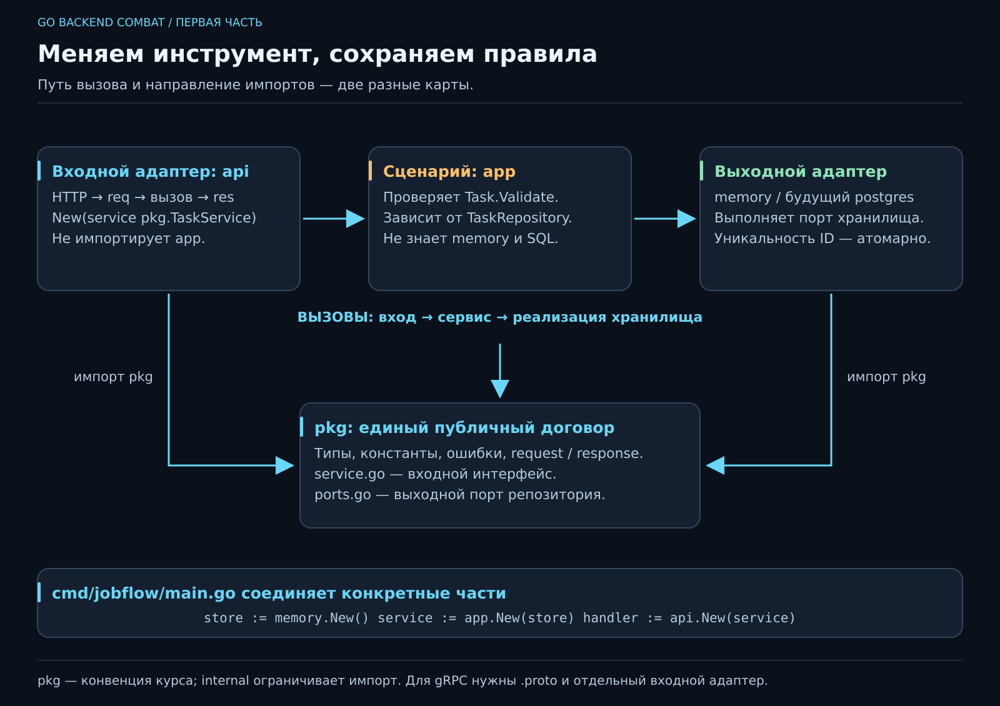

# Project Flow: как из задачи получается проект

Когда в проекте три папки, ориентироваться можно по памяти. Когда тридцать — хочется договориться, где искать договор, где правило и где код конкретного инструмента. Архитектура помогает ответить на эти вопросы до того, как навигация превратится в археологию.

В первый день прочитай историю и схему. После функций вернись к сигнатурам. После структур и интерфейсов сможешь самостоятельно воспроизвести пример.



[Открыть SVG крупно](../posters/core/HEXAGONAL.svg) · [Небольшой пример с исходниками](../examples/hexagonal/README.md)

## 1. Сначала вопрос, потом папка

Заказчик просит «добавлять дела с телефона». Сначала уточняем: какие поля обязательны, допустимы ли дубликаты, что возвращаем после создания? Затем формулируем инварианты: ID уникален, название непустое после удаления краевых пробелов при проверке, приоритет 1..3. Только после этого выбираем места для кода.

Путь разработки на любом размере задачи:

1. Записать цель человека и ограничения.
2. Составить примеры успеха, отказа и границы.
3. Назвать инварианты и владельца каждой проверки.
4. Описать входной и выходной договор операции.
5. Разделить правила и способы общения с внешним миром.
6. Реализовать один проход, сравнить с ожиданиями, изучить отказ.
7. Сохранить маленькое объяснимое изменение и провести ревью.

Пропущенное требование не исправляется добавлением папки `domain`. И наоборот, хорошее правило не должно потеряться при замене библиотеки.

## 2. Гексагональная архитектура на человеческом языке

Представь кафе: заказ можно принять у стойки, по телефону или через приложение. Кухня должна получить одинаково понятный заказ. Ей не нужно знать модель телефона клиента. Поставка продуктов — другая граница: кухня называет потребность, конкретный поставщик выполняет её.

В программе **порт** — договор о доступном действии, обычно интерфейс. **Адаптер** — конкретный способ исполнить этот договор или привести внешний запрос к нему. HTTP-вход, CLI и будущий gRPC — входные адаптеры; память и PostgreSQL — выходные.

Слово «гексагональная» не требует шести сервисов или шести папок. Оно подчёркивает границу приложения и независимость его правил от внешних механизмов. Аналогия с кафе объясняет роли; детали отмены, ошибок и одновременных заказов всё равно нужно проектировать явно.

## 3. Договор о пакетах в этом курсе

```text
jobflow/
  cmd/jobflow/main.go       # собирает конкретные части и запускает приложение
  pkg/
    task.go                # публичные типы, константы, правила Task
    requests.go            # запросы сервисных операций
    responses.go           # ответы, включая оболочку списка
    errors.go              # общие ошибки, которые понимают участники договора
    service.go             # входной интерфейс TaskService
    ports.go               # выходной интерфейс TaskRepository и его договор
  internal/
    app/service.go         # пользовательские сценарии и защита инвариантов
    api/api.go             # HTTP → сервисный запрос → HTTP-ответ
    memory/store.go        # конкретное хранилище в памяти
  go.mod                   # создан go mod init jobflow
```

**Правило курса: `pkg` — единый источник публичного договора.** Сервисные запросы и ответы, общие типы, константы, именованные варианты значений, ошибки и интерфейсы определены здесь один раз. Операционные детали реализации, например закрытый mutex, находятся рядом со своим кодом в `internal`. Драйвер базы и `http.Request` в публичный договор не попадают.

За кухонным столом можно услышать: «В `pkg` кладём код, который не стыдно показать, а в `internal` прячем то, что на коленке за пять минут до дедлайна». Шутка запоминается; в языке всё прозаичнее: `internal` ограничивает импорт деревом родительской папки, а `pkg` — обычное имя каталога. Внутренний код тоже пишем аккуратно. Так устроены [правила размещения Go-пакетов](https://go.dev/doc/modules/layout).

Это **наша конвенция проекта**, а не единственная разрешённая структура Go. Она делает поиск контракта предсказуемым. По мере роста `pkg` можно разделить на предметные подпакеты, сохранив один источник каждого типа. Не создавай копию `Task` в каждом адаптере только из-за разных имён папок. Отдельные транспортные DTO оправданы, когда внешний формат действительно отличается.

## 4. Сервисный метод: `(ctx, req) → (res, err)`

В `pkg/service.go`:

```go
type TaskService interface {
    Create(ctx context.Context, req CreateTaskRequest) (CreateTaskResponse, error)
    List(ctx context.Context, req ListTasksRequest) (ListTasksResponse, error)
}
```

Это фрагмент пакета `pkg`; импорт `context` и полные объявления есть в примере. Интерфейс описывает необходимое поведение. Сервис получает входной объект, возвращает выходной объект и ошибку. При ошибке возвращаем нулевой объект ответа: вызывающая сторона не должна использовать его как успешный результат.

`ctx` — контекст операции: сигнал отмены, срок и связанные с запросом данные. Его передают первым и протягивают к внешним операциям. Это не мешок для полей запроса и не способ спрятать бизнес-параметры.

```go
type ListTasksRequest struct{}

type ListTasksResponse struct {
    Tasks []Task `json:"tasks"`
}
```

Сегодня запрос пустой, завтра в нём может появиться фильтр. Сегодня ответ содержит список, завтра — ещё и указатель следующей страницы. Сигнатура остаётся объектной. HTTP-адаптер решает, как представить её на проводе; сервис не возвращает `http.ResponseWriter` и не выбирает коды HTTP.

Возврат голого `[]Task` допустим в Go и может использоваться в частных вспомогательных функциях. **На публичной сервисной границе курса используем объект.** Это даёт место для развития контракта. При gRPC всё ещё понадобятся `.proto`, сгенерированные сообщения и адаптер преобразования. Сам Go-объект не делает метод готовым gRPC-сервером; мы заранее убираем зависимость прикладного слоя от транспорта.

## 5. API получает интерфейс, сервис получает порт

Конструктор входного адаптера:

```go
func New(service pkg.TaskService) *http.ServeMux
```

В `api` нет импорта `internal/app`. Если завтра сценарий будет реализован иначе, HTTP-адаптеру достаточно того же договора. `api.New(&app.Service{})` как обязательная сигнатура привязала бы вход к конкретной реализации.

Выходной порт находится в **`pkg/ports.go`**, отдельно от реализации сервиса. Его определяем исходя из потребности приложения: вставить проверенную задачу и прочитать упорядоченный список. Это consumer-driven проектирование — сначала вопрос «какое действие нужно потребителю?», затем контракт. Физическое место интерфейсов по нашей конвенции — `pkg`.

Сервис хранит `pkg.TaskRepository`, а не `*memory.Store` или `*sql.DB`. Конкретные части соединяет `cmd/jobflow/main.go`:

```go
store := memory.New()
service := app.New(store)
handler := api.New(service)
```

Путь вызова: API → сервис → хранилище. **Направление импортов:** API, сервис и хранилище знают `pkg`; сервис не знает пакет памяти. Вот почему «стрелка исполнения» и «стрелка зависимости» на плакате разные. Зависимость внедряется через конструктор, без скрытых глобальных объектов.

## 6. Кто защищает инвариант

В примере `Task.Validate` содержит правила данных, а `app.Create` вызывает её **до записи**. Переход с HTTP на gRPC не отменяет проверку. Адаптер дополнительно защищает внешний формат: размер тела, известные поля, один JSON-документ. Хранилище отвечает за атомарную уникальность ID; проверка «сначала прочитать, потом вставить» без атомарной защиты дала бы гонку.

В PostgreSQL аналогом защиты уникальности станет ограничение БД. Доменные правила полезно защищать в приложении и подтверждать ограничениями хранилища там, где они выражаются. Один уровень не отменяет ответственность другого.

Общая ошибка `ErrConflict` находится в `pkg`; драйверный код ошибки — внутри адаптера. HTTP переводит конфликт в 409, будущий gRPC-адаптер выберет свой статус. Текст ошибки и её программная категория — разные вещи: для ветвления используем `errors.Is`, а не сравнение строк.

## 7. Цена структуры и момент роста

Один `main.go` помогает на первых шагах увидеть выполнение целиком. Держать в нём SQL, правила и HTTP после появления нескольких сценариев становится дорого. Тогда переносим код по уже знакомым ролям, сохраняя контракт и поведение. Пустые пакеты и интерфейс для каждой строки не добавляют надёжности автоматически.

**Самопроверка карты:** где изменить диапазон приоритета? Где заменить память на БД? Где добавить gRPC? Какой код останется прежним во всех трёх случаях? Если для ответа нужно открыть каждый файл, границы пока не помогают.

Карта реализована для Task-сценариев в reference11–24: public req/res, TaskService и TaskRepository живут в pkg; интерфейс хранилища в ports.go, реализации — в internal. Модель/ошибки в pkg с 06. На 10 статическое приветствие не требует TaskService; на 11 каркас вводится готовым, на 15 разбирается подробно. Блок фоновых Job с 20 будет переработан отдельно, не объявляем его старые контракты уже перенесёнными.
