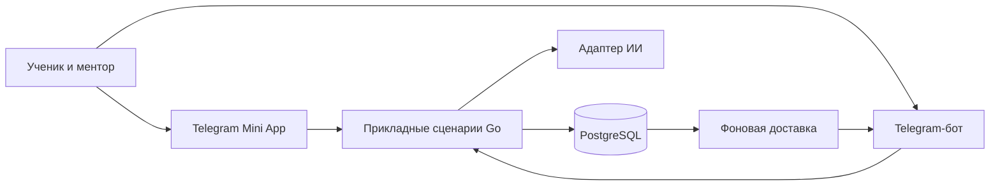

# go-routine-bot — техническое задание на MVP

**Редакция:** 1.1, 6 ноября 2026.

**Основание:** [согласованный вижен](VISION.md).  
**Статус:** спецификация будущей реализации. Приёмочные сценарии ниже ещё не выполнялись.

Порядок реализации и разбор модели хранения — в [PLAN.md](PLAN.md). Начинаем каждый сценарий с требований, инвариантов и публичного сервисного интерфейса; миграции и адаптеры выводим из его потребностей.

## 1. Цель и границы

Дать ученику самостоятельный следующий шаг между встречами, сохранить историю обучения и вовремя показать ментору, где требуется помощь.

Первая поставка рассчитана на одного ментора и небольшую группу учеников. Возможно подключение ещё 2–3 участников; состав пилота уточняется. Вход по приглашениям. Личный кабинет работает в Telegram Mini App; бот открывает кабинет, принимает команды и доставляет уведомления.

Включаем три маршрута по цели и по четыре подготовленных шага на маршрут. Расширение полного курса идёт через содержание, без изменения движка сопровождения.

Отдельные будущие поставки: платежи, открытая регистрация, несколько менторов в одной группе, автоматическая интеграция с GitHub, голосовые интервью, выполнение присланного кода на сервере. В пилоте ученик сдаёт текст и ссылки на свои работы.

## 2. Роли и вход

| Роль | Доступ |
|---|---|
| Ученик | Свой профиль, участие в маршруте, шаги, сдачи, вопросы, помощь и обратная связь |
| Ментор | Приглашения и данные назначенных ему учеников, маршруты, ревью, запросы помощи |

Идентификатор — Telegram user ID. Username используется только для отображения. Telegram ID первого ментора задаётся оператором при запуске; ученик не может назначить себе роль.

### Онбординг

1. Ментор создаёт одноразовое приглашение со сроком семь дней.
2. Ученик открывает ссылку, запускает бота через `/start` и открывает кабинет.
3. Указывает цель, краткий опыт, часовой пояс и удобные учебные окна.
4. Выбирает, нужны ли напоминания. По умолчанию они выключены.
5. Проходит короткую диагностику: несколько вопросов и маленькая практическая задача из подготовленного набора.
6. Ментор подтверждает маршрут и начальный шаг. Пока он смотрит ответы, доступен вводный шаг без зависимостей.

Фактическую доступность Ученика согласуем с ним; два подхода по 45–60 минут — предложение для старта.

### Авторизация Mini App

Сервер проверяет подпись `Telegram.WebApp.initData` по официальному алгоритму и свежесть `auth_date`: не старше пяти минут, допустимое опережение часов — до 30 секунд. `initDataUnsafe` не является доказательством личности. После проверки создаётся серверная сессия сроком 24 часа: cookie `Secure`, `HttpOnly`, `SameSite=Lax`. Изменяющие запросы защищаются CSRF-токеном. Истёкшая сессия требует повторного открытия Mini App.

Роль и связь «ученик — ментор» проверяются сервером при каждой операции. Источник протокола: [Telegram — Validating data received via the Mini App](https://core.telegram.org/bots/webapps#validating-data-received-via-the-mini-app).

## 3. Экраны и поведение

### Ученик

| Экран | Обязательные элементы |
|---|---|
| **Сейчас** | Текущий шаг, требование, ожидаемый результат, ориентир времени, опоры, состояние и доступные действия |
| **Маршрут** | Пройденные и следующие шаги, необходимые предпосылки, подтверждённые наблюдения о навыках |
| **Мои работы** | Сдачи по версиям, критерии приёмки, комментарии и итог ревью |
| **Мой ритм** | Учебные окна, часовой пояс, напоминания, пауза и возвращение |

На экране «Сейчас»: **Начать / Материал / Подсказка / Застрял / Сдать / Перенести / Пауза**. Показываем действия, допустимые в текущем состоянии. Неверное или устаревшее действие также отклоняется сервером.

### Ментор

| Экран | Обязательные элементы |
|---|---|
| **Ученики** | Текущий шаг, согласованный ритм, последнее учебное действие, открытые запросы помощи |
| **Ревью** | Сдачи, версии, критерии, предыдущие замечания, принятие или доработка |

Из карточки ученика доступны назначение шага, подтверждение маршрута, изменение плана, пауза и ответ на запрос помощи. Подробная информация о личных обстоятельствах для этих операций не требуется.

### Бот

Команды: `/start`, `/today`, `/progress`, `/help`, `/pause`, `/resume`.

Команда `/help` показывает помощь по боту и кнопки «Нужна подсказка по шагу» / «Позвать ментора». Контекст свободного текста определяется явно выбранным действием; случайное сообщение не становится сдачей.

## 4. Учебные шаги и состояние

Определение шага содержит устойчивый ID, маршрут, название, цель, постановку, инвариант, ожидаемый результат, ориентир времени, необходимые предыдущие шаги, критерии приёмки, опоры, последовательные подсказки и добровольную ★.

Назначение фиксирует версию определения и материалов. Участие закрепляет версию плана маршрута; обновление опубликованного плана не меняет последовательность задним числом. В пилоте у ученика одно незавершённое участие (`active` или `paused`) и не более одного незавершённого назначенного шага. Для перевода между маршрутами ментор сначала завершает или отменяет текущее назначение и завершает прежнее участие; причина сохраняется в истории.

### Переходы назначения

| Из | Действие | В | Кто |
|---|---|---|---|
| `ready` | Начать | `in_progress` | Ученик |
| `in_progress` | Отправить сдачу | `submitted` | Ученик |
| `submitted` | Вернуть с конкретным замечанием | `changes_requested` | Назначенный ментор |
| `changes_requested` | Продолжить | `in_progress` | Ученик |
| `submitted` | Принять с наблюдением о навыке | `accepted` | Назначенный ментор |
| Любое незавершённое | Отменить назначение с причиной | `cancelled` | Назначенный ментор |

Черновик можно сохранять в `in_progress` и `changes_requested`. После отправки версия сдачи неизменна. Следующая отправка создаёт новую версию. Ревью всегда указывает конкретную сдачу.

При принятии текущего шага и активном обучении назначается следующий опубликованный шаг согласованного маршрута, чьи предпосылки приняты. Если готового следующего шага нет, показываем «Планируем следующий шаг с ментором», а ментор получает запись в очереди планирования.

Принятое назначение не переписывается: дополнительную практику назначают отдельным шагом. Повторное принятие одной версии возвращает прежний результат операции.

### Сдача и обратная связь

Сдача содержит описание результата, ссылку на PR/коммит или текстовый результат, выполненные проверки и оставшиеся вопросы. Доработка может использовать ту же PR-ссылку: новая версия относится к назначению и фиксирует отправленный результат, а не уникальность URL. Если известен commit ID, сохраняем его вместе со ссылкой. Содержимое внешних ссылок приложение в MVP автоматически не загружает.

Для доработки ментор указывает нарушенное требование и следующее действие. Для принятия — что подтверждено и какая помощь потребовалась. Начальные наблюдения о навыке: `with_help`, `independent`, `transfer`; отсутствие наблюдения означает, что навык пока не оценён.

## 5. Помощь, ИИ и аттестации

### Запрос помощи

Ученик указывает ожидание, наблюдение и предпринятые попытки. Поля допускают короткие ответы; можно сразу попросить человеческий разбор. Запрос связан с назначением и имеет состояния `open`, `resolved`.

Ментор видит запрос сразу в кабинете. Через 24 часа без реакции запрос выделяется и включается в ближайшее уведомление ментора. Время совместного разбора согласуется отдельно. Ответ ментора сохраняется в истории запроса.

### ИИ-подсказки

Последовательность помощи: уточняющий вопрос → намёк на механизм → небольшой пример → обращение к ментору. Подготовленные авторские подсказки доступны независимо от ИИ.

В контекст модели входят текущий шаг, выбранные опоры, две непосредственные предпосылки при необходимости и последние сообщения обсуждения этого шага. Максимум — 6000 входных и 1000 выходных токенов на запрос. При нехватке места сначала сокращается история диалога, затем дополнительные опоры; текущая постановка и критерии сохраняются.

Стартовая квота — десять запросов на ученика в сутки UTC. Квота резервируется атомарно перед запросом, чтобы параллельные обращения её не обходили. Тайм-аут — 20 секунд, автоматического повторного вызова модели нет. Ошибка показывает подготовленную подсказку и возможность обратиться к ментору.

Внешний облачный адаптер использует настраиваемый OpenAI-compatible Chat Completions API. Endpoint, модель и ключ задаются оператором; расходы учитываются по ответам провайдера, при отсутствии usage — как неизвестные. До настройки адаптера доступны авторские подсказки. Проверка живого ИИ включается в приёмку его этапа после настройки провайдера.

Ответ модели содержит текст и идентификаторы использованных опор. Сервер разрешает ссылки только на материалы, переданные в текущий контекст. Если ответ не соответствует ожидаемой форме или ссылается на неизвестную опору, показывается авторская подсказка.

Модель не имеет инструментов записи прогресса, принятия ДЗ или назначения маршрута. Внешнему провайдеру передаётся содержание текущего запроса и учебные опоры; полные профили и прочие переписки в запрос не включаются. Перед первым ИИ-запросом ученик видит, какие данные отправятся, и выбирает этот способ помощи.

### Повторение

В пилоте ментор подбирает 12 вопросов из исходного банка, сохраняя исходные номера и формулировки. За учебную сессию показывается до двух вопросов: один новый и один на повторение, если они доступны.

После ответа ученик отмечает: самостоятельно / с подсказкой / после разбора. Вопрос с затруднением предлагается в следующую учебную сессию; уверенный ответ — через три сессии. Сессия для этого правила — явный запуск блока повторения, учитываемый не более одного раза за календарные сутки ученика. После паузы накопленная очередь не увеличивает лимит в два вопроса.

### Аттестация

После первых четырёх шагов: три вопроса из подготовленного набора, объяснение своего решения и небольшое изменение условия. Ответы сохраняются. Ментор фиксирует результат и следующий учебный шаг. Предварительная помощь ИИ не заменяет решение ментора.

## 6. Ритм и уведомления

- Учебные окна задаются днями недели и местным временем с IANA-часовым поясом.
- Напоминания включаются явно. На одно учебное окно приходится одно плановое напоминание.
- Кнопки: Начинаю / Маленький шаг / Перенести / Пауза.
- Уведомления о ревью и помощи объединяются с ближайшей доставкой, если они попали в тихие часы; исходное событие сразу видно в кабинете.
- Тихие часы по умолчанию — 21:00–09:00 местного времени; пользователь может изменить их.
- Несостоявшееся учебное окно не создаёт долг. При переносе отменяется ещё не отправленное напоминание старого окна.
- При неоднозначном местном времени из-за смены часового пояса выбирается первое вхождение; при пропуске местного времени — ближайшее следующее допустимое. Ключ события предотвращает два напоминания одного окна.

Состояния участия: `active`, `paused`, `completed`. Пауза сохраняет историю, отменяет неотправленные учебные напоминания и останавливает автоматическое назначение следующего шага. Читать материалы, сохранять текущую работу, сдавать и проводить ревью можно. При возвращении показываем последнее принятое изменение, открытый вопрос и ближайший посильный шаг. После возобновления следующее назначение создаётся по обычным правилам.

Все моменты времени хранятся в UTC; часовой пояс хранится отдельно. Истёкшие напоминания после простоя приложения не рассылаются пачкой: они помечаются пропущенными, а новое планируется для будущего окна.

## 7. Архитектура и контракты

Один Go-сервис с HTTP-адаптером Mini App, Telegram webhook, прикладными сценариями, PostgreSQL-адаптером и фоновыми работниками. Фронтенд — `html/template`, CSS и небольшой JavaScript для Telegram SDK и запросов. Отдельная SPA не требуется для пилотных экранов.

PostgreSQL доступен через native pgxpool/v5. Миграции Goose/v3 встроены в бинарник через `go:embed`. Порядок старта: конфигурация → подключение/Ping → Goose с advisory lock → фоновые процессы и HTTP. Ошибка старта завершает процесс неуспешно. Docker Compose поднимает приложение и PostgreSQL; HTTPS обеспечивает reverse proxy окружения. Настройку TLS и BotFather подготавливает ментор перед первым интеграционным шагом Ученика.

### Границы

- В `pkg` — DTO, типы, enum, константы, ошибки и интерфейсы. Выходные порты — в `pkg/ports.go`.
- Сценарии принимают `(ctx, req)` и возвращают `(res, err)`; ответы — объекты, в том числе списки.
- HTTP и Telegram получают интерфейсы прикладных сервисов. Разрешения и состояние проверяются в сервисе, а не только в кнопках.
- SQL, Telegram SDK и LLM-клиент остаются в адаптерах.
- Конкретные зависимости собираются в точке входа.

Группы контрактов: `DashboardService`, `LearningService`, `ReviewService`, `HelpService`, `RhythmService`. Основные операции: `GetDashboard`, `GetRoute`, `StartStep`, `SaveDraft`, `SubmitWork`, `ReviewSubmission`, `RequestHelp`, `AskHint`, `SetRhythm`, `Pause`, `Resume`.

Для HTTP используется префикс `/api/v1`: сессия, кабинет, маршрут, назначения и сдачи, ревью, помощь, повторение и настройки. Вход в браузере начинается с `POST /api/v1/session` с сырым `initData`; остальные действия используют сессию. Ошибки API имеют объектный ответ с программной категорией и сообщением. Неверный ввод — 400, нет сессии — 401, нет доступа — 403, объект отсутствует — 404, устаревшая версия или недопустимый переход — 409, лимит — 429, внутренний отказ — 500 без внутренних подробностей.

### Хранение

| Сущность | Ключевая ответственность |
|---|---|
| User, Session, Invitation | Telegram ID, роль, безопасный вход и приглашения |
| Enrollment | Маршрут, назначенный ментор, состояние участия и ритм |
| StepDefinition, ContentVersion | Версионное содержание и связи с материалами |
| Assignment | Назначение конкретной версии и его состояние |
| Submission, Review | Неизменные версии сдач и решения по конкретной версии |
| HelpRequest, HelpReply | Открытые затруднения и ответы |
| QuestionAttempt, Assessment | Ответы, самооценка и аттестация |
| NotificationJob, ProcessedUpdate | Намерения отправки и дедупликация Telegram-событий |
| AIUsage | Резервирование квоты, результат запроса и доступная статистика использования |

Текущий прогресс читается из истории участия и назначений; один перезаписываемый указатель на шаг её не заменяет. Дополнительно храним результаты ключей операций и очередь планирования. Пауза имеет один источник истины — состояние участия. Для изменяемых состояний используем `TEXT` с именованными `CHECK`, для маршрутов — ссылки на версионное содержание; именованные Go-типы и константы остаются в `pkg`.

В одной транзакции выполняются принятие сдачи, запись наблюдения о навыке, назначение следующего шага при наличии и запись намерения уведомления. Внешняя отправка в эту транзакцию не входит.

Telegram webhook проверяет секрет из `X-Telegram-Bot-Api-Secret-Token`. `update_id` фиксируется вместе с результатом обработки. Повторные действия Mini App используют ключ операции, ограниченный пользователем и видом действия; тот же ключ с другим содержимым даёт конфликт. После проверки доступа совпавший повтор возвращает сохранённый результат до проверки ревизии; проверка ревизии нового действия защищает от устаревшего окна ревью. Для состояния, следующего назначения и результата операции определяем общую транзакцию и порядок блокировок, согласованный с паузой и возобновлением.

Очередь уведомлений хранится в PostgreSQL. Планировщик и отправитель работают в том же приложении; один экземпляр на пилоте. Ключ логического уведомления включает получателя, тип и событие. Автоматические повторы допустимы только при подтверждённом временном отказе; до пяти попыток с ограниченной задержкой, для 429 учитывается `retry_after`. При неоднозначном результате отправки запись становится `uncertain` и требует разбора; повтор без риска дублирования не обещается. Блокировка бота пользователем останавливает его доставки и отображается ментору.

На остановке прекращаем приём новой фоновой работы, завершаем HTTP с отдельным контекстом, отменяем и ждём работников, затем закрываем пул. Фатальная ошибка фонового процесса сохраняется до точки входа и даёт ненулевое завершение.

## 8. Интеграция материалов курса

Манифест пилота содержит семантические ID маршрутов и шагов, версии, предпосылки, критерии и ссылки на опоры. Ссылки в [PILOT.md](PILOT.md) указывают на существующие сейчас главы.

В текущем checkout крупные главы курса организованы иначе, чем обсуждавшийся маршрут из 24 встреч; файла `course/lessons.json` сейчас нет. MVP не зависит от такого файла или фиксированного номера недели. Импортёр читает собственный манифест и выбранные авторские Markdown-материалы из зафиксированной Git-ревизии. Обновление курса публикует новую версию шага, сохраняя старые назначения.

Контекст ИИ формируется из явно привязанных материалов. Эталоны решений не включаются в подсказки по умолчанию. Присланные учеником тексты рассматриваются как данные; список опор и правила работы задаются приложением.

## 9. Приёмочные сценарии

Сценарии предназначены для будущей реализации и последующей проверки. Их описание не означает, что приложение или тесты уже существуют.

| ID | Сценарий | Ожидаемый результат |
|---|---|---|
| A01 | Приглашение, запуск бота, вход в кабинет | Ученик видит свой вводный шаг; приглашение повторно не используется |
| A02 | Поддельные или просроченные initData | Сессия не создаётся |
| A03 | Ученик запрашивает чужую сдачу или действие ментора | Доступ отклонён, данные не меняются |
| A04 | Начало, черновик, сдача, доработка, повторная сдача, принятие | Версии и история сохранены, следующий шаг назначен один раз |
| A05 | Повтор одного Telegram update или ключа действия | Повторный побочный эффект отсутствует |
| A06 | Принятие из устаревшего окна | Конфликт версии, требуется обновление экрана |
| A07 | Принятие во время паузы, затем возобновление | Ревью сохранено; новый шаг появляется после возобновления |
| A08 | Пауза, перенос, тихие часы, смена часового пояса | Напоминания соответствуют настройкам и не накапливаются |
| A09 | Перезапуск приложения | Сдачи, ревью и прогресс сохранены; просроченные окна не рассылаются пачкой |
| A10 | Открытый запрос помощи без реакции 24 часа | Выделение в кабинете и запись в ближайшем уведомлении ментора |
| A11 | Тайм-аут ИИ, лимит, некорректная ссылка модели | Авторская подсказка и обращение к ментору доступны; прогресс не меняется |
| A12 | Telegram 429, временный отказ, блокировка, неопределённый результат | Правильное состояние очереди; учебная операция остаётся сохранённой |
| A13 | Повторение и аттестация | Лимит двух вопросов соблюдается; понимание подтверждает ментор |
| A14 | Фатальная ошибка работника и обычная остановка | Причина фатального отказа не теряется; пул закрывается после работников |

## 10. Готовность к пилоту

Готовы четыре шага каждого маршрута и 12 выбранных вопросов. Ментор и ученик проходят полный цикл через Mini App. Настроены HTTPS, бот, резервное копирование базы, квоты ИИ и структурированные журналы с ID операций; секреты и содержимое личных сообщений в журналы не попадают.

Перед приглашением остальных участников фиксируются результаты сценариев A01–A14 и оставшиеся ограничения. Измеряется учебный эффект по [вижену](VISION.md), а дальнейшие приращения выбираются по [дорожной карте](ROADMAP.md).
