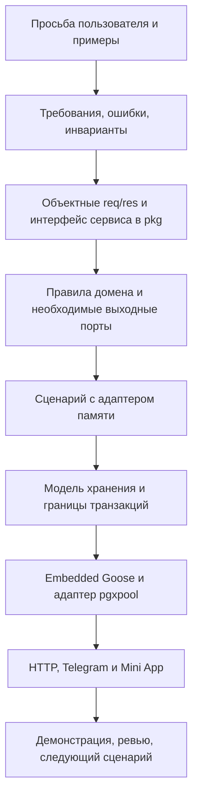

# go-routine-bot — план совместной разработки

**Редакция:** 6 ноября 2026.

**Для кого:** ментор и участник, который переходит на Go и разрабатывает продукт вместе с ним.

**Статус:** план будущей реализации. В каталоге пока находятся документы; приложения, применённых миграций и результатов приёмки нет.

Начнём с простой человеческой задачи: «Я вернулся к учёбе после рабочего дня. Что мне делать сейчас и как не потерять результат?» Первый работающий ответ — своя карточка задания, кнопка «Начать» и сохранённое состояние после перезапуска. Затем достраиваем сдачу, ревью и поддержку между встречами.

Этот документ задаёт порядок работы. [MVP_SPEC.md](MVP_SPEC.md) определяет поведение продукта, [PILOT.md](PILOT.md) — первые учебные шаги, [ROADMAP.md](ROADMAP.md) — обзор приращений. Если новый сценарий меняет правило продукта, сначала уточняем ТЗ и этот план, затем реализацию.

## 1. Как будем работать вдвоём

Предлагаемый стартовый ритм — два подхода по 45–60 минут и короткий разбор. Доступность согласуем с участником; это не обещание выпустить бота за определённое число недель. Один этап ниже может занять несколько подходов и несколько небольших PR.

| Ментор | Участник | Решаем вместе |
|---|---|---|
| Объясняет пользовательскую задачу, готовит карточку, примеры и опоры | Предлагает контракт и решение, фиксирует непонятное до того, как застрял надолго | Какие правила защищаем и как покажем результат |
| Готовит содержание, разбирает границы и ревьюит каждое изменение | Пишет ограниченный фрагмент, показывает поведение и объясняет решения | Где достаточно простого решения, а где нужна гарантия базы |
| Помогает с Compose, Telegram и HTTPS к соответствующему этапу | Осваивает Go и инфраструктуру по мере появления задачи | Следующее посильное приращение и фактические затраты времени |

В конце подхода оставляем короткую запись: **что получилось → где остановились → какой следующий шаг → какая помощь нужна**. Если изменение перестало помещаться в понятный результат, делим его вместе. Ожидание разбора не должно превращаться в ещё один самостоятельный проект ученика.

До совместной разработки отдельно обсуждаем доступы, участие и права на результат. План сам по себе не устанавливает оплату, занятость или состав команды. Позже могут присоединиться ещё 2–3 человека; сейчас не закладываем зависимость от их участия.

## 2. Порядок проектирования: контракт раньше таблиц

Берём метод из [mentor/0x_PROJECT_FLOW.md](../mentor/0x_PROJECT_FLOW.md): сначала обещание компонента, затем его исполнение. **Контракт** — это вход, результат, ошибки и смысл изменения состояния. **Инвариант** — правило, которое должно оставаться верным в каждом зафиксированном состоянии системы, в том числе после отказа операции.

Например, «ученик начинает только собственный назначенный шаг» — инвариант. Отключённая кнопка в браузере помогает человеку, но защищает его сервис на сервере. Ограничение в БД дополняет эту защиту там, где требуется согласованность нескольких записей или конкурентных действий.



Миграция появляется, когда уже понятно, **какую операцию и какую историю она обязана сохранить**. Она важна для гарантии хранения, но сама не определяет ни право ученика на действие, ни смысл принятия работы.

В этом проекте все публичные DTO, типы, ошибки и интерфейсы размещаем в `pkg`, выходные порты — в `pkg/ports.go`. Это наша договорённость о размещении, а не требование языка Go. Из учебного примера берём порядок рассуждения; расположение его внутреннего порта не копируем вопреки правилам проекта.

Любая публичная сервисная операция имеет вид `(ctx, req) -> (res, err)`. Список тоже возвращается объектом, например `ListAssignmentsResponse{Assignments: ...}`. HTTP-конструктор принимает интерфейс сервиса. Для будущего gRPC ещё потребуются protobuf-контракты и адаптер; объектные ответы уменьшают объём переделок.

## 3. Первый сценарий и его правила

**Результат первого приращения:** участник видит своё назначение, начинает его и после перезапуска получает то же состояние. До подключения Telegram показываем этот сценарий локальным вызовом сервиса с подготовленными данными.

| Ситуация | Обещание сервиса |
|---|---|
| Открыли кабинет | Вернуть своё назначение с зафиксированной версией содержания и доступными действиями |
| Начали собственный шаг в `ready` | Состояние становится `in_progress`, ревизия назначения увеличивается |
| Повторили тот же ключ операции и те же данные | Вернуть сохранённый результат без второго изменения |
| Тот же ключ использовали с другими данными | Вернуть конфликт, состояние не менять |
| Нажали из старого окна с новым ключом | Вернуть конфликт ревизии и предложить обновить кабинет |
| Попробовали изменить чужое назначение | Отказать, состояние не менять |
| Участие поставлено на паузу | Уже назначенный шаг можно продолжать; новое автоматическое назначение не создаётся |

Повтор с прежним ключом распознаём **до проверки устаревшей ревизии**, иначе успешный запрос после потери ответа ошибочно станет конфликтом. При этом сначала устанавливаем личность и право на операцию: ключ не является пропуском к чужому результату.

Набросок одного контракта для обсуждения на первой встрече:

```go
type LearningService interface {
    StartStep(ctx context.Context, req StartStepRequest) (StartStepResponse, error)
}

type StartStepRequest struct {
    ActorID          UserID
    AssignmentID     AssignmentID
    ExpectedRevision int64
    OperationKey     string
}

type StartStepResponse struct {
    Assignment AssignmentView
}
```

`UserID`, `AssignmentID` и `AssignmentView` — публичные типы, которые определим вместе с DTO. У представления назначения нужны ID, состояние, ревизия и сведения о закреплённой версии шага. `ActorID` транспорт получает из проверенной сервером сессии; произвольное поле JSON не устанавливает личность.

На этом же этапе описываем `DashboardService.GetDashboard`, объектные запрос/ответ и ошибки: неверный ввод, отсутствие назначения, отсутствие доступа, конфликт состояния/ревизии и недоступность зависимости. Новые операции добавляем под конкретный сценарий, сохраняя группы сервисов из ТЗ.

## 4. Этапы реализации

Внутри каждого этапа идём по цепочке из раздела 2. Код инфраструктуры появляется после контракта соответствующего сценария. Номера — порядок зависимостей, а не календарные недели.

### Этап 0. Договориться о первом результате

1. **Вместе:** пройти первый сценарий словами; выбрать одну карточку из маршрута `go-transition` и разобрать таблицу выше.
2. **Ментор:** подготовить карточку, небольшой фрагмент курса и примеры отказов. Уточнить, что уже знакомо участнику: Go, интерфейсы, транзакции, HTTP.
3. **Участник:** пересказать требование своими словами, предложить вопросы и оценить размер ближайшего изменения.
4. **Вместе:** записать постановку первого PR и удобное время разбора.

**Результат:** одна согласованная карточка задачи с входом, результатом, инвариантами и примерами. **Переход дальше:** оба могут объяснить, что покажем после первого приращения. Выбор всех таблиц MVP для этого не требуется.

### Этап 1. Описать публичный сервисный контракт

1. Создать модуль обычной командой `go mod init go-routine-bot`, если отдельного модуля приложения ещё нет. Зафиксировать путь импорта; начальный `go.mod` вручную не писать.
2. В `pkg` определить типы идентификаторов, состояния назначения и минимальное представление карточки.
3. Добавить req/res для `GetDashboard` и `StartStep`, известные ошибки и интерфейсы `DashboardService`, `LearningService`.
4. Для каждого метода записать успешный исход, отказы, повтор и ожидаемое изменение состояния.
5. Разобрать контракт с ментором до реализации SQL и HTTP.

**Участник** предлагает типы и сигнатуры; **ментор** помогает убрать двусмысленность, не подменяя работу готовым сервисом. **Результат:** маленький PR с контрактами и примерами. **Переход дальше:** вызывающему коду не нужны ни SQL-строки, ни структуры конкретной реализации.

Ориентир для первых файлов: `pkg/model.go` — типы и представления; `pkg/requests.go` и `pkg/responses.go` — входы и результаты; `pkg/errors.go` — известные отказы; `pkg/service.go` — интерфейсы. На этапе 2 добавляем `pkg/ports.go`, прикладной код в `internal/app` и адаптер памяти. Названия помогают ориентироваться; пустые пакеты будущих интеграций заранее не создаём.

### Этап 2. Исполнить сценарий в памяти

1. Описать допустимые переходы и проверки владельца, состояния, ревизии и повтора.
2. Вывести минимальные выходные порты из потребностей сценария и разместить в `pkg/ports.go`. Не делать универсальный репозиторий «на все будущие таблицы».
3. Реализовать прикладной сервис и адаптер памяти. Операция изменения должна сохранять проверку ревизии, новое состояние и результат ключа операции как одно целое.
4. Собрать зависимости в локальной демонстрационной программе. Подготовленные личности существуют только в демонстрации; будущий HTTP-вход не получает обход авторизации через заголовок или query-параметр.
5. Показать успешное начало, повтор, старую ревизию и попытку обратиться к чужому назначению. Объяснить, почему память теряется после остановки.

**Участник** реализует сценарий; **ментор** разбирает границы и последствия ошибок. **Результат:** понятный вызов сервиса без сети и базы. **Переход дальше:** понятно, какие данные и атомарные операции должен поддержать PostgreSQL. Демонстрация в памяти ещё не доказывает корректность конкурентной реализации БД.

### Этап 3. Сохранить состояние в PostgreSQL

1. Утвердить минимальную модель из разделов 5–6: пользователь, маршрут и его версия, версия шага, участие, назначение, результат ключа операции. Подготовленные данные содержат только первый необходимый маршрут и карточку.
2. Разобрать ключи, ограничения, индексы и транзакцию `StartStep`. Зафиксировать решение: какие гарантии выполняет сервис, какие дополнительно обеспечивает БД.
3. Поднять PostgreSQL через Compose; `psql` запускать через `compose exec`. **Ментор** помогает с окружением, **участник** понимает конфигурацию и самостоятельно объясняет подключение.
4. Добавить первую миграцию Goose/v3, встроить SQL через `go:embed`, подключить native `pgxpool/v5` и запуск миграций по правилам раздела 7.
5. Реализовать PostgreSQL-адаптер тех же портов. Конкретная транзакция остаётся в адаптере, её необходимые гарантии явно описаны в контракте порта.
6. Показать сохранение после перезапуска и разбор двух одновременных попыток изменения. Порядок действий и ограничения должны защищать от дублей, а не только последовательный успешный путь.

**Результат:** тот же сервис работает с долговечным хранением. **Переход дальше:** версия содержания закреплена, старые данные сохраняются, ошибка миграции не допускает запуска приложения. Это первая полезная миграция, а не схема всего будущего продукта.

### Этап 4. Дать доступ из Telegram и Mini App

1. До реализации описать контракты приглашения, входа и сессии; добавить нужные миграции и адаптеры по тому же порядку.
2. **Ментор:** подготовить BotFather, HTTPS и минимальную страницу к началу интеграции. Это отдельные будущие действия; план не означает, что они уже выполнены.
3. **Участник:** реализовать проверку `initData`, серверную сессию и CSRF по ТЗ. Роль ментора задаётся конфигурацией, приглашение одноразовое, привязка к ученику проверяется сервером.
4. Сделать HTTP-адаптеры `GetDashboard` и `StartStep`, принимающие публичные интерфейсы. Показать карточку и допустимые действия в небольшом HTML/JS-интерфейсе.
5. Подключить Telegram webhook с проверкой секрета и дедупликацией `update_id`; зафиксировать обработку вместе с её результатом.
6. Пройти первый результат настоящими пользователями: каждый видит только своё; начало работы переживает перезапуск.

**Результат:** первое приращение ROADMAP доступно через Telegram. **Переход дальше:** личность поступает из проверенной сессии, интерфейс не скрывает ошибки сервиса, чужие данные недоступны. Настройка кнопок не заменяет проверку разрешений.

### Этап 5. Замкнуть цикл «сдача → доработка → принятие»

1. Описать `SaveDraft`, `SubmitWork`, `ReviewSubmission`: объектные контракты, ошибки, разрешения, ревизии и ключи операций.
2. Уточнить правила состояний, неизменность отправленной версии и отличие решения ревью от статуса назначения.
3. Добавить порты и миграции для черновика, версий сдачи, решений, наблюдений о навыке, очереди планирования и намерений уведомлений.
4. Реализовать транзакцию принятия из раздела 6. Следующий шаг выбирается из закреплённого плана по принятым предпосылкам; отсутствие готового шага становится понятным состоянием для ученика и задачей ментора.
5. Добавить формы сдачи и ревью. Для результата допустимы текст и ссылки; автоматического чтения GitHub нет.
6. Показать полный цикл с доработкой в том же PR, новой версией сдачи, повтором принятия, устаревшим окном и принятием во время паузы.

**Участник** ведёт небольшие PR по отдельным операциям; **ментор** принимает учебный результат и разбирает гонки. **Результат:** история работы и решений воспроизводима. **Переход дальше:** принятие создаёт следующий шаг не более одного раза, пауза не блокирует ревью. Пока отправитель не подключён, намерения уведомлений сохраняются, но не считаются доставленными.

### Этап 6. Поддержать ритм и помощь

1. Описать контракты запроса помощи, ответа ментора, настройки ритма, паузы, переноса и возобновления. Уточнить рабочие примеры времени до написания планировщика.
2. Добавить соответствующие миграции: окна по дням недели и местному времени, IANA-зону, тихие часы, согласие на напоминания; помощь связать с назначением и историей ответов.
3. Реализовать сохраняемые задания уведомлений и один фоновый отправитель в приложении. Разделить намерение отправки и фактическую доставку; определить поведение после неоднозначного сетевого отказа.
4. При паузе отменять неотправленные учебные напоминания и останавливать автоматическое назначение. Сдачи и ревью остаются доступны. Возобновление не создаёт пачку старых напоминаний.
5. Выделять запрос без реакции 24 часа и включать его в ближайшее уведомление ментора.
6. Настроить завершение работников до закрытия пула, ограниченные повторы и сохранение причины фатального отказа.

**Результат:** человек может попросить поддержку, остановиться и вернуться без потери контекста. **Переход дальше:** перенос, тихие часы, перезапуск и отказ Telegram не нарушают учебную историю; граница гарантии доставки объяснима.

### Этап 7. Добавить повторение, аттестацию и ИИ-подсказки

1. **Ментор:** подготовить 12 вопросов из исходного банка с сохранёнными номерами, авторские подсказки и критерии аттестации. Все 500 вопросов остаются в курсе.
2. **Участник:** описать сервисные контракты, затем добавить хранение попыток, самооценки и решения ментора. Реализовать до двух вопросов за сессию и правила повторения из ТЗ.
3. Замкнуть короткую аттестацию: три вопроса, объяснение своего решения и изменение условия. Подтверждение навыка выполняет ментор.
4. Отдельным приращением описать `AskHint`, порт внешней модели, резервирование квоты и исходы отказов; затем добавить миграции и адаптер.
5. Подключить ИИ только к разрешённым опорам, с тайм-аутом, учётом использования и запасным вариантом авторской подсказки. Квота — десять запросов в сутки UTC, автоматических повторных вызовов модели нет.
6. Показать работу без провайдера и при его отказе. Живой вызов добавляется к приёмке этапа после настройки; без него ИИ-интеграция не объявляется проверенной.

**Результат:** помощь и повторение встроены в учебный цикл. **Переход дальше:** ИИ не меняет прогресс и не принимает работу; параллельные обращения не обходят лимит; самооценка ученика отделена от подтверждения ментора.

### Этап 8. Провести пилот и выбрать продолжение

1. Довести содержание до четырёх шагов каждого маршрута и 12 вопросов. Сохранить ID, версии, ссылки и предпосылки в манифесте; импортировать опубликованное содержание из закреплённой Git-ревизии.
2. Подготовить запуск через Compose, резервное копирование и восстановление, конфигурацию, журналы с ID операций, порядок обновления и совместимость схемы.
3. По отдельному явному запросу добавить и выполнить нужные проверки. До пилота фактически пройти A01–A14 из ТЗ и записать результат каждого, ограничения и способ воспроизведения. Описание сценария не считается его прохождением.
4. Пройти полный цикл учеником и ментором, затем при готовности согласовать приглашение дополнительных участников.
5. Собрать наблюдения после четырёх согласованных учебных окон: понятен ли следующий шаг, сколько ждали помощи, где теряли контекст, сколько времени тратил ментор.
6. Выбрать следующее изменение по наблюдаемой проблеме. Больше функций, сервисов или участников само по себе не означает лучший учебный продукт.

**Результат:** небольшой работающий пилот и обоснованный список следующих изменений. **Завершение MVP:** сценарии приняты с зафиксированными результатами, а участники могут продолжать учёбу и получать человеческую помощь.

## 5. Оценка предложенной SQL-схемы

**Вердикт:** это полезный черновик сущностей, но до первой миграции ему нужна переработка под сценарии ТЗ. Сохраняем версионные определения шагов, `TIMESTAMPTZ`, внешние ключи, связь ревью с конкретной сдачей и частичные индексы для очередей. Основные изменения — история назначений, версии сдач, идемпотентность, полномочия и поведение фоновой работы.

| Участок | Что требуется изменить и почему |
|---|---|
| `users` | Telegram ID в `BIGINT` подходит для пилота. Username — отображение, не ключ доступа. Роль `admin` пока не имеет сценария; остаются student/mentor. FK на пользователя подтверждает существование, но не роль ментора и не право на конкретного ученика. |
| `mentor_id` в пользователе | Связь ментора, маршрута и состояния обучения переносим в `enrollments`. Она относится к участию и его истории; при смене маршрута прошлые назначения не теряются. |
| PostgreSQL ENUM | Сам по себе корректен, но наборы в черновике уже расходятся с ТЗ. Для изменяемых состояний выбираем `TEXT` с именованными `CHECK`, для маршрута — FK. В Go остаются строгие именованные типы и константы. Это выбранный компромисс, а не запрет ENUM. |
| ID маршрутов | Используем опубликованные `backend-start`, `go-transition`, `systems-design`. В черновике другие написание и число у последнего маршрута. Расхождение нельзя прятать в случайных конвертерах. |
| `course_steps` | Составной ключ `(id, version)` сохраняем. Добавляем опубликованность, предпосылки и закреплённые версии опор. План маршрута тоже версионируем, чтобы «следующий шаг» не менялся задним числом. Проверяем положительные версии/оценки времени и обязательные непустые поля. |
| `student_progress` | Это возможная проекция текущей точки, но не история. Нужны отдельные `enrollments` и `assignments`; у каждого назначения свой ID, закреплённая версия шага, состояние и ревизия. Прошлое назначение не переписываем следующим. |
| Статусы | Используем `ready`, `in_progress`, `submitted`, `changes_requested`, `accepted`, `cancelled`. Решение ревью имеет отдельные значения `accepted`/`changes_requested`, а не произвольный статус назначения. |
| `submissions` | Сдача относится к назначению и имеет номер версии, например уникальный `(assignment_id, revision)`. Отправленный текст и ссылки неизменны. Ссылка необязательна при текстовом результате. Один PR может содержать несколько сдач; уникальность по `pr_link` мешает доработке и не заменяет ключ операции. При сдаче фиксируем известный commit ID, если он предоставлен. |
| `reviews` | Одно итоговое решение на конкретную версию сдачи — разумное правило MVP; сохраняем уникальность. Нужны отдельное решение, замечание/наблюдение о навыке и проверка полномочий. Если понадобится обсуждение, сообщения будут отдельной историей, не перезаписью решения. |
| `rhythm_settings` | `INT[]` «то часы, то дни, то маска» неоднозначен. Нужны отдельные окна: участие, день недели, местное время; отдельно IANA-зона, тихие часы и явное включение напоминаний. Источник паузы — состояние участия, без второго независимого `is_paused`. |
| `help_requests` | Связываем с назначением, сохраняем `open`/`resolved` и ответы ментора. Ожидание, наблюдение и попытки полезны, но форма допускает короткий ответ и немедленный запрос человеческого разбора. |
| `flashcards` и ответы | Сохраняем исходный номер вопроса, версию источника, ID учебной сессии и историю попыток. Самооценка не является аттестацией. Простой список ответов без состояния повторения не обеспечивает правила двух вопросов и интервалов. |
| `ai_usage_logs` | Журнал токенов не защищает квоту от гонки. Нужны атомарное резервирование, уникальность запроса, суточный счётчик и исход запроса. Сохраняем входные/выходные токены, если известны; отсутствие usage — неизвестность, а не нулевой расход. Контекст связан с назначением и версией опор. |
| `notification_queue` | Нужны ключ логического события, состояние, число попыток, время следующей попытки, срок актуальности, ошибка и данные захвата работником. Одного `sent_at` недостаточно для переноса, паузы, временного и неоднозначного отказа. |
| Не хватает сущностей | Приглашения, сессии, версии плана маршрута, ключи операций, обработанные Telegram updates, ответы помощи, наблюдения/аттестации и очередь планирования добавляются на этапах своих сценариев. |
| Детали DDL | `DEFAULT NOW()` у `updated_at` не обновляет его при `UPDATE`: это делает явный запрос. `PRIMARY KEY` уже означает `NOT NULL`. Межтабличные правила нельзя честно выразить обычным `CHECK`; выбираем FK/уникальность и атомарные проверки перехода. |

PostgreSQL описывает ограничения `CHECK`, FK и PK в [документации по ограничениям](https://www.postgresql.org/docs/current/ddl-constraints.html). Особенности изменения наборов ENUM — в [документации ENUM](https://www.postgresql.org/docs/current/datatype-enum.html). Эти свойства учитываем при выборе модели, а не оцениваем схему по количеству таблиц.

### Целевая модель по мере появления сценариев

| Когда | Группа данных | Ключевая гарантия |
|---|---|---|
| Этап 3 | `users`, `routes`, версии планов/шагов и их связи | Опубликованная версия не переписывается; назначение закрепляет конкретное содержание |
| Этап 3 | `enrollments`, `assignments` | История участия и назначений; один незавершённый шаг и одно незавершённое участие ученика в пилоте |
| Этап 3 | `operation_results` | Ключ ограничен актором и операцией; вход и итог позволяют распознать повтор/конфликт |
| Этап 4 | `invitations`, `sessions`, `processed_updates` | Одноразовый вход по приглашению, проверяемая сессия, дедупликация Telegram |
| Этап 5 | Черновики, `submissions`, `reviews`, наблюдения, очередь планирования | Неизменные версии сдач, человеческое решение и прослеживаемая история |
| Этапы 5–6 | `notification_jobs`, окна ритма, запросы и ответы помощи | Намерение не теряется, устаревшее напоминание не отправляется, помощь видна ментору |
| Этап 7 | Вопросы/сессии/попытки/аттестации, резервирования ИИ | Повторение воспроизводимо, квота атомарна, ИИ не подтверждает навыки |

Это ориентир ответственности, а не требование заранее создать все перечисленные таблицы. Точные имена, поля и DDL утверждаем вместе с контрактами соответствующего этапа.

## 6. Какие гарантии должны переживать гонки и перезапуск

### История и ограничения

- `Enrollment` хранит ученика, назначенного ментора, маршрут с версией плана и состояние `active`/`paused`/`completed`. Пауза не освобождает место для второго участия. Перевод на другой маршрут завершает прежнее участие после принятия или отмены незавершённого назначения.
- `Assignment` ссылается на участие и точную версию шага. Состояние и ревизия меняются явно; строка принятого назначения не становится новым заданием.
- Частичный уникальный индекс запрещает второе участие в `active`/`paused` одному ученику; другой — второе назначение в незавершённых состояниях одному участию. Такие индексы поддерживаются [PostgreSQL](https://www.postgresql.org/docs/18/indexes-partial.html).
- Шаг назначения принадлежит закреплённому плану маршрута. Эту согласованность обеспечиваем составными ссылками или проверкой в защищённой транзакции; одни независимые FK на существующие строки её не гарантируют.
- Опубликованные определения шагов и версии источников сохраняются. Импорт новой редакции добавляет версию, не меняя содержание уже назначенной работы.

### Изменяющая операция

Для начала шага и позднее для сдачи/ревью порт должен обещать атомарность нужных действий. Несколько независимых вызовов `SaveReview`, `SaveAssignment`, `SaveNotification` без общего соглашения о транзакции этого не обеспечат.

Пример принятия сдачи:

1. Установить актора и проверить доступ. Захватить участие и назначение в согласованном порядке; все конкурирующие изменения, включая паузу и возобновление, соблюдают тот же порядок.
2. Найти результат по `(actor_id, operation, operation_key)`. Для совпавшего нормализованного входа вернуть прежний итог; другой вход с тем же ключом отклонить.
3. Проверить ожидаемую ревизию, состояние `submitted`, конкретную версию сдачи и полномочия назначенного ментора.
4. Записать решение, наблюдение о навыке и новое состояние/ревизию назначения.
5. Для активного участия назначить один следующий готовый шаг; если такого шага нет — создать запись планирования. При паузе этого не делать; возобновление выполнит правило отдельно.
6. Записать намерение уведомления с уникальным ключом события и результат операции. Подтвердить транзакцию.
7. Доставку в Telegram выполнить позже, вне транзакции. Отказ Telegram не отменяет принятие работы.

Ограничение уникальности ключа операции дополняет блокировки. Для каждого нового изменяющего метода заранее определяем область сериализации и порядок захвата: защита назначения не решает гонку одноразового приглашения или суточной квоты.

### Фоновые действия

Уведомления различают ожидание, обработку, отправку, подтверждённый отказ, неоднозначный результат, отмену и истечение актуальности. Захват имеет срок; после падения работника учитываем возможность уже состоявшейся отправки. Для неясного исхода сохраняем `uncertain`, не обещая доставку ровно один раз. Автоматические повторы — только по правилам ТЗ.

Суточная квота ИИ резервируется условным атомарным изменением счётчика `(user_id, utc_day)` до сетевого вызова, с уникальной записью запроса. Повтор ключа не расходует квоту снова. Одновременные новые запросы не должны превысить десять резервирований; простой `COUNT` журнала перед вставкой этого не гарантирует. Политику учёта неуспешного вызова фиксируем в контракте этапа 7 до реализации.

Окна обучения хранят местное время и IANA-зону, а вычисленные моменты доставки — `TIMESTAMPTZ`. Правила перехода часов, тихих часов и истечения окна берём из ТЗ; перенос отменяет старое намерение. На перезапуске восстанавливаем состояние из PostgreSQL, а не из таймеров процесса.

## 7. Миграции: встроенные, небольшие, вместе с версией приложения

1. Подготовить первую SQL-миграцию инструментом Goose. В неё входят только данные и ограничения этапа 3; следующие сценарии получают новые миграции, а не правки уже применённой первой.
2. Хранить SQL в пакете миграций и включать через `go:embed`. Во время запуска не требуется отдельный каталог SQL рядом с бинарником. Возможность описана в [Goose: embed SQL migrations](https://pressly.github.io/goose/blog/2021/embed-sql-migrations/).
3. Приложение использует native `pgxpool/v5`. Для Goose создаём совместимый `database/sql`-мост через [`stdlib.OpenDBFromPool`](https://pkg.go.dev/github.com/jackc/pgx/v5/stdlib#OpenDBFromPool) того же пула; основной репозиторий остаётся на pgx.
4. Порядок старта: конфигурация → пул и Ping → Goose Provider с session advisory lock → восстановление фоновой работы → работники и HTTP. Блокировку включаем явно: по умолчанию Provider её не устанавливает. Миграционные соединения и блокировки освобождаются штатно; пул не закрывается раньше зависимых процессов. См. [Goose Provider](https://pressly.github.io/goose/documentation/provider/).
5. Ошибка миграции останавливает запуск с ненулевым кодом. Отдельного сервиса мигратора, `cmd/migrate` и автоматического `Down` при остановке нет. Встроенный SQL связывает схему со сборкой, а успешный запуск подтверждает её применение.
6. Применённый SQL неизменяем. Новые релизы используют совместимые изменения схемы; откат бинарника не означает автоматический откат данных. Перед изменением с риском потери данных нужен явный план сохранения и восстановления.
7. Обычный набор DDL не оборачивать целиком в `StatementBegin`/`StatementEnd` без необходимости. Это управление разбором SQL со сложными выражениями и внутренними `;`, а не команда начала транзакции; Goose по умолчанию выполняет миграцию транзакционно. См. [аннотации Goose](https://pressly.github.io/goose/documentation/annotations/).
8. Если пишем `Down` для разработки, удаляем только свои объекты в обратном порядке зависимостей, без широкого `CASCADE`. В пилоте откат сначала обсуждаем как восстановление данных и совместимость приложения, а не как вызов `DROP TABLE`.

Предложенный SQL пока рассматриваем как черновик. Если какие-либо его версии уже применены в другом окружении, их не редактируем задним числом: отдельно составляем сохраняющее данные изменение.

## 8. Ближайшие три рабочих подхода

Это стартовая последовательность, которую уточним после разговора о доступном времени. Остальные этапы не превращаются в обязательное домашнее задание к следующей встрече.

| Подход | До встречи готовит ментор | Делает участник | Что приносим на разбор |
|---|---|---|---|
| 1. Обещание сервиса | Одну карточку, примеры начала/повтора/отказа, опору по интерфейсам | Формулирует инварианты, предлагает DTO и интерфейсы `GetDashboard`/`StartStep` | Контракт и объяснение: кто вызывает, что меняется, что происходит при повторе |
| 2. Правила и зависимости | Ревью первого предложения, объяснение ревизии и ключа операции на двух запросах | Описывает переход, необходимые порты и прикладной сценарий | Небольшой PR с границами; список ещё не реализованных частей |
| 3. Демонстрация в памяти | Подготовленные данные и вопросы для разбора | Подключает память, показывает начало, повтор и конфликт | Вызовы сервиса и вывод: что нужно сохранить атомарно в PostgreSQL |

Следом совместно рисуем небольшую модель хранения и начинаем этап 3. Если основа уже знакома, подходы можно объединить; если нужно разобраться в Go, делим их дальше. Оценка следует за фактической работой.

### Карточка каждого следующего PR

```text
Пользовательская задача:
Что уже работает:
Контракт / ошибки:
Инвариант и граница ответственности:
Что меняем сейчас:
Пример успешного действия / повтора / отказа:
Затронутые данные и транзакция:
Что показать на разборе:
Где остановились и какой следующий шаг:
```

В описании результата раздельно фиксируем выполненную работу, ручную демонстрацию и автоматические проверки. Тесты добавляются и запускаются только по явному запросу. До получения реальных результатов не ставим отметку «проверено» напротив сценариев ТЗ.

## 9. Контрольные точки до пилота

| После этапа | Что должно быть подтверждено при приёмке | Сценарии ТЗ |
|---|---|---|
| 4 | Вход и приглашение, изоляция данных, повторы, долговечность начала работы | A01–A03, относящиеся к этапу части A05/A09 |
| 5 | Полный цикл, неизменные сдачи, повторы принятия, устаревшее окно, пауза | A04–A07, история из A09 |
| 6 | Ритм, помощь, восстановление очереди, исходы отказов Telegram, остановка | A08–A10, A12, A14 |
| 7 | Квоты и отказ ИИ, повторение и человеческая аттестация | A11, A13 |
| 8 | Полный проход на собранной версии с готовым содержанием | Все A01–A14, резервное копирование и восстановление |

Сейчас эта таблица — критерии будущей приёмки. Ближайшее действие для пары: согласовать карточку первого сценария и публичные сервисные контракты. После их разбора появится обоснованная первая миграция, которую можно реализовать и сопровождать вместе с приложением.
