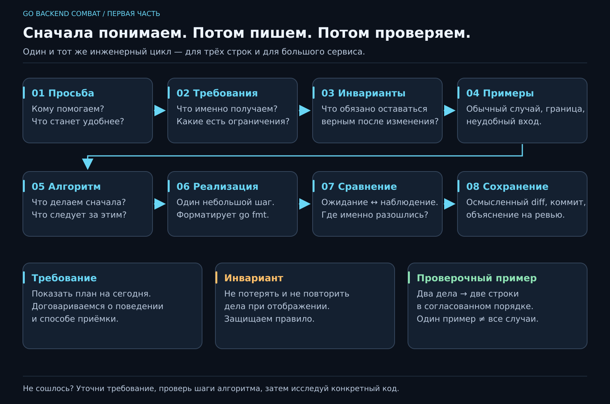

# 01. А что вообще такое программирование?

[Карта курса](../course/README.md) · [Следующий урок →](02_VALUES.md)

## «Сделай, чтобы я ничего не забывала»

Представь разговор на кухне. Подруга говорит: «У меня врач, работа, посылка, ещё маме позвонить. Сделай приложение, чтобы я ничего не забывала». Ты открываешь редактор. Курсор мигает с выражением лица человека, который уже всё понял. А ты пока — нет.

С чего начать? С папки `internal`? С красивой кнопки? С выбора базы? Сначала попробуем понять, **какую перемену в жизни человека должна принести программа**. «Ничего не забывать» может означать список на экране, уведомление в телефоне или звонок робота в семь утра. Последнее бодрит, но заказчик мог иметь в виду другое.

Программирование — превращение задачи в точные действия над данными. Компьютер умеет хранить, вычислять, сравнивать, передавать и показывать данные. Смысл этих действий задаём мы. Поэтому работа разработчика начинается ещё до первой строчки Go.

Сегодня у тебя появятся первая версия JobFlow и **повторяемый способ решать задачи**. К нему будем возвращаться и при добавлении поля, и при работе с базой, и перед первым собеседованием.



[Открыть SVG крупно](../posters/core/01_ENGINEERING_LOOP.svg). На занятии держи перед глазами верхний маршрут; нижние карточки помогут разбирать ошибки.

## 1. Просьба превращается в требования

Спросим: «Как будет выглядеть полезная первая версия?» Договоримся: человек запускает программу и видит два дела в нужном порядке. Ввод пока меняем в исходном коде. Даты и уведомления оставим следующим версиям.

**Требование** — конкретное ожидаемое свойство программы. **ТЗ**, техническое задание, — согласованный набор требований и ограничений. Оно может занимать пять строк. Полезность ТЗ определяется тем, помогает ли оно одинаково понять результат.

Наше первое мини-ТЗ:

| Вопрос | Договорённость |
|---|---|
| Для кого? | Для человека, который хочет увидеть ближайшие дела |
| Что получает? | Заголовок `Сегодня`, затем два дела, каждое с новой строки |
| Откуда дела? | Сейчас заданы в `main.go` |
| Что сохраняем? | Исходный код; отдельного хранилища списка пока нет |
| Как принимаем работу? | Запускаем из папки проекта, сравниваем вывод с согласованным примером |

«Красиво» и «быстро» пока не дают проверки. «Два дела под заголовком, без пропущенных строк» — уже дают. На работе придётся уточнять и время ответа, и объём данных. Сейчас важнее научиться замечать неясность до того, как она превратится в три вечера переделок.

**Твоя остановка:** заказчик просит «показать важные дела». Какой вопрос ты задашь? Например: кто определяет важность и что показывать, если важных дел нет? Уточнение — часть разработки.

## 2. Инвариант: что нельзя испортить при изменении

Слово звучит так, будто сейчас понадобится высшая математика. Возьмём электрический чайник: режимы меняются, а правило «не греть при отсутствии воды» должно сохраняться во всех разрешённых режимах. Это пример **инварианта** — условия, которое должно оставаться истинным для допустимого состояния системы или операции.

Для первой версии: **каждое запланированное дело отображается ровно один раз и в согласованном порядке**. Сегодня это обеспечивается последовательными вызовами. Когда появится редактирование списка, способ защиты изменится, а правило останется.

Позже введём инварианты данных: «приоритет сохранённой задачи от 1 до 3», «у задачи непустое название». Значение `9` вполне помещается в Go-тип `int`, но не подходит нашему приложению. Компилятор проверяет правила языка; правила предметной области придётся выразить в коде самим.

Различай три вещи:

- **Требование:** показать список на сегодня — желаемое поведение.
- **Инвариант:** не потерять и не продублировать дела при отображении — правило допустимого результата.
- **Проверочный пример:** для двух заданных дел ожидаем две строки в указанном порядке — конкретное свидетельство. Один пример ещё не доказывает все случаи.

Система — части, их связи и правила. В нашем маленьком случае уже есть данные дел, порядок действий, экран и договор с человеком. Системное мышление начинается с вопроса: **что затронет моё изменение?** Если отсортировать дела по алфавиту, удобнее ли станет человеку или мы нарушим согласованный порядок?

## 3. Алгоритм до кода

**Алгоритм** — точная последовательность шагов для получения результата. Рецепт «приготовь вкусно» оставляет всю работу повару. Рецепт с продуктами, действиями и условиями позволяет повторить процесс. Компьютер не имеет режима «ну ты понял».

Наша версия словами:

```text
1. Показать заголовок «Сегодня».
2. Показать первое дело: «Записаться к врачу».
3. Показать второе дело: «Позвонить маме».
4. Завершить работу.
```

Это **линейный алгоритм**: шаги выполняются один за другим. На третьем занятии появятся выбор и повторение. Уже сейчас отделяй алгоритм программы от **алгоритма разработки**:

```text
Понять просьбу → уточнить требования → назвать инварианты
→ придумать обычный и неудобный пример → расписать действия
→ реализовать маленький шаг → запустить и сравнить → сохранить изменение.
```

Если пример не сошёлся, возвращаемся к причине: неправильно поняли просьбу, придумали неверный алгоритм или ошиблись в записи кода? Переписывание всего файла редко помогает выяснить, какой вариант случился.

## 4. Первая реализация на Go

Подготовь папку через [первый запуск](../docs/START_HERE.md): инструменты создают модуль командой `go mod init jobflow`. В `main.go`:

```go
package main

import "fmt"

func main() {
    fmt.Println("Сегодня")
    fmt.Println("Записаться к врачу")
    fmt.Println("Позвонить маме")
}
```

`package main` обозначает пакет исполняемой программы. `import "fmt"` подключает готовые средства форматирования и вывода. `func main()` — точка входа: отсюда начинает выполняться наш код. Фигурные скобки ограничивают тело функции. `fmt.Println` показывает переданные значения и переводит строку; текст в двойных кавычках — строковое значение.

Сначала предскажи результат на бумаге. Затем сохрани файл и выполни из папки проекта:

```sh
go fmt ./...
go run .
```

Увидишь:

```text
Сегодня
Записаться к врачу
Позвонить маме
```

`go run` сначала собирает код, потом запускает получившуюся программу. **Компилятор** переводит исходный код в форму для выполнения и проверяет правила языка. Если заменить `Println` на `PrintLn`, выполнение наших строк не начнётся: имя не найдено. Если написать «Позвонить малине», программа прекрасно соберётся. Компилятор не знает, кому ты собирался звонить.

Получились две категории проблем: **ошибка сборки** и **неверное поведение корректно собранной программы**. Привычка замечать разницу сэкономит время.

## 5. Проверяем намеренно, а не любуемся выводом

Проведи три коротких эксперимента. До каждого запиши ожидание, после — наблюдение.

| Изменение | Что исследуем |
|---|---|
| Поменять местами два вызова | Следует ли выполнение порядку строк? |
| Продублировать второе дело | Замечает ли компилятор нарушение нашего инварианта? |
| Написать `PrintLn` | На какой стадии обнаруживается неизвестное имя? |

После каждого эксперимента возвращай верную версию. Меняй по одному фактору: иначе неясно, какое действие повлияло на результат. Это инженерная дисциплина эксперимента.

**Отладка** — поиск причины расхождения между ожидаемым и наблюдаемым. Начни с фактов: нужная ли папка, сохранён ли файл, какая команда выполнена, какая первая ошибка выдана? Сообщение `main.go:...` ведёт к месту в исходнике. Читаем первую содержательную ошибку, исправляем и повторяем запуск. Тридцать случайных правок дают тридцать новых подозреваемых.

## 6. Где тут архитектура, если всего один файл?

Уже можно назвать три роли: **представление** показывает текст, **правила** определяют допустимый результат, **данные** описывают дела. Пока всё помещается рядом. Постепенно научимся отделять роли, чтобы изменение экрана не ломало правила.

Открой [карту проекта и контрактов](../docs/PROJECT_FLOW.md). Сегодня нужно суметь рассказать путь «запрос → правило → хранилище → ответ». Все файлы примера самостоятельно писать пока не требуется. Объявления интерфейсов разберём после функций и типов; направление зависимостей видно уже сейчас.

**Глубже:** большие системы тоже строят маленькими проверяемыми шагами. Если первая версия требует поднять четыре сервиса, чтобы увидеть одну строку, полезно спросить, какую задачу это решает на данном шаге. У каждой дополнительной части есть цена настройки, понимания и диагностики.

## 7. Сохраняем результат и можем его объяснить

Git сохранит выбранное изменение. Начни с [первого коммита](../docs/GIT.md#первый-коммит-в-своём-jobflow); конфликты из лаборатории освоим за этот вводный блок. Вместе с кодом положи короткое `NOTES.md`: требования, инвариант, алгоритм, ожидаемый вывод, один разобранный сбой. Это журнал решений, который завтра поможет восстановить ход мысли.

Перед завершением ответь своими словами: чем просьба отличается от требования? Какой инвариант мы защищаем? Почему успешная сборка не гарантирует полезный результат? Что проверишь первым, если на экране старый текст?

На собеседовании история «я уточнил порядок, зафиксировал правило и поймал дубликат сравнением» говорит о тебе больше, чем заученное определение алгоритма. А на следующем занятии вынесем данные из текста действий: появятся значения, типы и расчёт времени на дела.

---

[ДЗ и подсказки](../combat/01_FIRST_PROGRAM.md) · [Ментору](../mentor/01_FIRST_PROGRAM.md) · [Эталон](../reference/01/README.md) · [Вопросы недели](../interview/route.md#week-01)
