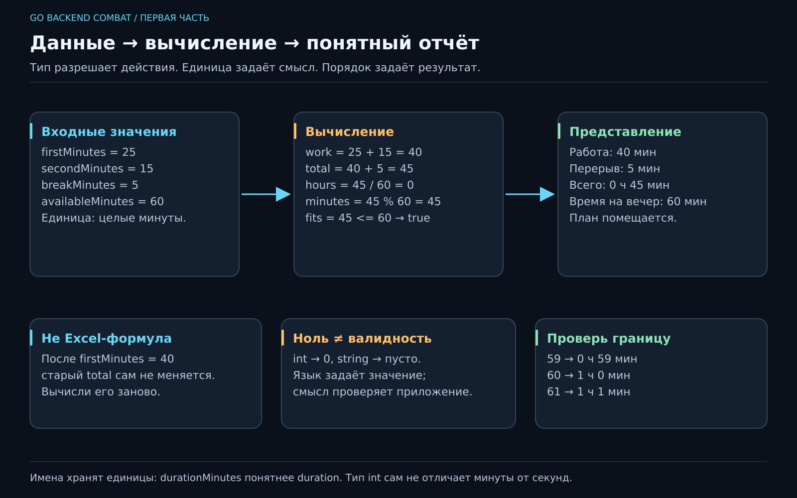

# 02. Где программа держит значения?

[Карта курса](../course/README.md) · [← Предыдущий урок](01_FIRST_PROGRAM.md) · [Следующий урок →](03_DECISIONS.md)

## «Погоди, а сколько это всё займёт?»

Список дел готов. Но в нём рядом стоят «заказать чай» и «разобраться с налогами». По числу строчек одинаково, по ощущениям — две разные вселенные. Добавим оценку длительности и посчитаем, сколько займут дела вместе с перерывом.

Перед кодом уточним единицы: считаем **целые минуты**, длительность дела неотрицательная, перерыв учитываем один раз между двумя делами. Оценка — пожелание человека, а не обещание программы, что налоги займут ровно 25 минут.



[Открыть SVG крупно](../posters/core/02_VALUES.svg). Проследи стрелки от исходных данных до отчёта: какой шаг нужно пересчитать после изменения длительности?

## 1. Дадим данным имена

**Переменная** связывает имя со значением определённого типа. Имя `title` подсказывает человеку смысл, тип `string` — допустимые действия с этим значением. Короткая запись `:=` объявляет локальную переменную и определяет тип по правой части.

Вот полный `main.go` для этой версии:

```go
package main

import "fmt"

func main() {
    title := "Записаться к врачу"
    priority := 2
    done := false
    firstMinutes := 25
    secondMinutes := 15
    const breakMinutes = 5

    workMinutes := firstMinutes + secondMinutes
    totalMinutes := workMinutes + breakMinutes

    fmt.Println("Задача:", title)
    fmt.Println("Приоритет:", priority)
    fmt.Println("Выполнена:", done)
    fmt.Println("Работа, мин:", workMinutes)
    fmt.Println("Вместе с перерывом, мин:", totalMinutes)
}
```

Предскажи пять строк, затем выполни `go fmt ./...` и `go run .`. Итог должен быть **45 минут**. Если получилось 50, где-то перерыв попал в расчёт дважды. Именно поэтому полезно записывать ожидаемый результат до запуска.

Здесь `string` — текст, `int` — целое число, `bool` — значение `true` или `false`. Тип позволяет компилятору отклонить, например, `priority = "очень"`. Но `priority = 99` язык допускает. Это нарушение нашего правила приложения; на следующем уроке поставим явную защиту.

## 2. Значение вычисляется в момент присваивания

Добавь после расчёта, но перед выводом:

```go
firstMinutes = 40
```

Какой итог увидим? Всё ещё 45. В `workMinutes` уже записано число 40, вычисленное из старых 25 и 15. Переменная не превращается в живую Excel-формулу. Если исходные данные поменялись, расчёт нужно выполнить заново.

Объявление `:=` создаёт переменную; присваивание `=` меняет существующую. Запись `firstMinutes = firstMinutes + 5` сначала читает старое значение, вычисляет сумму, затем сохраняет новое. Это действие во времени, а не математическое равенство.

Проведи трассировку — **пошаговую запись значений**:

| Шаг | firstMinutes | secondMinutes | workMinutes |
|---|---:|---:|---:|
| Исходные данные | 25 | 15 | ещё не объявлена |
| После сложения | 25 | 15 | 40 |
| После изменения первого дела | 40 | 15 | 40 |
| После повторного сложения | 40 | 15 | 55 |

Читать такую таблицу медленнее, чем угадывать. Зато причина ошибки становится видна. Для маленького участка кода это один из самых доступных способов отладки.

## 3. Нулевое значение — не всегда допустимое значение

Можно объявить без начального значения:

```go
var attempts int
var note string
var archived bool
```

Go задаст `0`, `""`, `false`. Это **нулевые значения**, предсказуемые правила языка. Для числа попыток ноль естественен. Для обязательного названия пустая строка означает незаполненные данные. Поэтому «переменная существует» и «данные подходят задаче» — разные утверждения.

`const breakMinutes = 5` задаёт константу: её нельзя переприсвоить. Константа полезна для стабильного правила, которому нужно имя. Длительность конкретного дела — переменная. Если завтра пользователь сможет выбирать перерыв, этот выбор станет входными данными, а значение по умолчанию можно сохранить константой.

## 4. Типы защищают, но смысл нужно защищать тоже

Попробуй предсказать результаты:

```go
fmt.Println(25 + 15)
fmt.Println("25" + "15")
fmt.Println(45 / 60)
fmt.Println(45 % 60)
```

Первый результат — 40, второй — `2515`. В третьем случае делятся целые числа, поэтому получится 0: дробная часть отбрасывается. Четвёртый — 45, остаток от деления. Для 95 минут: `95 / 60` даёт 1 час, `95 % 60` даёт 35 минут.

**Неудобный пример:** 59, 60 и 61 минута. Эти три значения покажут, правильно ли ты оформляешь переход к часам. Умение выбирать границы важнее, чем десять раз запускать вариант с 95.

Имена `timeout`, `size`, `duration` без контекста легко перепутать. `timeoutSeconds` и `durationMinutes` уже сообщают единицу. Когда появится `time.Duration`, получим более сильную типовую защиту. Сейчас начнём с честных имён и одного принятого масштаба.

## 5. Почему Go ругается на полезные, казалось бы, строки

Неиспользованная локальная переменная — ошибка сборки. Решение зависит от намерения: действительно нужен результат — используй; передумал — удали. Добавлять случайный `Println` ради тишины компилятора быстро превращает вывод в склад временных запчастей.

В одном блоке повторное `title := "Другое"` без нового имени не сработает. Нужен `title = "Другое"`. Вложенный блок может объявить **другую** переменную с тем же именем — это затенение:

```go
title := "Врач"
{
    title := "Чай"
    fmt.Println(title)
}
fmt.Println(title)
```

Внутри будет «Чай», снаружи — «Врач». Фрагмент вставляется внутрь `main` вместо его текущего содержимого. Отдельные фигурные скобки здесь нужны только для эксперимента с областью видимости. В обычной работе одинаковые имена в соседних областях иногда удобны, но случайное затенение мешает заметить, почему значение «не изменилось».

## 6. Вывод — тоже часть договора

`fmt.Println` разделяет аргументы пробелами и добавляет перевод строки. Для управляемого формата есть `fmt.Printf`:

```go
fmt.Printf("Итого: %d ч %d мин\n", totalMinutes/60, totalMinutes%60)
```

`%d` — место целого числа, `\n` — перевод строки. Плейсхолдеры и аргументы должны соответствовать друг другу по количеству и типам. Текстовое представление — ещё один маленький контракт: человек должен понимать единицы, а не угадывать, что означает голое `45`.

Более сложное решение — хранить каждое дело в структуре, а все дела в коллекции. Это избавит от `first` и `second` при росте списка. Разберём его после функций; сейчас два явно названных значения позволяют увидеть расчёт целиком.

Перед практикой объясни: почему итог не изменился после присваивания исходной переменной? Чем нулевое значение отличается от допустимого? На каком примере целочисленное деление удивит пользователя? Как по именам понять единицы?

---

[ДЗ и подсказки](../combat/02_VALUES.md) · [Ментору](../mentor/02_VALUES.md) · [Эталон](../reference/02/README.md) · [Вопросы недели](../interview/route.md#week-02)
