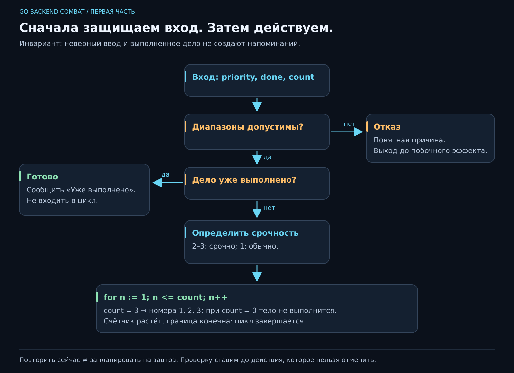

# 03. Как программа выбирает и повторяет?

[Карта курса](../course/README.md) · [← Предыдущий урок](02_VALUES.md) · [Следующий урок →](04_FUNCTIONS.md)

## «Важное — наверх. Сделанное больше не напоминай»

Пользователь смотрит на список: «Почему вы снова напоминаете про чай? Я его уже купила». В прошлой версии программа всегда выполняла одни и те же действия. Теперь результат зависит от состояния дела.

Уточним правила: приоритет допустим от 1 до 3; 2 и 3 считаем срочными; выполненное дело не напоминаем; для невыполненного показываем от нуля до трёх напоминаний. Отрицательное число повторов — неверный ввод, ноль — осознанное отсутствие напоминаний.

**До кода** составим таблицу решений. Это способ разложить человеческое «ну очевидно же» на варианты, с которыми справится компьютер.

| Приоритет | Выполнена? | Повторы | Результат |
|---:|---|---:|---|
| 2 | нет | 3 | Срочно, три напоминания |
| 1 | нет | 1 | Обычное дело, одно напоминание |
| 3 | да | 3 | Уже выполнено, без напоминаний |
| 0 или 4 | любое | любое | Отказ: неверный приоритет |
| 2 | нет | −1 или 4 | Отказ: неверное число повторов |
| 2 | нет | 0 | Срочно, без напоминаний |



[Открыть SVG крупно](../posters/core/03_DECISIONS.svg). Покажи пальцем, каким путём проходит выполненная задача. В какой точке ей запрещён вход в цикл?

## 1. Условие — выражение со значением bool

`priority >= 2` даёт `true` или `false`. `if` выбирает действия по этому результату. Для равенства пишем `==`, для присваивания — `=`. Ещё есть `!=`, `<`, `>`, `<=`, `>=`.

Условия объединяем: `&&` — оба верны, `||` — хотя бы одно верно, `!` — отрицание. Условия вычисляются с коротким замыканием: если левая часть `&&` ложна, правая уже не вычисляется; если левая часть `||` истинна, правая тоже не нужна.

Для допустимого приоритета: `priority >= 1 && priority <= 3`. Для отказа: `priority < 1 || priority > 3`. Прочитай оба вслух и проверь на 0, 1, 3, 4. Частая ошибка — соединить две причины отказа через `&&`: число одновременно меньше 1 и больше 3 не бывает.

## 2. Сначала защищаем вход, потом выполняем действие

Полная версия `main.go`:

```go
package main

import "fmt"

func main() {
    priority := 2
    done := false
    reminders := 3

    if priority < 1 || priority > 3 {
        fmt.Println("Ошибка: приоритет должен быть от 1 до 3")
        return
    }
    if reminders < 0 || reminders > 3 {
        fmt.Println("Ошибка: число напоминаний должно быть от 0 до 3")
        return
    }
    if done {
        fmt.Println("Уже выполнено")
        return
    }

    if priority >= 2 {
        fmt.Println("Срочно")
    } else {
        fmt.Println("Можно запланировать")
    }
    for number := 1; number <= reminders; number++ {
        fmt.Println("Напоминание", number)
    }
}
```

`return` завершает текущую функцию. Здесь это `main`, поэтому программа заканчивает свою работу. Такой ранний выход называют **guard clause**, защитной проверкой: всё, что ниже, уже может опираться на проверенное условие. В этом примере отказ пока печатается и завершает программу с обычным кодом выхода; полноценную передачу ошибок и ненулевой exit code разберём отдельно.

Инвариант операции: **выполненное дело и недопустимый ввод не приводят к отправке напоминаний**. Защита стоит до цикла. Проверить после цикла было бы поздно: «мы уже разослали всё лишнее, но теперь очень строго валидируем» — плохой сервис даже с красивым сообщением.

Если нужно обработать сразу несколько дел, `return` из `main` остановит всю программу. Позже вынесем обработку одного дела в отдельную функцию и будем решать, продолжать ли остальные. Место проверки определяет область последствий.

## 3. Цикл можно пройти пальцем

У `for number := 1; number <= reminders; number++` три части:

1. Начало: `number := 1`, один раз перед циклом.
2. Условие: `number <= reminders`, перед каждым повтором.
3. Изменение: `number++`, после тела цикла.

Для трёх напоминаний состояния такие:

| Перед проверкой | Условие | Действие |
|---:|---|---|
| 1 | верно | Показать напоминание 1, увеличить до 2 |
| 2 | верно | Показать напоминание 2, увеличить до 3 |
| 3 | верно | Показать напоминание 3, увеличить до 4 |
| 4 | ложно | Выйти |

Для нуля условие ложно уже при первой проверке. Тело не выполнится ни разу — именно это мы обещали. Если начать с нуля и оставить `<=`, напоминаний станет на одно больше. Так выглядит **ошибка на единицу**, off-by-one.

Почему цикл завершится? Счётчик растёт, верхняя граница конечна. Можно рассуждать через оставшееся количество шагов: оно уменьшается после каждого повтора. Для будущего воркера похожий вопрос будет «что остановит повторные попытки?» — только ответы станут сложнее.

## 4. Повторить действие — не значит подождать

Цикл выведет три строки почти сразу. У него нет понятия «завтра» или «через час». Для реального напоминания понадобятся время, ожидание, хранение состояния и обработка остановки процесса. Сейчас наш вывод — модель решения о напоминании.

Полезно честно называть границы прототипа. «Мы реализовали три запланированных повтора» было бы неверно. «Мы проверили правило, сколько напоминаний надо создать» — уже точное описание результата.

У Go есть и `for condition { ... }`, и бесконечный `for { ... }`. Не запускай бесконечный цикл ради эксперимента без понимания остановки: `Ctrl+C` завершит процесс. `break` выходит из ближайшего цикла, `continue` переходит к следующему повтору; у трёхчастного `for` перед следующей проверкой выполнится его шаг изменения.

**Попробуй на бумаге:** если перед выводом добавить `if number == 2 { continue }`, какие номера увидишь? 1 и 3. Если заменить `continue` на `break`, останется только 1. Для основного решения эти конструкции сейчас не нужны, но разницу важно уметь предсказать.

## 5. Условия можно записать правильно и всё равно решить другую задачу

`if priority >= 2 || done` корректен по типам. По смыслу он назовёт срочным даже выполненное обычное дело. Компилятор не восстановит таблицу наших договорённостей.

Проверки выбираем по причинам разных исходов: границы приоритета 0/1/2/3/4, выполненная задача, ноль и крайние значения повторов. Для неизменившихся условий не обязательно перебирать все сочетания. Если порядок проверок важен, добавь сочетание двух ошибок: какой отказ обещаем первым? В этом примере первым проверяется приоритет.

Неудачное решение — вложить всё в четыре уровня `if`: найти путь отказа становится тяжело. Ранние выходы упрощают чтение. Но двадцать несвязанных проверок в одной функции тоже просят разделения. На следующем занятии дадим правилам имена и ясные контракты.

Перед практикой объясни: почему `9` нельзя просто считать срочным? Почему `return` стоит до вывода? Сколько раз выполнится цикл при нуле? Какое изменение нарушает ровно одну строку таблицы решений?

---

[ДЗ и подсказки](../combat/03_DECISIONS.md) · [Ментору](../mentor/03_DECISIONS.md) · [Эталон](../reference/03/README.md) · [Вопросы недели](../interview/route.md#week-03)
