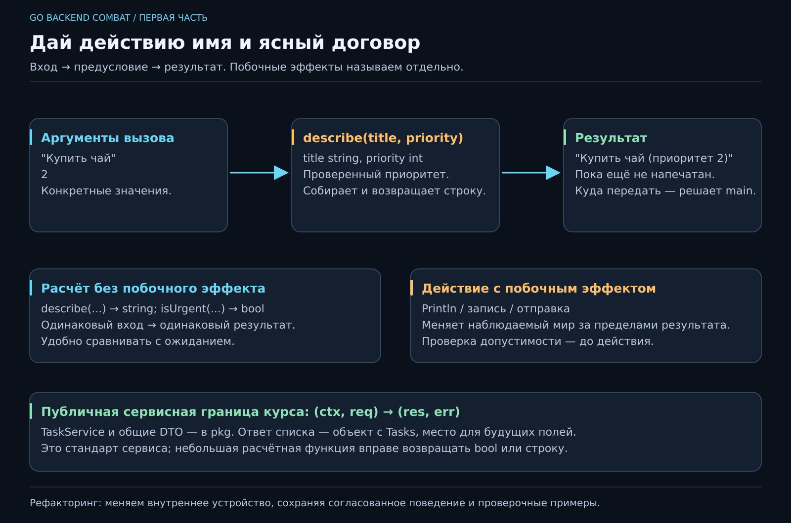

# 04. Как разложить задачу на маленькие шаги?

[Карта курса](../course/README.md) · [← Предыдущий урок](03_DECISIONS.md) · [Следующий урок →](05_COLLECTIONS.md)

## «А теперь тот же результат — в другом месте»

Вчера правило срочности жило прямо в `main`. Сегодня карточку надо показать в терминале, завтра — отправить пользователю по сети. Копировать правило в каждый вход? Тогда одна версия однажды решит, что приоритет 2 срочный, другая — что только 3. Обе соберутся без ошибок, а команда проведёт незабываемое утро.

Вынесем понятные действия в **функции**. Функция получает входные значения, выполняет работу и может вернуть результат. Её имя и сигнатура — объявление того, какое действие доступно вызывающему коду.



[Открыть SVG крупно](../posters/core/04_FUNCTIONS.svg). Сначала пройди верхнюю схему для одной функции. Нижняя показывает, как тот же принцип вырастет в границу сервиса.

## 1. Договоримся о поведении до реализации

Для функции полезно ответить на четыре вопроса:

| Часть контракта | Для `describe` |
|---|---|
| Вход | Название и приоритет |
| Предусловие | Название уже проверено, приоритет в диапазоне 1..3 |
| Результат | Строка с названием и приоритетом |
| Побочные эффекты | Нет вывода, записи файлов или изменения внешнего состояния |

**Предусловие** — что должно быть верно перед вызовом. **Постусловие** — что обещано после успешного выполнения. **Побочный эффект** — наблюдаемое изменение за пределами возвращаемого результата: например, печать, запись в базу или отправка письма.

Инвариант описывает правило допустимого состояния на протяжении работы; предусловие и постусловие описывают границы конкретной операции. Не нужно вставлять эти слова в каждое предложение. Нужно уметь ответить, кому поручено защитить правило.

## 2. Возвратить и напечатать — разные действия

Полный `main.go`:

```go
package main

import "fmt"

func describe(title string, priority int) string {
    return fmt.Sprintf("%s (приоритет %d)", title, priority)
}

func isUrgent(priority int) bool {
    return priority >= 2
}

func main() {
    title := "Записаться к врачу"
    priority := 2
    text := describe(title, priority)
    fmt.Println(text)
    if isUrgent(priority) {
        fmt.Println("Срочно")
    }
    fmt.Println(describe("Купить чай", 1))
}
```

Ожидаем карточку врача, строку `Срочно`, карточку чая. Предскажи порядок, затем запусти `go fmt ./...` и `go run .`.

В объявлении `title` и `priority` — **параметры**. В вызове `describe("Купить чай", 1)` текст и число — **аргументы**, конкретные значения. Последний `string` перед телом функции — тип результата.

`fmt.Sprintf` собирает строку и возвращает её. `fmt.Println` печатает. Разделение позволяет завтра тот же результат показать в другом месте или сравнить с ожиданием. Если `describe` сама печатает и ничего не возвращает, вызывающий код теряет эту свободу.

**Остановка:** если удалить строку `fmt.Println(text)`, напечатает ли карточку вызов `describe`? Нет. Она рассчитала и вернула значение; дальнейшее действие выбирает `main`.

## 3. Как проходит один вызов

При `text := describe(title, priority)` Go вычисляет аргументы, передаёт их функции, выполняет её тело, затем возвращает строку в место вызова. `return` завершает **этот вызов**, а не всю программу. Исключение из прошлой встречи было связано с тем, что мы возвращались из `main`.

Объявление функции само по себе ничего не выполняет. Можно поставить `describe` после `main` в файле: для этих обычных объявлений порядок текста не задаёт порядок вызовов. Историю выполнения восстанавливаем по вызовам.

Имена параметров принадлежат своей функции. `title` из `describe` не доступна в `main`; совпавшие имена не создают тайный канал связи. Это помогает читать небольшой кусок кода без знания всех переменных проекта.

## 4. Значения передаются копированием

Вставь перед `main`:

```go
func addBreak(minutes int) int {
    minutes = minutes + 5
    return minutes
}
```

А внутри `main` отдельно исследуй:

```go
minutes := 25
withBreak := addBreak(minutes)
fmt.Println(minutes, withBreak)
```

Получится `25 30`. В этом случае функция меняет свою копию числа, исходная переменная не меняется. У Go аргументы всегда передаются по значению; когда позже встретятся указатели, слайсы и карты, скопированное значение сможет ссылаться на общие данные. Обобщать этот опыт до «функция никогда ничего не изменяет снаружи» было бы ошибкой.

## 5. Маленькая функция может скрывать большую неоднозначность

Наша `isUrgent(9)` вернёт `true`. При заявленном предусловии функция получает только 1..3. Значит, **кто-то до вызова должен проверить вход**. Вчера это делал `main`.

Для проверки допустимости выделим другой вопрос:

```go
func validPriority(priority int) bool {
    return priority >= 1 && priority <= 3
}
```

Сначала `validPriority`, затем решение о срочности. Если функция станет публичной точкой входа для внешних данных, рассчитывать на договорённость в голове коллеги нельзя: проверка должна находиться на этой границе. Сервисный метод будет возвращать осмысленную ошибку, а не делать вид, что неверный ввод — обычное дело. Ошибки как значения подробно разберём на седьмом занятии.

Не смешивай «не срочно» и «неверный приоритет». Одно — допустимый результат, другое — нарушение контракта. Такая разница определит и поведение API, и сообщения человеку.

## 6. Функции помогают разделить ответственность

Посмотри на роли нашей программы:

- Проверка отвечает, допустим ли вход.
- Расчёт определяет срочность и итоговое время.
- Форматирование собирает понятную человеку строку.
- `main` соединяет эти шаги и выполняет вывод.

Это **декомпозиция**: деление задачи на части с понятными обязанностями. Удачная граница позволяет менять формат карточки без переписывания правила срочности. Неудачная — функция `processEverything`, которая одновременно спрашивает пользователя, пересчитывает время, печатает и сохраняет файл. У неё трудно предсказать последствия изменения.

Выносить каждое сложение в отдельный файл тоже не требуется. Имя должно помогать читать сценарий, а граница — удерживать понятный контракт. Функция на две строки с устойчивым смыслом нормальна; десять обёрток без новых ролей только увеличат путешествие по коду.

## 7. От функции к сервисному контракту

Через несколько занятий несколько связанных операций станут **сервисом** — частью приложения, которая исполняет пользовательские сценарии. Для него вводим стандарт курса: `(ctx, req) → (res, err)`.

`ctx` несёт срок и сигнал отмены работы. `req` — объект запроса, `res` — объект ответа, `err` сообщает об отказе. Названия, общие типы, ошибки и интерфейсы живут в `pkg`. Даже список оборачиваем в объект: `ListTasksResponse` с полем `Tasks`, чтобы позже добавить, например, следующую страницу. Это правило **публичного сервисного слоя**. Небольшие расчётные функции вроде `isUrgent` закономерно возвращают `bool`.

Полная карта и небольшой пример — в [Project Flow](../docs/PROJECT_FLOW.md). Сейчас сопоставь понятия: параметры функции → входной контракт; результат → обещанный ответ; `main` → место соединения частей. Синтаксис интерфейсов и структур будем разбирать последовательно, сохраняя эту карту перед глазами.

**Глубже:** чистая функция при одинаковых входах возвращает одинаковый результат и не производит побочных эффектов. Такой расчёт удобно исследовать отдельно. Чтение текущего времени, генерацию случайных значений и работу с сетью полезно держать явно видимыми: они влияют на повторяемость результата.

Перед практикой объясни, где выполняется проверка, кто печатает, что вернёт функция и что она меняет. На ревью нужно суметь перенести одно правило в функцию без изменения внешнего поведения. Это уже **рефакторинг**: меняем устройство кода, сохраняя согласованный результат.

---

[ДЗ и подсказки](../combat/04_FUNCTIONS.md) · [Ментору](../mentor/04_FUNCTIONS.md) · [Эталон](../reference/04/README.md) · [Вопросы недели](../interview/route.md#week-04)
