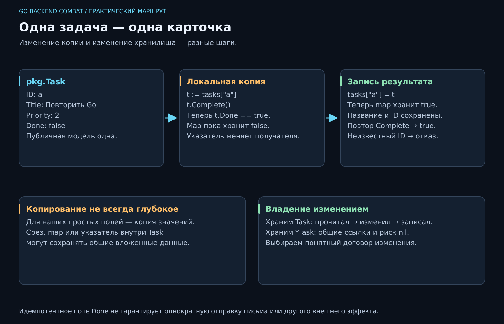

# 06. Что мы знаем об одной задаче?

[Карта курса](../course/README.md) · [← Предыдущий урок](05_COLLECTIONS.md) · [Следующий урок →](07_ERRORS.md)

## Название уже не вмещает жизнь

Пока наше дело — строка. Но «Повторить Go» занимает 25 минут, имеет приоритет и однажды становится выполненным. Можно завести четыре map с одинаковыми ключами. А потом удалить запись из трёх и забыть четвёртую. Получится маленькое бюро потерянных приоритетов.

Соберём связанные значения вместе. **Модель** — выбранное нами описание предмета: что программе нужно знать о задаче, а что пока не нужно. Номер любимой кружки в модель JobFlow не входит, как бы мы её ни любили.



**50 минут:** требования к полям — 7; struct — 10; значения и копии — 12; методы и указатели — 13; изменение map и итог — 8. Резерв — 10 минут.

## Структура вместо параллельных списков

```go
type Task struct {
    ID       string
    Title    string
    Priority int
    Done     bool
}
```

`struct` объединяет именованные поля. Такой тип — чертёж; `Task{ID: "a", Title: "Повторить Go", Priority: 2}` — конкретное значение. Неуказанный `Done` получит нулевое значение `false`.

В учебном контракте обязательны ID, непустое название и приоритет от 1 до 3. Поле длительности из планировщика можно добавить как развитие: назови `EstimateMinutes`, чтобы единица была видна. Отдельное поле лучше, чем строка `"Повторить Go, 25 минут"`, которую потом придётся разбирать.

С этого шага публичную модель своего проекта держим в `pkg/task.go`: `package pkg`, использование `pkg.Task`. Правило размещения и полный рабочий пример есть в [Project Flow](../docs/PROJECT_FLOW.md). Эталон 06 использует то же размещение модели.

Заглавная буква делает имя доступным из других пакетов. Это не делает все значения корректными: `pkg.Task{Priority: 99}` по-прежнему можно написать. Публичные поля требуют явной проверки на границе операции. Саму проверку построим в следующем уроке.

## Копия — это другая карточка

```go
original := pkg.Task{ID: "a", Title: "Повторить Go", Priority: 2}
copy := original
copy.Done = true
fmt.Println(original.Done, copy.Done) // false true
```

Этот фрагмент — внутри main с импортами fmt и jobflow/pkg. Здесь `Task` содержит простые значения, поэтому изменение копии не меняет оригинал. Если позже добавим срез, map или указатель, копирование структуры скопирует и их описания: вложенные данные могут остаться общими. «Структура копируется» не означает «весь мир под ней клонируется».

Зачем нам это знать? Чтобы понимать, какую карточку меняет функция. Если она получила значение, она работает с копией. Если получила указатель — может менять исходное значение.

## Указатель: где лежит нужная карточка

`&task` — получить адрес переменной. `*Task` в типе параметра означает указатель на Task. `*pointer` в выражении — прочитать значение по адресу. В Go доступ к полю через указатель обычно пишется просто `pointer.Done`.

```go
func (t *Task) Complete() {
    t.Done = true
}
```

Функция с получателем `(t *Task)` называется **методом**. Читается как «завершить эту задачу»: `task.Complete()`. Указатель нужен потому, что мы меняем существующую карточку. Для вычисления без изменения часто достаточно получателя-значения.

Указатель не делает код автоматически быстрее или профессиональнее. Он добавляет возможность совместного изменения и может быть nil. В этой модели `Complete` вызывается на существующей задаче; nil не является допустимым получателем. Не добавляй молчаливое `if t == nil { return }`, скрывая ошибку вызывающего кода, без причины в контракте.

## Почему map заставляет достать карточку

Для `map[string]Task` используй три действия:

```go
task, found := tasks["a"]
if found {
    task.Complete()
    tasks["a"] = task
}
```

Элемент map нельзя адресовать как обычную переменную: запись `tasks["a"].Done = true` не скомпилируется. Мы прочитали значение, изменили локальную копию и записали её обратно. Пропустишь последний шаг — программа бодро объявит о завершении, а хранилище сохранит прежний статус.

Можно хранить `*Task`, тогда указатель позволит менять объект напрямую. Но появятся nil-элементы, общие ссылки и другой разговор о том, кто имеет право менять задачу. Для маленького хранилища значения дают более понятное владение. Выбор делаем по поведению, а не по количеству звёздочек.

## Подпишем переход состояния

До операции задача может быть незавершённой или завершённой. После `Complete` она завершена. Повторный вызов оставляет её завершённой. Это **идемпотентность**: повтор действия не меняет итог после первого успеха. Пока речь только о поле в памяти; гарантию однократной отправки письма такой метод не даёт.

**Инварианты:** ID сохраняется при изменении названия; завершение не меняет приоритет; неизвестный ID не создаёт пустую задачу; отказ не портит соседние записи. Выпиши их до переноса CRUD на `map[string]Task`.

Небольшое усложнение для внимательного читателя: пусть `Get` вернул задачу, вызывающий поменял `Title`, но не вызвал `Update`. Должно ли это менять хранилище? Для нашего хранения значений — нет. Это полезная граница, которую ты теперь способен объяснить.
---

[ДЗ и подсказки](../combat/06_TASK_MODEL.md) · [Ментору](../mentor/06_TASK_MODEL.md) · [Эталон](../reference/06/README.md) · [Вопросы недели](../interview/route.md#week-06) · [Словарь](../docs/GLOSSARY.md)
