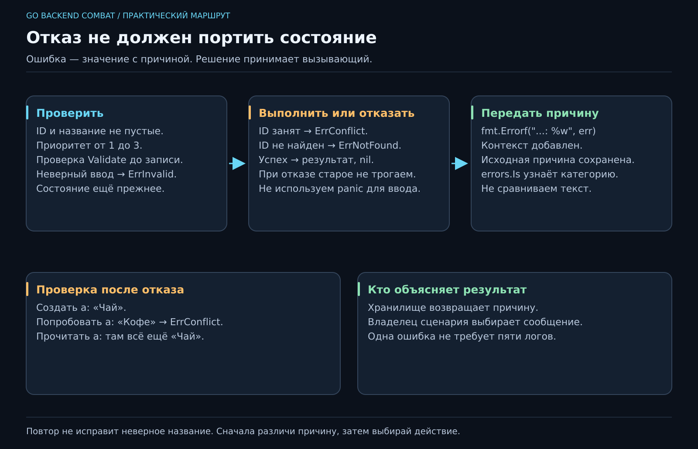

# 07. Что делать, когда что-то пошло не так?

[Карта курса](../course/README.md) · [← Предыдущий урок](06_TASK_MODEL.md) · [Следующий урок →](08_TESTS.md)

## «Не получилось» — мало для разговора

Представь: приложение ответило `false`. Ты неверно указал ID? Задача уже существует? Закончилось место? Boolean честный, но немногословный коллега. Добавим причину.

В Go ошибка — обычное значение типа `error`. Функция возвращает его, вызывающий решает, что делать. Неудачный пользовательский ввод не требует аварийно завершать всю программу.



**50 минут:** причины отказа — 5; error и возврат — 10; валидация — 12; оборачивание — 10; разбор четырёх операций — 13. Резерв — 10.

## Два результата — один договор

```go
task, err := pkg.New("a", "Повторить Go", 2)
if err != nil {
    fmt.Println("Не удалось создать задачу:", err)
    return
}
fmt.Println(task.Title)
```

При `err == nil` результат пригоден к использованию. При ошибке не продолжаем успешный сценарий. `return` здесь завершает текущую функцию; он не обязательно завершает весь процесс. Сам конструктор удобно держать рядом с публичной моделью в `pkg`.

В `pkg/errors.go` зададим различимые причины:

```go
var (
    ErrInvalid  = errors.New("некорректная задача")
    ErrNotFound = errors.New("задача не найдена")
    ErrConflict = errors.New("ID уже занят")
)
```

`errors.New` требует пакет `errors`. Эти значения создаём один раз и используем повторно. По строке сообщения ошибки не сравниваем: формулировка может измениться, смысл отказа — остаться прежним.

## Валидация: проверяем до изменения

**Валидация** — проверка, удовлетворяют ли входные данные правилам. В нашем контракте: ID и название после `strings.TrimSpace` не пустые, приоритет от 1 до 3 включительно.

```go
func (t Task) Validate() error {
    if strings.TrimSpace(t.ID) == "" {
        return fmt.Errorf("%w: пустой ID", ErrInvalid)
    }
    if strings.TrimSpace(t.Title) == "" {
        return fmt.Errorf("%w: пустое название", ErrInvalid)
    }
    if t.Priority < 1 || t.Priority > 3 {
        return fmt.Errorf("%w: приоритет от 1 до 3", ErrInvalid)
    }
    return nil
}
```

Это код внутри пакета с `Task` и `ErrInvalid`; нужны `fmt`, `strings`. Проверка пробелов не означает автоматическое изменение названия: нормализация — отдельное решение. Если решили обрезать пробелы, опиши это в ТЗ и делай одинаково во всех путях создания.

Конструктор собирает Task, вызывает `Validate` и при отказе возвращает `Task{}, err`. На успешном пути возвращает готовую задачу и nil. Но конструктор не единственный путь создать структуру, поэтому хранилище также проверяет объект **до записи**.

## Ошибка проходит через этажи

Хранилище сообщает причину, прикладной слой добавляет контекст, транспорт позже переведёт её в понятный ответ. `%w` сохраняет связь с исходной ошибкой:

```go
return fmt.Errorf("создать задачу %q: %w", task.ID, err)
```

Вызывающий проверяет `errors.Is(err, pkg.ErrConflict)`. Обычное `err == pkg.ErrConflict` перестанет работать после оборачивания. `%v` печатает текст, но не строит эту цепочку.

Представь упаковку посылки: надпись «ошибка создания задачи» помогает найти этаж, а внутри всё ещё должна лежать исходная причина. Не надо упаковывать посылку так, чтобы её можно было только сфотографировать и гадать по фото.

Типизированные ошибки через `errors.As` понадобятся, когда нужно извлечь поля, например ограничение PostgreSQL. Пока трёх общих категорий и контекста достаточно.

## Что именно обещает отказ

| Вход | Категория | Состояние после вызова |
|---|---|---|
| Название из пробелов | ErrInvalid | Запись не появилась |
| Повторный ID | ErrConflict | Старая задача прежняя |
| Update неизвестной задачи | ErrNotFound | Новая задача не появилась |
| Удаление известной задачи | nil | Удалена только эта задача |

Порядок проверок тоже часть договора: сначала корректность входа, затем поиск конфликта. Для неправильной задачи с уже занятым ID вернём ErrInvalid. Важна последовательность, которую можно объяснить, а не угадывать при каждом запуске.

## Когда повторять, когда исправлять, когда падать

Пустое название повтором запроса не исправить: нужен новый ввод. Неизвестный ID требует проверить намерение пользователя. Сетевой сбой иногда допускает ограниченный повтор, но к сети и безопасным повторам мы ещё вернёмся. Бесконечный retry на любую ошибку — очень дорогой способ снова получить тот же ответ.

`panic` оставим для нарушений, при которых обычное выполнение продолжать нельзя. Не превращаем неверный приоритет в panic и не прячем ошибки через повсеместный recover. Пока нет отдельного изолированного обработчика, recover чаще скрывает причину, чем лечит систему.

На нижних этажах возвращаем ошибку; сообщение пользователю или запись в журнал делает владелец сценария. Если каждый слой и логирует, и возвращает одну причину, журнал превращается в хор из пяти одинаковых жалоб. Хорошая обработка ошибки сохраняет причину и помогает принять следующее решение.
---

[ДЗ и подсказки](../combat/07_ERRORS.md) · [Ментору](../mentor/07_ERRORS.md) · [Эталон](../reference/07/README.md) · [Вопросы недели](../interview/route.md#week-07) · [Словарь](../docs/GLOSSARY.md)
