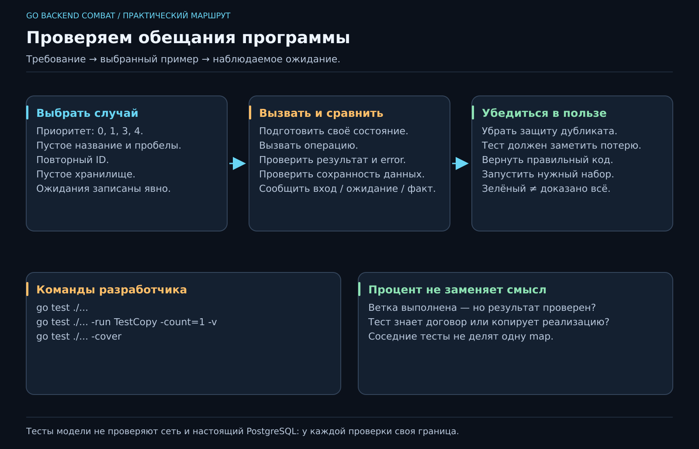

# 08. Исправили одно. Как проверить остальное?

[Карта курса](../course/README.md) · [← Предыдущий урок](07_ERRORS.md) · [Следующий урок →](09_ENVIRONMENT.md)

## Память разработчика — ненадёжный сервер

Мы проверили создание задачи, потом исправили удаление, потом снова забыли попробовать повторный ID. Это нормально для человека. Поручим повторяющиеся проверки машине.

**Автоматический тест** — программа, которая вызывает наш код, сравнивает результат с ожиданием и сообщает о расхождении. Он не доказывает отсутствие всех ошибок. Он бережёт конкретные обещания, которые мы сумели сформулировать.



**50 минут:** превращаем требования в примеры — 8; устройство теста — 10; таблица границ — 12; проверка состояния — 12; разбираем падение и пределы покрытия — 8. Резерв — 10.

## Сначала ожидание, затем код проверки

Возьми `Validate`. Приоритет 1 допустим? Да. 3? Да. 0 и 4? Нет. Название `"   "`? Нет. Это **граничные случаи**: рядом с границей ошибки встречаются чаще, чем в середине диапазона.

Запиши таблицу до реализации теста. Если ожидание непонятно человеку, `go test` за него ТЗ не сочинит. Нам нужно согласовать, что именно считать правильным.

Go ищет тесты в файлах `*_test.go`. Тестовая функция называется `Test...` и принимает `t *testing.T`. В открытом эталоне уже есть `TestNew` и `TestCopy`; сначала прочитай их и предскажи результаты.

```go
func TestCopy(t *testing.T) {
    original, err := New("a", "Чай", 1)
    if err != nil {
        t.Fatal(err)
    }
    copy := original
    copy.Complete()
    if original.Done || !copy.Done {
        t.Fatalf("ожидали false/true, получили %v/%v", original.Done, copy.Done)
    }
}
```

Фрагмент находится в пакете `pkg`, рядом с моделью. При внешнем `package pkg_test` обращаемся через `pkg.New`. `Fatal` завершает текущую тестовую функцию, `Error` отмечает неудачу и продолжает её. После неудачной подготовки продолжение часто только добавляет шум.

## Табличный тест: одна проверка, несколько историй

Вместо шести одинаковых функций можно создать срез случаев: название истории, вход, ожидаемая категория ошибки. Для каждого случая вызвать `t.Run`. Это **table-driven test**, таблица входов и ожиданий; база данных здесь не участвует.

Не делай тест, который копирует условие реализации: `want := priority >= 1 && priority <= 3`. Если ошиблись в правиле и скопировали ошибку в два места, тест подтвердит вашу дружную неправоту. Ожидания для выбранных примеров записываем явно.

Для ошибок используй `errors.Is`. При неверном конструкторе проверяй и причину, и нулевой результат. Для успеха — значения полей. Один `err == nil` ничего не говорит о том, какую задачу вернули.

## Проверяем обещание «ничего не испортилось»

Самый ценный сценарий на этой неделе:

1. Создать `a` с названием «Чай».
2. Попробовать создать `a` с другим названием.
3. Получить ErrConflict.
4. Прочитать `a` и убедиться, что там всё ещё «Чай».

Проверка только третьего пункта пропустила бы реализацию «сначала перезаписать, потом вернуть ошибку». Теперь видишь, зачем мы с первого урока называем инварианты словами?

Ещё две истории: изменение неизвестного ID не добавляет запись; завершение не меняет название и приоритет. Для каждого теста создавай своё хранилище. Иначе порядок запуска тестов превратится в тайного соавтора программы.

## Как запускать и читать результат

```sh
go test ./...
go test ./... -run TestCopy -count=1 -v
go test ./... -cover
```

`./...` — пакеты модуля и их подпакеты. `-run` отбирает имена, `-v` показывает подробности, `-count=1` отключает повторное использование сохранённого результата тестов. Сначала читай **первое осмысленное сообщение** о падении: какой вход, что ожидали, что получили. Двадцать строк стека не требуют двадцати исправлений.

Если нужно сохранить отчёт: `go test ./... -coverprofile=coverage.out`, затем `go tool cover -html=coverage.out`. Покрытие показывает выполненные участки кода, а не качество проверенных обещаний. Можно выполнить ветку, ни разу не проверить результат и получить красивый процент.

## Небольшая лаборатория уверенности

В отдельной ветке намеренно убери проверку повторного ID. Какой тест обязан упасть? Если ни один — добавь недостающее ожидание в свою работу. Потом верни правильный код. Такой эксперимент называют **проверкой чувствительности теста к поломке**; полноценные инструменты мутационного тестирования пока не нужны.

Не привязывай проверки к случайному порядку map и точной пунктуации текста ошибки. Проверяй наблюдаемое поведение договора. Юнит-тесты не узнают, доступен ли настоящий PostgreSQL; позже для этой границы появятся интеграционные проверки.

Эта неделя сложнее двух строк с `if`: тебе предстоит выбрать примеры, устроить независимую подготовку, увидеть настоящее падение и объяснить, какое обещание оно защищает. Это и есть первый инструмент спокойного рефакторинга.
---

[ДЗ и подсказки](../combat/08_TESTS.md) · [Ментору](../mentor/08_TESTS.md) · [Эталон](../reference/08/README.md) · [Вопросы недели](../interview/route.md#week-08) · [Словарь](../docs/GLOSSARY.md)
