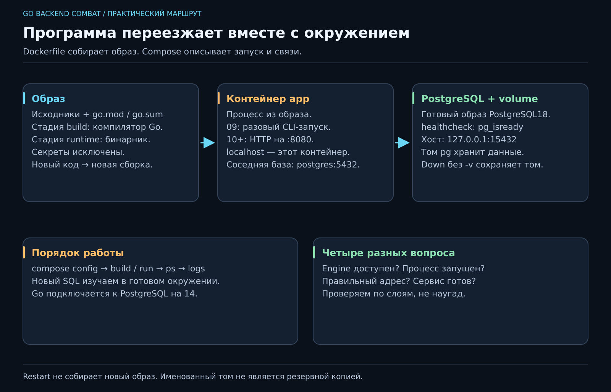

# 09. На моей машине работает. А на твоей?

[Карта курса](../course/README.md) · [← Предыдущий урок](08_TESTS.md) · [Следующий урок →](10_HTTP.md)

## Принесли кухню вместе с рецептом

Коллега запускает наш проект и спрашивает: «А какой Go? А PostgreSQL где? А почему у меня порт занят?» До сих пор программа жила в привычной комнате. Теперь научим её переезжать с понятными условиями.

**Docker** запускает процессы в изолированных контейнерах. **Образ** — упакованный набор файлов и настроек для запуска; **контейнер** — конкретный экземпляр работающего процесса. Это не отдельная виртуальная машина с собственным ядром для каждого приложения. На Windows и macOS Linux-контейнерам помогает виртуальная машина Docker Desktop; на Linux они используют ядро хоста.

Построим окружение заранее: сейчас контейнер запускает знакомую консольную программу; рядом поселится PostgreSQL. На SQL-неделе мы уже будем учить запросы, а не искать пароль от неизвестной локальной базы.



**50 минут:** проблема окружения — 5; образ и сборка — 12; Compose и PostgreSQL — 13; сеть и том — 12; диагностика — 8. Резерв — 10. Установка Docker и загрузка образов — подготовка до встречи, с помощью ментора при необходимости.

## Сначала рабочий инструмент

[Памятка окружения](../docs/ENVIRONMENT.md) даёт официальную установку для твоей ОС. После установки должны работать:

```sh
docker version
docker compose version
```

В `docker version` нужны сведения о клиенте **и сервере**. Наличие команды ещё не означает, что Docker Engine запущен. Ошибка доступа к сокету на Ubuntu — отдельная настройка прав, а не повод писать `sudo` перед каждой командой проекта.

Go остаётся установленным на машине для редактора и быстрых запусков. Сборка в контейнере даёт второй, воспроизводимый путь. Полный пример окружения лежит в `reference/09`; копируем осмысленно отдельные файлы окружения в свой проект, не заменяем свой код эталоном.

## Dockerfile читается сверху вниз

```dockerfile
FROM golang:1.27.2-alpine AS build
WORKDIR /src
COPY go.* ./
RUN go mod download
COPY . .
RUN CGO_ENABLED=0 go build -trimpath -o /out/jobflow ./cmd/jobflow

FROM alpine:3.22.2
RUN adduser -D -u 10001 jobflow
WORKDIR /app
COPY --from=build /out/jobflow /app/jobflow
USER jobflow
ENTRYPOINT ["/app/jobflow"]
```

Это многоступенчатая сборка: в первой части есть компилятор, во вторую копируем бинарник. `go.*` забирает `go.mod` и `go.sum`, когда он есть. Зависимости скачиваются до исходников: изменение названия задачи не должно заново скачивать весь интернет. Docker повторно использует неизменившиеся слои — **кэш сборки**.

`CGO_ENABLED=0` подходит нашему чистому Go-коду и pgx; для библиотеки с обязательным C-кодом решение придётся пересмотреть. `USER` запускает приложение без root внутри контейнера. Exec-форма `ENTRYPOINT` отдаёт сигналы самому процессу — пригодится при корректной остановке.

В `.dockerignore` исключаем `.git`, локальный `.env`, бинарники и отчёты. Не запекаем секреты в образ. Копирование всего проекта удобно только тогда, когда понятны исключения.

## Compose — записанный план запуска

`compose.yaml` описывает сервисы, настройки, сеть и тома. На этой неделе:

- `app` собирает нашу консольную программу; запускаем её разово;
- `postgres` берёт готовый образ базы и хранит данные в именованном томе `pg`.

Из корня **своего** проекта с этими файлами:

```sh
docker compose config
docker compose run --rm --build app
docker compose up -d --wait postgres
docker compose ps
docker compose exec postgres psql -U jobflow -d jobflow -c "SELECT version();"
```

`config` показывает итог настроек; не публикуй вывод, если там реальные секреты. `run --rm` запускает одноразовый контейнер и удаляет его после выхода. Успешная консольная программа завершилась с кодом 0 — это нормально; не каждому приложению полагается вечно гореть зелёным.

`up -d` запускает в фоне, `--wait` ждёт готовности по healthcheck. Наш healthcheck вызывает `pg_isready`. Это проверка доступности PostgreSQL, а не наличие таблиц JobFlow. Они появятся через Goose на уроке 14.

## Два адреса одной базы

| Кто подключается | Хост и порт |
|---|---|
| Go-программа на твоей машине | `127.0.0.1:15432` |
| Приложение в сети Compose | `postgres:5432` |
| psql через `compose exec postgres` | Уже внутри контейнера базы |

`localhost` внутри app означает **сам контейнер app**. Соседа ищем по имени сервиса `postgres`. Публикация `127.0.0.1:15432:5432` открывает порт базы только на локальном интерфейсе хоста; внутренним соседям опубликованный порт не нужен.

Когда на уроке 10 появится HTTP, процесс внутри контейнера будет слушать `:8080`, а наружу откроем `127.0.0.1:8080:8080`. Прослушивание только `127.0.0.1` **внутри** контейнера недоступно через такую публикацию. Граница сети часто объясняет «сервер жив, но я его не вижу» лучше, чем десятый rebuild.

## Где живут данные после остановки

Образ не хранит новые записи базы. Контейнер имеет свой изменяемый слой, а PostgreSQL пишет в подключённый **volume**, отдельное постоянное хранилище Docker. Для выбранного PostgreSQL 18 монтируем `/var/lib/postgresql`; путь зависит от версии образа, не переносим вслепую настройки из старого гайда.

`docker compose stop` останавливает процессы. `docker compose down` удаляет контейнеры и сеть проекта, но сохраняет именованный том. `down -v` удаляет и этот том: это намеренный сброс, не обычная уборка. В штатном маршруте курса `-v` не нужен. Том — не резервная копия: сломать данные запросом можно и в нём.

Снимки эталонов используют одно имя Compose-проекта `jobflow-local`. Это позволяет сохранить учебную базу между неделями. Не запускай одновременно разные снимки с одним именем; для параллельной лаборатории используй отдельное `-p` и свободные внешние порты.

## Диагностика по слоям

Не работает? Сначала `docker compose ps -a`: запустился ли процесс? Затем `docker compose logs --tail=50 postgres`: почему остановился? Далее проверяем настройки и адрес. `port is already allocated` — занятый порт хоста, а не ошибка SQL. Поменяй `POSTGRES_PORT` в локальном `.env`, сверяясь с `.env.example`, и обнови адрес клиента.

Новая версия исходников попадает в образ через **сборку**: `run --build` или позже `up --build`. `restart` лишь перезапускает прежний контейнер. «Я поправил код, а он старый» — иногда не философский вопрос о наследии, а пропущенный build.

Архитектуру к этому моменту уже собираем по [Project Flow](../docs/PROJECT_FLOW.md): публичный договор в `pkg`, реализация в `internal`, сборка зависимостей в `cmd/jobflow`. Контейнер упаковывает эту программу и не меняет направление зависимостей. Эталоны 06–09 уже хранят модель и общие ошибки в pkg. Полный договор сервиса с объектными ответами показывает рабочий [пример с pkg](../examples/hexagonal/README.md).

Сегодняшний инвариант: другой участник получает тот же способ сборки и отдельную базу с сохраняемыми данными. К SQL подойдём с уже открытой кухней, электричеством и холодильником.
---

[ДЗ и подсказки](../combat/09_ENVIRONMENT.md) · [Ментору](../mentor/09_ENVIRONMENT.md) · [Эталон](../reference/09/README.md) · [Вопросы недели](../interview/route.md#week-09) · [Словарь](../docs/GLOSSARY.md)
