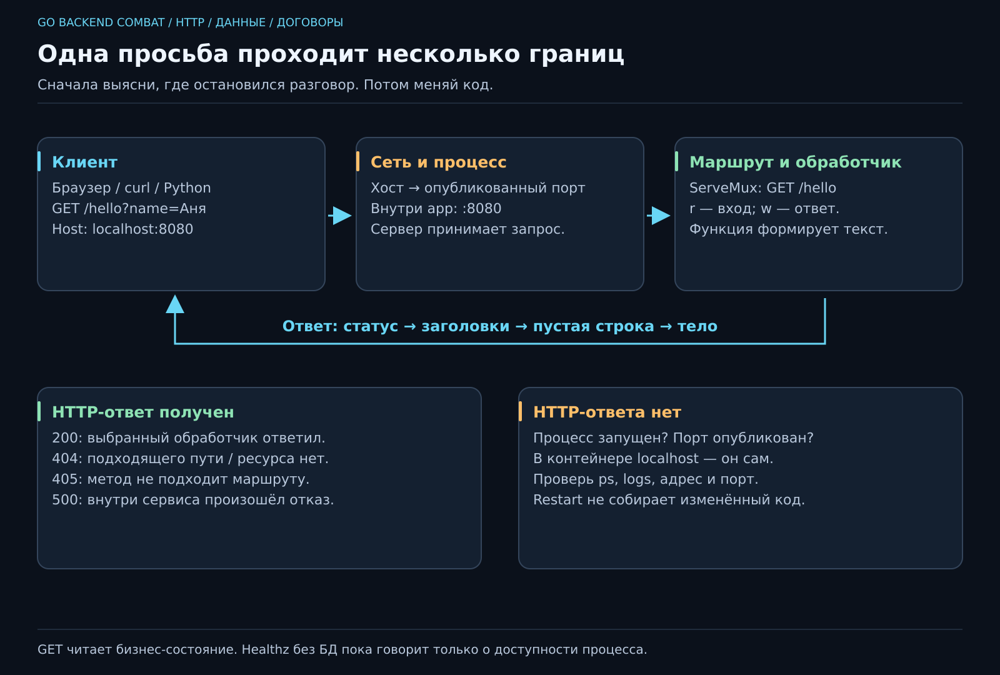

# 10. Как одна программа обращается к другой?

[Карта курса](../course/README.md) · [← Предыдущий урок](09_ENVIRONMENT.md) · [Следующий урок →](11_API.md)

## У программы появился собеседник

Вчера JobFlow умел работать со списком дел в терминале. Но подруге, которая хочет добавить задачу, не хочется получать твой исходный код, устанавливать Go и изучать внутреннее устройство map. Ей нужен понятный вход.

Сделаем программу, которая ждёт обращений и отвечает. Обращающийся участник — **клиент**, отвечающий — **сервер**. Это роли, а не сорта компьютеров: наш сервер позже сам может стать клиентом другой программы. Браузер, curl и небольшой Python-скрипт сегодня будут тремя клиентами одного JobFlow.

Два человека могут договориться по-русски. Две программы тоже нуждаются в правилах разговора — **протоколе**. Возьмём HTTP. Сначала научимся видеть одну просьбу и один ответ, без шести операций и JSON в первой же строке.



**50 минут:** роли и требование — 6; устройство запроса/ответа — 10; обработчик и сервер — 14; запуск в Compose — 10; диагностика — 10. Резерв — 10 минут.

## До кода напишем маленький договор

**Просьба:** по адресу `/hello` показать приветствие. **Требования:** GET возвращает статус 200 и текст; неизвестный адрес даёт 404; запрос приветствия не меняет задачи. Последнее — инвариант операции чтения. Сервер должен отвечать и на второй запрос, а не завершаться после первого.

Адрес `http://localhost:8080/hello` разбирается на части: `http` — схема обращения, `localhost` — имя этого компьютера, `8080` — порт, `/hello` — путь внутри приложения. Порт помогает операционной системе доставить обращение нужному слушающему процессу. Путь дальше разбирает программа.

Мысленно видим такой разговор:

```http
GET /hello HTTP/1.1
Host: localhost:8080

```

И ответ:

```http
HTTP/1.1 200 OK
Content-Type: text/plain; charset=utf-8

Привет из JobFlow
```

Это учебное представление HTTP/1.1. В реальном ответе появятся дополнительные заголовки; HTTP/2 и HTTP/3 кодируют разговор иначе. Сейчас нам нужны устойчивые части: **метод, путь, заголовки и тело**. Заголовки описывают сообщение, тело несёт содержимое. Пустая строка отделяет одно от другого.

## Обработчик — обычная функция с новой ролью

В `internal/api/api.go`:

```go
package api

import (
    "fmt"
    "net/http"
)

func New() *http.ServeMux {
    mux := http.NewServeMux()
    mux.HandleFunc("GET /hello", func(w http.ResponseWriter, r *http.Request) {
        w.Header().Set("Content-Type", "text/plain; charset=utf-8")
        fmt.Fprintln(w, "Привет из JobFlow")
    })
    return mux
}
```

`ServeMux` выбирает **обработчик** по маршруту — правилу вида «метод + путь». `r` содержит входящий запрос. `w` позволяет записать ответ. `Fprintln` похож на Println, но пишет в указанное место: здесь клиенту, а не в терминал сервера.

Почему не написали явно 200? Первая запись тела без предварительного WriteHeader подразумевает 200. Поэтому порядок важен: сначала нужные заголовки и статус, затем тело. После начала ответа нельзя передумать и прислать другой окончательный статус. Это поведение описано у [ResponseWriter](https://pkg.go.dev/net/http#ResponseWriter).

Статическое приветствие пока не вызывает TaskService, поэтому конструктор не принимает фиктивную зависимость. На 11, когда появятся операции с задачами, будет `api.New(service pkg.TaskService)`.

## Кто запускает ожидание запросов

Обработчик сам порт не открывает. `cmd/jobflow/main.go` собирает приложение и запускает HTTP-сервер. Возьми точку входа из эталона 10, не переписывай рабочий go.mod. В ней увидишь:

```go
server := &http.Server{
    Addr:              httpAddress(),
    Handler:           api.New(),
    ReadHeaderTimeout: 5 * time.Second,
}
return server.ListenAndServe()
```

Это фрагмент функции run; нужны net/http и time. `httpAddress` читает HTTP_ADDR, а без настройки возвращает `127.0.0.1:8080`. Ошибка запуска возвращается в main, который завершает процесс неуспешно. `ReadHeaderTimeout` ограничивает чтение заголовков клиента; это не универсальный таймер выполнения любого обработчика.

При `go run ./cmd/jobflow` терминал остаётся занят: программа ждёт запросы. Это другой жизненный цикл, чем у нашего разового CLI. Остановка сейчас — Ctrl+C; аккуратное завершение активных запросов разберём позднее.

## Запускаем в знакомом окружении

Файлы сборки уже появились на 09. В Compose для app добавь HTTP_ADDR `:8080` и публикацию `127.0.0.1:8080:8080`, как в эталоне 10. Затем:

```sh
docker compose up -d --build app
docker compose ps
docker compose logs --tail=30 app
curl -i http://localhost:8080/hello
```

В Windows используй `curl.exe`, если curl оказался псевдонимом PowerShell. Браузер тоже подойдёт, но `-i` покажет заголовки и статус. В [памятке HTTP](../docs/HTTP.md) есть вариант через Python.

Приложение внутри контейнера слушает `:8080`, то есть все свои интерфейсы. Наружная публикация ограничена localhost хоста. Если внутри слушать только 127.0.0.1, запрос через опубликованный порт туда не попадёт. Строка «всё работает» в журнале не отменяет границу сети.

## Маленькое изменение: приветствие по имени

После `/hello` можно добавить `?name=Аня`. Часть после вопросительного знака — **query string**, параметры запроса. В обработчике `r.URL.Query().Get("name")` получит имя; `strings.TrimSpace` уберёт крайние пробелы. Нет имени — обычное приветствие, есть — приветствие по имени. Параметр меняет ответ, но не сохраняет карточку и не становится ID задачи.

Для кириллицы и пробелов удобнее дать клиенту собрать корректный адрес: `curl --get --data-urlencode "name=Аня" http://localhost:8080/hello`. В Windows — curl.exe. Новый случай не требует нового слушающего порта: это всё тот же маршрут с дополнительными данными.

## Не все неудачи происходят на одном этаже

| Что видим | Что это означает | Следующий шаг |
|---|---|---|
| Не удалось соединиться | HTTP-ответ не получен | Процесс, порт, публикация, адрес |
| 404 | Сервер ответил, подходящего ресурса/маршрута нет | Проверить путь |
| 405 | Путь известен, метод не поддержан | Проверить GET/POST |
| 500 | Сервер ответил о внутреннем отказе | Найти причину в журнале |

Попробуй неизвестный путь и `curl -i -X POST http://localhost:8080/hello`. Зафиксируй различие 404/405, а затем останови app и сравни с ошибкой соединения. GET-маршрут ServeMux также принимает HEAD: ответ имеет соответствующие заголовки, а тело по сети не отправляется. Подробности маршрутизации — в [ServeMux](https://pkg.go.dev/net/http#ServeMux).

## Где заканчивается сегодняшняя задача

Пока отвечаем постоянным текстом. GET не должен создавать задачу «заодно»: клиент может повторить чтение, и это не должно размножить записи. При этом лог о запросе вполне допустим — речь о бизнес-состоянии, а не запрете любой записи на диск.

Сервер может обслуживать несколько запросов одновременно. Как только подключим map, потребуется синхронизация. На 11 выдадим готовое хранилище с замком; на 17 разберём, какую гонку он предотвращает. Новые инструменты вводим с причиной, а не подбрасываем ученику ещё одну неизвестную систему посреди первого запроса.
---

[ДЗ](../combat/10_HTTP.md) · [Ментору](../mentor/10_HTTP.md) · [Эталон](../reference/10/README.md) · [Вопросы недели](../interview/route.md#week-10) · [Словарь](../docs/GLOSSARY.md)
