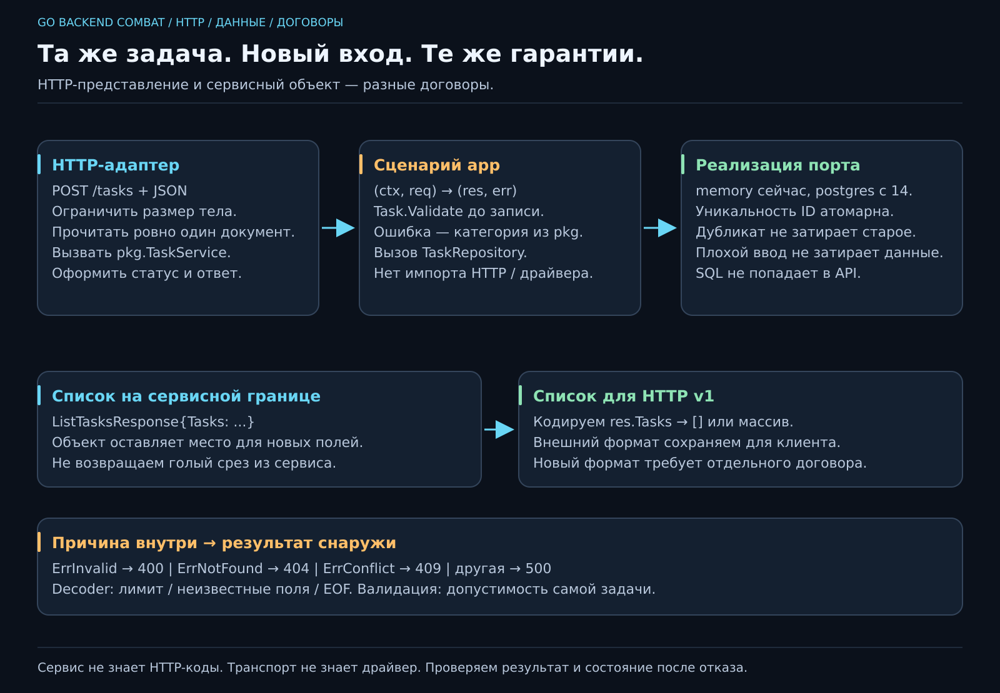

# 11. Как дать человеку пользоваться нашим сервисом?

[Карта курса](../course/README.md) · [← Предыдущий урок](10_HTTP.md) · [Следующий урок →](12_SQL.md)

## Теперь клиент хочет не приветствие, а своё дело

«Добавь задачу “Повторить Go”». Человеку просьба понятна. Программе нужны детали: куда отправить, как назвать поля, что считать успехом и что ответить при повторном ID. Этот договор взаимодействия — **API**.

Сначала пройдём одну операцию целиком. Остальные соберём из тех же частей. Каркас pkg, app и защищённого memory уже открыт в эталоне: сегодня не нужно одновременно изобретать интерфейсы, замки и обработку JSON. На 15 вернёмся к устройству каркаса и заменим исполнителя, сохранив договор.



**50 минут:** договор и примеры — 7; JSON/DTO — 9; путь Create — 15; отказ и HTTP-коды — 10; чтение/изменение и итог — 9. Резерв — 10 минут.

## Запрос на бумаге, затем в терминале

**JSON** — текстовый формат данных. Объект записывается в фигурных скобках, имена полей — в кавычках:

```json
{"id":"a","title":"Повторить Go","priority":2}
```

Это текст, а не готовая Go-структура. **Декодирование** превращает его в значение программы; кодирование делает обратное. Подпись ``Title string `json:"title"` `` связывает поле Go с именем в JSON. Не передали bool Done — получим false; PUT у нас обновляет всю изменяемую карточку, поэтому пропущенный Done тоже станет false.

Сохрани тело в request.json и отправь его по [памятке HTTP](../docs/HTTP.md). Ожидаем 201 и созданную задачу. Повтор того же ID вернёт 409, а прежняя задача останется прежней. Это инвариант из урока 05, который теперь проходит через сеть.

## У одной просьбы три разных представления

1. **HTTP:** метод, путь, заголовки, JSON-тело.
2. **Сервис:** `pkg.CreateTaskRequest` → `pkg.CreateTaskResponse` или error.
3. **Хранилище:** порт `pkg.TaskRepository`, реализованный памятью или PostgreSQL.

DTO — **объект передачи данных**: именованный набор полей запроса или ответа. Это не обязательно новая копия всей модели в каждом файле. Общая Task уже есть в pkg; DTO обозначает намерение конкретной операции.

Фрагмент POST-обработчика внутри `api.New(service pkg.TaskService)`:

```go
var value pkg.Task
if err := Decode(w, r, &value); err != nil {
    WriteError(w, err)
    return
}
res, err := service.Create(r.Context(), pkg.CreateTaskRequest{
    ID: value.ID, Title: value.Title,
    Priority: value.Priority, Done: value.Done,
})
if err != nil {
    WriteError(w, err)
    return
}
WriteJSON(w, http.StatusCreated, res.Task)
```

Сначала разобрали транспорт, затем вызвали сценарий и оформили ответ. HTTP-адаптер не открывает пул и не пишет SQL. `r.Context()` передаёт срок жизни запроса вниз: подробно разберём отмену на 19, сейчас не обрываем эту цепочку случайным Background.

Проверку бизнес-полей делает сервис через Task.Validate; ограничение размера/формата JSON относится к HTTP. PostgreSQL позже добавит ограничения ещё одной границы. Разные защиты отвечают на разные вопросы.

## Почему одного Decode мало

Каркас Decode ограничивает тело 64 КиБ через MaxBytesReader, запрещает неизвестные поля через DisallowUnknownFields и после первого значения пытается прочитать следующее. Успешный конец — `io.EOF`.

Иначе текст `{"id":"a",...} {}` мог бы притвориться одним запросом, а лишний документ остался бы незамеченным. Пробелы после объекта допустимы; второй объект — нет. Эти возможности и поведение повторных ключей описаны у [encoding/json](https://pkg.go.dev/encoding/json#Decoder).

У JSON есть нюанс: повторное поле вроде `"priority":1,"priority":3` стандартный декодер обычно обрабатывает последующим значением. DisallowUnknownFields **не запрещает дубликаты**. Наш core не обещает их специального отклонения. Если такой запрет нужен продукту, его надо явно реализовать и проверить.

Заголовок Content-Type сообщает клиентский формат; в примерах отправляем application/json. Текущий Decode сам не проверяет этот заголовок. И все его ошибки, включая превышение лимита, переводятся в 400. Более подробные 415/413 возможны как отдельное изменение HTTP-договора, не выдаём их за уже реализованное поведение.

## Одна ошибка — разные языки на разных границах

| Причина сервиса | HTTP | Смысл для клиента |
|---|---|---|
| ErrInvalid | 400 | Исправь входные данные |
| ErrNotFound | 404 | Запрошенной задачи нет |
| ErrConflict | 409 | ID уже занят |
| Другая ошибка | 500 | Внутренний отказ, подробности в журнале |

Сервис не знает о статусе 404: он возвращает причину, подходящую и консоли, и будущему gRPC. WriteError узнаёт категорию через errors.Is. Пароли и SQL-ошибки не отправляем клиенту в теле 500.

WriteJSON сначала выставляет заголовок, затем статус, затем кодирует тело. После ошибки записи уже начатого ответа нельзя отправить второй полноценный JSON с новым статусом. Запишем проблему в журнал, а не будем пытаться перемотать сеть назад.

## Список сервиса — объект, HTTP v1 — массив

Сервис возвращает `pkg.ListTasksResponse{Tasks: ...}`. Это объект: позже в нём смогут появиться дополнительные поля. HTTP-адаптер существующего API отдаёт `res.Tasks`, поэтому клиент по-прежнему видит `[]` или массив задач. Сервисный DTO и внешнее представление — две отдельные границы.

Добавить поле к сервисному объекту обычно проще, чем менять сигнатуру с голого среза. Но это ещё не готовая поддержка gRPC: понадобятся .proto, правила присутствия полей и адаптер. И нельзя незаметно превратить внешний массив в `{"tasks":...}` — существующие клиенты ожидают прежний формат.

## Остальные операции по тому же маршруту

| Намерение | Маршрут | Успех | Типичный отказ |
|---|---|---|---|
| Создать | POST /tasks | 201, Task | 400/409 |
| Список | GET /tasks | 200, массив | 500 |
| Получить | GET /tasks/{id} | 200, Task | 404 |
| Изменить | PUT /tasks/{id} | 200, Task | 400/404 |
| Удалить | DELETE /tasks/{id} | 204, без тела | 404 |
| Завершить | POST /tasks/{id}/complete | 200, Task | 404 |

У PUT ID из пути задаёт адрес карточки. Пустой ID тела заполняем им, другой непустой ID отклоняем **до изменения**. Изменение неизвестной задачи не превращаем в создание. Повтор Complete сохраняет Done=true, повтор DELETE после успеха даёт 404: идемпотентность состояния не требует одинакового HTTP-ответа.

Полный договор — в [описании проекта](../docs/PROJECT.md). Сначала сверяй с ним ожидание, затем смотри фактический ответ. Работающий curl — только начало: полезно ещё понять, какую старую гарантию он сейчас проверяет.
---

[ДЗ](../combat/11_API.md) · [Ментору](../mentor/11_API.md) · [Эталон](../reference/11/README.md) · [Вопросы недели](../interview/route.md#week-11) · [Словарь](../docs/GLOSSARY.md)
