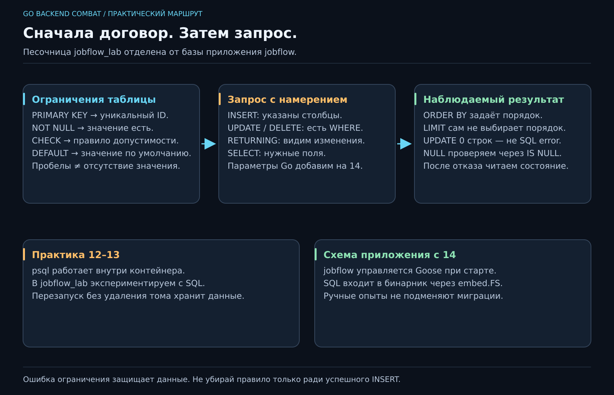

# 12. Закрыли программу. Куда делись данные?

[Карта курса](../course/README.md) · [← Предыдущий урок](11_API.md) · [Следующий урок →](13_RELATIONS.md)

## Map честно закончила свою работу

Создай задачу, перезапусти приложение — её нет. Map жила в памяти процесса. Она не обещала пережить завершение программы. Теперь появилось новое требование: **сохранять задачи после перезапуска**.

Постоянное хранение поручим PostgreSQL. Он уже запущен через Compose из урока 09. Сегодня говорим с ним напрямую на SQL; подключение Go добавим на 14. Учить новый язык и одновременно чинить драйвер было бы слишком много неизвестных за один вечер.



**50 минут:** новое требование — 5; таблица и ограничения — 12; запросы — 15; NULL и порядок — 10; сохранность и итог — 8. Резерв — 10.

## Выбираем правильную песочницу

По [памятке](../docs/POSTGRES.md) создай `jobflow_lab` и подключись к ней через `docker compose exec postgres psql -U jobflow -d jobflow_lab`. `\conninfo` показывает, где ты оказался. Рабочая база приложения `jobflow` остаётся для встроенных миграций на неделе 14.

**SQL** — язык описания данных и запросов к ним. Таблица похожа на аккуратный список карточек: столбцы описывают поля, строка — одну задачу. Наша модель подсказывает начальную схему:

```sql
CREATE TABLE tasks (
    id text PRIMARY KEY CHECK (btrim(id) <> ''),
    title text NOT NULL CHECK (btrim(title) <> ''),
    priority integer NOT NULL CHECK (priority BETWEEN 1 AND 3),
    done boolean NOT NULL DEFAULT false
);
```

`PRIMARY KEY` задаёт уникальный, не NULL ключ. `NOT NULL` запрещает отсутствие значения, но не строку из пробелов: её проверяет `CHECK`. `DEFAULT false` заполняет значение, когда поле не передали. Он не запрещает явно переданный NULL; это делает NOT NULL.

Это защита ещё одной границы. Валидация Go помогает быстро объяснить ошибку, а ограничение БД защищает данные и при записи из другого клиента. Условия должны совпадать по смыслу. Наличие проверки в Go не отменяет ограничение таблицы.

## Добавить, прочитать, изменить, удалить

```sql
INSERT INTO tasks (id, title, priority)
VALUES ('a', 'Повторить Go', 2);

SELECT id, title, priority, done FROM tasks WHERE id = 'a';

UPDATE tasks SET done = true WHERE id = 'a'
RETURNING id, title, done;

DELETE FROM tasks WHERE id = 'a' RETURNING id;
```

Пиши список столбцов при INSERT: порядок полей таблицы может измениться. `WHERE` ограничивает строки; без него UPDATE меняет все записи. Перед выполнением произнеси условие вслух. `RETURNING` возвращает затронутые данные и помогает понять результат без дополнительного SELECT.

UPDATE неизвестного ID обычно затронет **ноль строк**, а не выдаст ошибку PostgreSQL. Значит, будущий репозиторий должен проверить количество строк и перевести ноль в наш ErrNotFound. Уникальность ID, наоборот, даёт явную ошибку ограничения.

## Найти нужное и договориться о порядке

Добавь несколько задач с разным приоритетом. Сначала запиши ожидаемый список ID, затем выполни:

```sql
SELECT id, title, priority
FROM tasks
WHERE done = false AND priority >= 2
ORDER BY priority DESC, id
LIMIT 10;
```

`DESC` — по убыванию. Второе поле сортировки делает порядок однозначным при равных приоритетах. Без ORDER BY SQL не обещает порядок — как map не обещала его на неделе 05. LIMIT ограничивает число строк результата, но сам по себе не определяет, **какие** строки окажутся первыми.

## NULL не равен пустой строке

NULL означает отсутствие известного значения, а не `""` или 0. Проверка пишется `IS NULL`, не `= NULL`: обычное сравнение с NULL даёт неизвестный результат, а WHERE оставляет только true. Для обязательных полей нашей модели отсутствие запрещено; для будущей необязательной даты завершения NULL может иметь смысл.

Отдельно проверь отказ на повторном ID, названии из пробелов и приоритетах 0/4. После отказа прочитай таблицу: старые записи должны сохраниться. Ошибочный INSERT — не повод сразу менять ограничение, чтобы «позеленело».

## Сохранность — наблюдаемый результат

Закрой psql, открой снова, прочитай задачу. Затем `docker compose restart postgres`, дождись готовности через `docker compose up -d --wait postgres` и повтори SELECT. Том остался — данные на месте. Это небольшой эксперимент на требование «пережить перезапуск», а не доказательство сохранности при любой аварии диска.

Запросы и ожидаемые результаты сохрани в `sql/practice.sql`. Не превращай все ручные опыты в миграцию приложения. **Миграция** — упорядоченное изменение схемы, которое входит в версию проекта. На 14 SQL с пометками Goose встроится в бинарник и выполнится при старте. Пока отделяем учебные запросы к jobflow_lab от истории схемы jobflow.

★ Если хочется глубже: сравни запрет пустого названия с правилом «уникальное название». Два дела «Позвонить» вполне могут быть разными. Не вводи ограничение только потому, что база умеет его выразить.
---

[ДЗ и подсказки](../combat/12_SQL.md) · [Ментору](../mentor/12_SQL.md) · [Эталон](../reference/12/README.md) · [Вопросы недели](../interview/route.md#week-12) · [Словарь](../docs/GLOSSARY.md)
