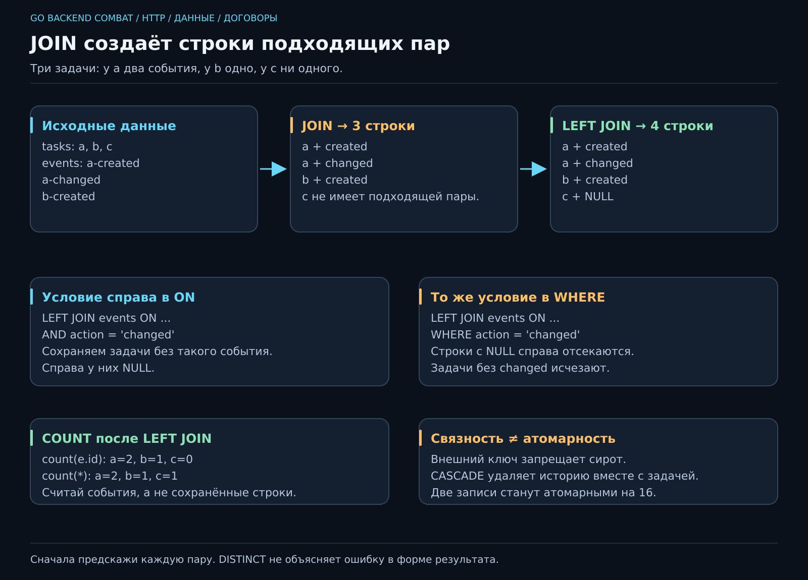

# 13. Как связать данные и не запутаться?

[Карта курса](../course/README.md) · [← Предыдущий урок](12_SQL.md) · [Следующий урок →](14_POSTGRES.md)

## Карточка говорит «что сейчас», история — «как получилось»

Вчера задача называлась «Купить чай», сегодня — «Купить улун». Одного текущего названия достаточно для списка. Для вопроса «когда её меняли?» уже нужна история. Поля previous_title_1, previous_title_2 быстро превратят таблицу в шкаф, к которому каждую неделю прикручивают новую полку.

У одной задачи может быть несколько событий. Выделим для них вторую таблицу. Это **связь один ко многим**: одна карточка, много записей истории. Обратное тоже важно: одно событие у нас принадлежит ровно одной задаче.



**50 минут:** вопрос к данным — 6; внешний ключ и удаление — 11; JOIN по строкам — 13; LEFT JOIN/NULL/COUNT — 13; договор и итог — 7. Резерв — 10 минут.

## Сначала маленький набор, который видно целиком

Работаем через psql в **jobflow_lab** из 12; приложение jobflow оставляем для Goose 14. Подготовь три задачи: `join-a`, `join-b`, `join-c`. У первой два события, у второй одно, у третьей ни одного. Если повторяешь лабораторию, сначала посмотри существующие записи; дубликат ID не повод удалять всю базу.

```sql
CREATE TABLE task_events (
    id bigint GENERATED ALWAYS AS IDENTITY PRIMARY KEY,
    task_id text NOT NULL REFERENCES tasks(id) ON DELETE CASCADE,
    action text NOT NULL,
    created_at timestamptz NOT NULL DEFAULT now()
);
```

Если таблица уже есть после твоих опытов, сравни её схему через `\d task_events`, а не запускай CREATE вслепую. **Первичный ключ** id обозначает событие. **Внешний ключ** task_id связывает его с tasks.id. NOT NULL запрещает событие без ссылки, REFERENCES — ссылку на несуществующую задачу.

Проверка «SELECT, есть ли задача» в Go не заменяет внешний ключ: между проверкой и записью другая операция могла удалить задачу. Ограничение БД защищает связь в момент записи. Оно не выбирает за нас бизнес-смысл события: строку action всё ещё надо согласовать с продуктом.

IDENTITY выдаёт номера, но не обещает отсутствие пропусков. Не используй последовательность ID как доказательство, что событий ровно столько, сколько последний номер. `timestamptz` хранит момент времени; отображение зависит от часового пояса сеанса.

## JOIN не «склеивает две карточки в одну»

Для каждой пары строк проверяется условие ON. Подходящие пары становятся строками результата:

```sql
SELECT t.id, t.title, e.action
FROM tasks AS t
JOIN task_events AS e ON e.task_id = t.id
WHERE t.id IN ('join-a', 'join-b', 'join-c')
ORDER BY t.id, e.id;
```

Буквы t/e — короткие имена таблиц в этом запросе. Перед выполнением выпиши пары: a-событие 1, a-событие 2, b-событие 1. Получится **три строки**, хотя задач тоже три по случайному совпадению. Задача c здесь отсутствует. Если первой добавить ещё событие, результат станет длиннее, а задач больше не станет.

Это **кардинальность результата** — сколько строк получается при выбранных связях и условиях. Ошибка в этом рассуждении потом выглядит как «API дублирует задачи», хотя SQL честно вернул одну строку на событие.

Не начинай с DISTINCT, чтобы спрятать неожиданное размножение. Сначала выясни, какие пары ты действительно запросил. Иногда нужны события, иногда — список задач, иногда — число событий на задачу. Это разные результаты.

## LEFT JOIN оставляет место для отсутствия

Поменяем JOIN на LEFT JOIN. Все три задачи останутся, но для задачи c поля события будут NULL. Строк станет **четыре**: две для a, одна для b и одна пустая справа для c.

Теперь тонкость, на которой спотыкаются и после первого трудоустройства:

```sql
-- Только события changed, но сохраняем задачи без таких событий.
SELECT t.id, e.action
FROM tasks t
LEFT JOIN task_events e
  ON e.task_id = t.id AND e.action = 'changed'
WHERE t.id IN ('join-a', 'join-b', 'join-c')
ORDER BY t.id, e.id;
```

Условие в ON определяет подходящие события. Если перенести `e.action = 'changed'` в WHERE, строки с NULL справа отсеются, и задачи без такого события исчезнут. Внешнее соединение сначала добавляет пустую правую часть, а фильтр затем может её убрать. Официальные примеры этого различия — в [PostgreSQL: table expressions](https://www.postgresql.org/docs/18/queries-table-expressions.html).

## Ноль событий — не одна запись

```sql
SELECT t.id, count(e.id) AS event_count
FROM tasks t
LEFT JOIN task_events e ON e.task_id = t.id
WHERE t.id IN ('join-a', 'join-b', 'join-c')
GROUP BY t.id
ORDER BY t.id;
```

GROUP BY собирает строки по задаче; count(e.id) считает непустые ID событий. Для c получится 0. `count(*)` посчитал бы и сохранённую LEFT JOIN строку с пустой правой частью — получилось бы 1. Считаем то, что на самом деле спрашивали.

Это уже полезный маленький отчёт для JobFlow: карточка и число изменений. Но не называй такой список полной моделью задачи с вложенной историей: группировка и сбор вложенных объектов — разные действия.

## Удаление: технический механизм с человеческим последствием

ON DELETE CASCADE удалит события вместе с задачей. Удобно для учебного списка дел; опасно, если история нужна для аудита или разбирательства. Возможны запрет удаления связанной задачи, мягкое удаление или отдельное хранение журнала — выбор зависит от требования.

Попробуй неизвестный task_id: база откажет. Затем удали одну тестовую задачу через WHERE и посмотри судьбу её событий. **Инвариант:** в выбранной схеме не остаётся событий со ссылкой на отсутствующую задачу. Это не инвариант «история хранится вечно»: CASCADE обещает другое.

Создание задачи и первого события ещё не стало одной атомарной операцией только из-за внешнего ключа. Если первая запись прошла, а вторая нет, задача может остаться без истории. На 16 нужна будет транзакция. Мы уже можем назвать проблему до знакомства с инструментом решения.

## Что переходит в проект

Создание таблицы сохраняем в migrations/002_events.sql, упражнения — в sql/relations.sql. На 14 миграции получат секции Goose Up/Down и войдут в бинарник. Новое изменение схемы — новый файл; ручной опыт в песочнице не подменяет историю приложения.

Сегодняшняя глубина — объяснить каждую строку результата, выбрать смысл удаления и увидеть разницу между связностью данных и атомарностью сценария. Три понятных запроса полезнее запроса на экран, который автор боится трогать.
---

[ДЗ](../combat/13_RELATIONS.md) · [Ментору](../mentor/13_RELATIONS.md) · [Эталон](../reference/13/README.md) · [Вопросы недели](../interview/route.md#week-13) · [Словарь](../docs/GLOSSARY.md)
