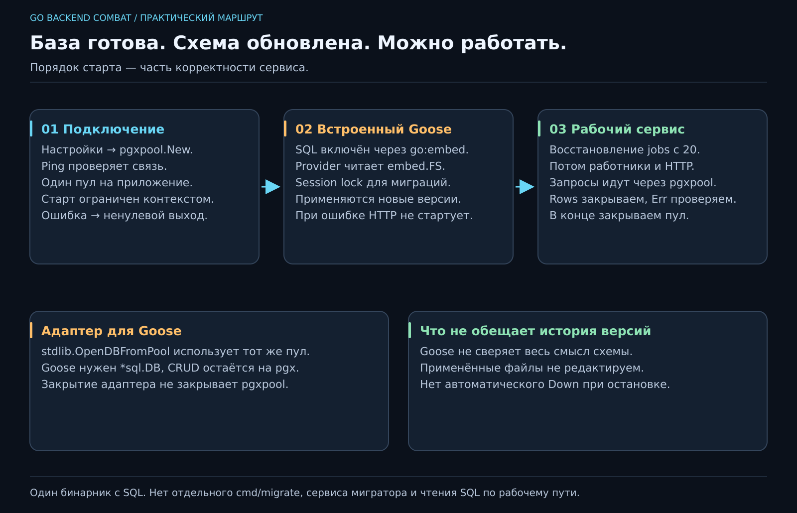

# 14. Как Go разговаривает с базой?

[Карта курса](../course/README.md) · [← Предыдущий урок](13_RELATIONS.md) · [Следующий урок →](15_INTERFACES.md)

## У нас уже есть обе стороны разговора

Go умеет принимать задачу, PostgreSQL — сохранять её. Между ними нужен клиент, который отправляет запросы и читает ответы. Используем **pgx v5**, а для управления соединениями — `pgxpool`.

Не будем открывать новое соединение на каждое нажатие кнопки. Установление соединения требует времени и ресурсов. **Пул** держит ограниченный набор соединений и выдаёт их операциям на время работы — как стойка проката, где важно вернуть инструмент после использования.



**50 минут:** путь запроса — 5; пул и контекст — 10; запросы и ошибки — 13; встроенные миграции — 15; отказ старта и итог — 7. Резерв — 10.

## Что меняется в архитектуре

HTTP не должен узнавать пароль базы и собирать SQL. Прикладной сервис получает порт хранилища, а Postgres-реализация выполняет запросы. Публичные DTO и интерфейсы лежат в `pkg`, порт — в `pkg/ports.go`; api.New принимает `pkg.TaskService`. На новой работе держим этот договор из [Project Flow](../docs/PROJECT_FLOW.md).

В эталонах 11–24 Task-сценарии уже используют этот договор: api.New принимает pkg.TaskService, app.New — pkg.TaskRepository. Запросы и ответы — объекты, порт находится в pkg/ports.go. Минимальный вариант двух операций отдельно разобран в [examples/hexagonal](../examples/hexagonal/README.md).

Для новой зависимости команда такая: `go get github.com/jackc/pgx/v5@v5.11.0` и `go get github.com/pressly/goose/v3@v3.29.0`. В эталонах эти версии уже закреплены в go.mod/go.sum. Мы фиксируем выбранные версии, а не требуем обновляться при каждом запуске.

## New ещё не означает «база отвечает»

```go
pool, err := pgxpool.New(ctx, databaseURL)
if err != nil {
    return err
}
if err := pool.Ping(ctx); err != nil {
    pool.Close()
    return err
}
```

Это фрагмент инициализации: `databaseURL` приходит из настройки, `ctx` ограничивает время. Создание пула и реальное установление соединения — разные шаги. Ping выявляет неверный адрес, пароль или недоступную базу до запуска HTTP. Пул создаём один раз и закрываем при завершении приложения; не вызываем Close после каждого запроса.

`context.Context` несёт отмену и срок операции. Подробно разберём его на 19, а сейчас правило простое: операции БД получают контекст вызывающего сценария. Для старта у приложения отдельный таймаут 60 с, а не бесконечное ожидание недоступной базы.

## Параметры и освобождение ресурсов

```go
err := pool.QueryRow(ctx,
    "SELECT id, title, priority, done FROM tasks WHERE id=$1", id,
).Scan(&task.ID, &task.Title, &task.Priority, &task.Done)
```

`$1` — параметр. Данные передаём отдельно от текста SQL: название `Роберт'); DROP TABLE...` должно остаться названием. Конкатенация пользовательского ввода в SQL превращает данные в часть команды.

Для одной строки — QueryRow и Scan; отсутствующая строка даёт `pgx.ErrNoRows`. Для нескольких — Query, `defer rows.Close()`, цикл `rows.Next()`, Scan и **rows.Err() после цикла**. Последняя проверка ловит ошибку чтения, возникшую уже в процессе обхода. Незакрытый результат может удерживать соединение, пока следующий запрос ждёт свободного места в пуле.

Для UPDATE/DELETE без RETURNING используем Exec и `RowsAffected()`. Ноль — наш ErrNotFound. Ошибку уникальности с SQLSTATE23505 переводим в ErrConflict; детали драйвера не должны становиться публичным договором HTTP. Сетевой сбой не надо маскировать под «задача не найдена».

## Схема едет внутри версии программы

В `migrations/001_tasks.sql` есть секции `-- +goose Up` и `-- +goose Down`. Рядом Go-файл:

```go
//go:embed *.sql
var files embed.FS
```

Директива включает SQL на этапе сборки. После этого запуск не зависит от рабочей директории и наличия папки SQL рядом с бинарником. Чтобы включить новую миграцию, **пересобираем образ**. Монтаж старой папки с SQL не обновит уже собранный бинарник.

В `migrations.Up` используется Goose Provider. Он принимает `*sql.DB`, поэтому вызываем `stdlib.OpenDBFromPool(pool)`. Это адаптер к **этому же пулу pgx**, а не другой способ писать запросы приложения. После Goose закрываем адаптер; основной пул остаётся работать. [Документация pgx](https://pkg.go.dev/github.com/jackc/pgx/v5/stdlib#OpenDBFromPool) явно описывает это владение.

Provider читает embed.FS, хранит применённые версии в goose_db_version и выполняет только новые. Подключён session advisory lock: два одновременно стартующих экземпляра с одним ключом не должны вместе менять схему. Таймаут старта ограничивает и ожидание этой блокировки. Полный код — `reference/14/migrations/migrations.go`; здесь не пишем свой движок поверх SQL-файлов.

## Правильный порядок запуска

1. Прочитать настройки и открыть пул.
2. Проверить связь с PostgreSQL.
3. Применить pending-миграции Goose.
4. При ошибке вернуть её из run; main завершит процесс с кодом 1.
5. Только после успеха запустить обработчики и HTTP.

Позже между миграциями и HTTP добавим восстановление фоновых задач. Пока база запускается Compose-командой `up -d --wait postgres`, приложение — `up -d --build --wait app`. Полная инструкция и DSN для хоста/контейнера — в [памятке PostgreSQL](../docs/POSTGRES.md).

**Инвариант запуска:** сервис не принимает работу, пока его изменения схемы не применены. Это не обещание, что любая старая база автоматически совместима. Goose учитывает версии, не проверяет семантику всей схемы и не сверяет содержимое уже применённых файлов. Не редактируем старые миграции, добавляем новые. В откат приложения не включаем автоматический Down с удалением данных.

Старая таблица course_migrations из предыдущей редакции требует [явного переноса](../docs/POSTGRES_UPGRADE.md); новая сборка не объявляет незнакомую историю верной. На чистой базе дополнительной процедуры нет.

## Как понять, что задача решена

Созданная через HTTP задача переживает перезапуск app. Повторный запуск не выполняет CREATE TABLE заново. Неверный пароль не приводит к слушающему HTTP без базы. При отказе миграции в логе видна причина, а процесс завершается неуспешно. Эти наблюдения проверяют разные обещания, поэтому одного «страничка открылась» мало.

★ Для глубины: если запустить 10 экземпляров с пулом по 20 соединений, возможный бюджет уже 200. Настройка пула относится к системе целиком. «Давай побольше» — не измерение производительности.
---

[ДЗ и подсказки](../combat/14_POSTGRES.md) · [Ментору](../mentor/14_POSTGRES.md) · [Эталон](../reference/14/README.md) · [Вопросы недели](../interview/route.md#week-14) · [Словарь](../docs/GLOSSARY.md)
