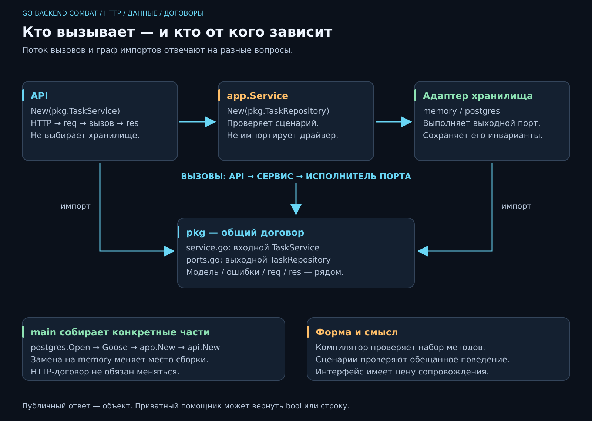

# 15. Как заменить инструмент и сохранить правила?

[Карта курса](../course/README.md) · [← Предыдущий урок](14_POSTGRES.md) · [Следующий урок →](16_TRANSACTIONS.md)

## На столе уже два исполнителя

Память быстро отвечает в маленьком примере, PostgreSQL сохраняет после перезапуска. Для пользователя намерение прежнее: добавить дело и не потерять старое при конфликте. Почему замена инструмента хранения вообще должна затрагивать HTTP?

На 11 мы получили каркас границ готовым. Сейчас разберём его так, чтобы уметь собрать и изменить самостоятельно. **Интерфейс** — набор методов, который описывает нужное потребителю поведение. **Реализация** — конкретный тип, который это поведение предоставляет. Проверим, что за формальной сигнатурой сохранился смысл.



**50 минут:** история замены — 6; метод/интерфейс — 10; два порта и DTO — 12; сборка и одинаковое поведение — 14; цена и границы — 8. Резерв — 10 минут.

## Объявление интерфейса — просьба вызывающего кода

HTTP-адаптеру нужен сервис задач; приложению нужно хранилище. Это две разные роли, поэтому в pkg два интерфейса. В service.go — TaskService, в ports.go — TaskRepository. Физически они в общем пакете по договору курса; состав методов определяет **потребитель**, а не список возможностей драйвера.

Сокращённый входной договор (полные шесть операций в эталоне):

```go
type TaskService interface {
    Create(context.Context, CreateTaskRequest) (CreateTaskResponse, error)
    List(context.Context, ListTasksRequest) (ListTasksResponse, error)
}
```

Это фрагмент пакета pkg с импортом context. В CreateTaskRequest находятся поля намерения, в CreateTaskResponse — Task. ListTasksResponse содержит Tasks, а не является голым срезом. Стандарт **(ctx, req) → (res, err)** действует для всех публичных операций сервиса и порта; приватный расчёт вправе возвращать строку или bool.

Сервис вызывает `repository.Insert(ctx, pkg.InsertTaskRequest{Task: task})`. Входное намерение Create и запись Insert разделены, поэтому конкретное хранилище не подставляется напрямую вместо TaskService. На 16 реализация Insert в PostgreSQL сохранит задачу и created-событие в транзакции; сервисному вызову не понадобится знать SQL этой операции.

## Как Go понимает, что тип подходит

Не пишем implements или extends. У типа есть нужные методы с точными сигнатурами — он подходит интерфейсу. В app стоит строка:

```go
var _ pkg.TaskService = (*Service)(nil)
```

Она проверяется компилятором и не создаёт работающий сервис. Если забыли метод или перепутали тип ответа, сборка остановится. Такой же контроль есть у адаптеров memory/postgres для TaskRepository.

Если метод объявлен с получателем `*Store`, набор методов указателя включает его, а значение Store может не подойти интерфейсу. Именно поэтому конструктор возвращает `*Store`, и проверка выше использует указатель. Наборы методов описаны в [спецификации Go](https://go.dev/ref/spec#Method_sets).

Соответствие сигнатурам не доказывает корректность поведения. Хранилище может реализовать Insert и всё равно молча перезаписать дубликат. Компилятор проверяет форму договора, сценарии и ревью — смысл.

## Сервис защищает сценарий, адаптер знает инструмент

В app.Service нет импортов postgres, memory, net/http или SQL-клиента. Create проверяет context, строит Task, вызывает Validate, затем Insert. Неверный ввод не должен доходить до записи. Адаптер также защищает свою границу; уникальность ID должна обеспечиваться атомарно там, где хранится состояние.

В HTTP-конструкторе `api.New(service pkg.TaskService)`. Он не принимает *app.Service и не выбирает драйвер. В Postgres-адаптере публичные методы порта работают с объектами; небольшие приватные create/get/list содержат SQL-механику. Срез внутри приватной list допустим: он не является публичным ответом сервиса.

В memory ту же роль выполняют map и замок. Это не имитация надёжной дисковой базы. Одинаковый договор операций не отменяет разницу в долговечности и изоляции.

## Кто знает конкретные типы

В cmd/jobflow/main.go:

```go
store, err := postgres.Open(startup, databaseURL)
if err != nil { return err }
defer store.Close()
if err := store.Migrate(startup); err != nil { return err }
service := app.New(store)
mux := api.New(service)
```

Фрагмент сборки, не отдельная программа: startup и databaseURL подготовлены выше. Подключение и встроенный Goose остаются до HTTP. Для опыта с памятью меняем создание store на memory.New; конструкторы app.New и api.New сохраняются. Это **внедрение зависимости** — нужного исполнителя передали снаружи.

Из main вызовы идут API → сервис → реализация хранилища. Импорты устроены иначе: api/app/адаптер знают общий pkg, а main выбирает конкретные реализации. Не перепутай рисунок вызовов с графом импортов. `pkg` — наша конвенция общего договора, не специальная возможность компилятора.

## Замена должна сохранить наблюдаемые обещания

На обоих исполнителях проверь создание, чтение, дубликат с прежним названием, Update неизвестного ID, завершение, удаление. Список отсортирован по ID; пустой список — пустой срез. Отказ валидации, дубликат и изменение неизвестного ID не меняют прежние записи. В PostgreSQL дополнительно остаются SQL, миграции и реальная сохранность — память их не проверяет.

Для одного вопроса «Validate остановил запись?» пригодится маленький помощник, отмечающий вызов Insert. Это **подставная реализация**, обычно fake или spy по роли. Ей не нужно изображать все особенности PostgreSQL. Если для проверки понадобилось воспроизвести половину базы, граница опыта выбрана слишком широко.

## Цена интерфейса тоже входит в решение

Дополнительные типы требуют чтения и сопровождения. Не создаём интерфейс у каждой функции только ради буквы I в архитектуре. Здесь есть две реализации и два реальных потребителя: основание для границ уже видно.

Если новый сценарий только читает, ему может хватить Get/List. Его небольшой интерфейс можно объявить в pkg отдельно. Не заставляй читателя зависеть от транзакций, миграций и остановки пула — это жизненный цикл конкретной инфраструктуры, не запрос пользователя.

★ Ещё один нюанс: интерфейс со значением `(*Service)(nil)` сам не равен nil, потому что хранит тип и nil-значение. Компиляционная проверка выше не означает, что такой объект можно передать в HTTP и вызывать. При сборке приложения передаём настоящий результат конструктора. Подробности устройства интерфейсов — в [Go FAQ](https://go.dev/doc/faq#nil_error).

На собеседовании расскажи историю решения: какой код вызывал, какой договор понадобился, чем заменили исполнителя и что сравнили после замены. Это проверяемый опыт вместо фразы «интерфейс нужен для абстракции».
---

[ДЗ](../combat/15_INTERFACES.md) · [Ментору](../mentor/15_INTERFACES.md) · [Эталон](../reference/15/README.md) · [Вопросы недели](../interview/route.md#week-15) · [Словарь](../docs/GLOSSARY.md)
