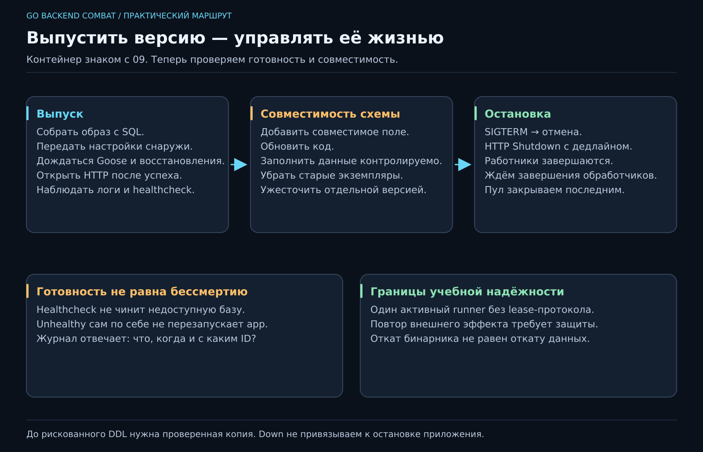

# 21. Как выпустить новую версию и спокойно её остановить?

[Карта курса](../course/README.md) · [← Предыдущий урок](20_BACKGROUND.md) · [Следующий урок →](22_QUERY_PLAN.md)

## Контейнер мы уже умеем запускать. Теперь ему доверяют данные

На 09 познакомились с Docker, на 14 приложение научилось применять встроенные миграции. Сейчас в нём есть HTTP, база и фоновые задачи. Обычный `kill` посреди работы уже может оставить незавершённый сценарий. Значит, следующий навык — управлять жизнью приложения.

**Эксплуатация** — как сервис запускается, показывает состояние, обновляется и останавливается. Это часть разработки: тот же человек, который написал бесконечный цикл, должен уметь закончить его работу.

**50 минут:** восстановить путь старта — 5; готовность и журналы — 10; выпуск со схемой — 15; остановка — 12; разбор аварии — 8. Резерв — 10.

## Один артефакт, понятные настройки

В финальном образе один бинарник. SQL уже включён через go:embed, Goose запускается внутри приложения. Отдельного сервиса мигратора, команды перед стартом и папки migrations в runtime-образе не требуется.

Сборка неизменяема: исправление локального SQL не меняет ранее собранный образ. Конфигурация — снаружи: DATABASE_URL, HTTP_ADDR, WORKER_COUNT. Проверь настройки при запуске и заверши процесс при неверном значении. Пароли не включаем в логи и тег образа.

В своём проекте: `docker compose up -d --build --wait app`. Итоговый эталон из корня курса: `docker compose -f deploy/docker-compose.yml up -d --build --wait`. Это разные пути к файлу Compose, выбираем один. `restart app` запускает старую сборку повторно; новый код требует build и пересоздания контейнера.

## «Процесс жив» и «можно работать»

PostgreSQL прошёл pg_isready — база доступна. Это ещё не означает, что схема обновлена. Наше приложение ждёт Goose, выполняет восстановление jobs, затем поднимает HTTP. `/healthz` проверяет доступность базы с коротким контекстом и отвечает 503 при отказе.

Проверка относится к готовности обслуживать работу. Она не доказывает успешность всех пользовательских операций и не должна выполнять дорогой полный обход таблиц. В Compose нездоровый контейнер не перезапускается автоматически только из-за статуса healthcheck: нужны действия оператора или отдельная политика управления. `depends_on: service_healthy` помогает при **старте**, не лечит последующее отключение базы.

Начинаем диагностику с `docker compose ps -a`, затем `logs --tail=80 app`. Читаем первую причину: ошибка настройки, подключения, SQL, блокировки? Если миграция не успела за таймаут, не увеличиваем его вслепую: выясняем, что держит блокировку и сколько реально занимает DDL.

## Миграции со стартом — удобство с условиями

В учебной системе один оператор и небольшой набор таблиц. Встроенный Goose убирает забытый ручной шаг и привязывает SQL к сборке. Но SQL всё ещё может блокировать записи, требовать широких прав и занимать минуты. Блокировка Goose защищает от параллельных миграторов с тем же ключом, а не от тяжёлой операции над миллионом строк.

Представь два экземпляра приложения: старый ещё принимает запросы, новый добавляет поле. Безопаснее так:

1. Добавить совместимое необязательное поле новой миграцией.
2. Выпустить код, который понимает старые и новые записи.
3. Заполнить данные контролируемо; измерить нагрузку и время.
4. После ухода старых экземпляров ужесточить ограничение отдельной версией.

Это постепенное расширение и последующая уборка схемы, часто называется **expand/contract**. Нельзя в одном шаге удалить столбец, которым ещё пользуется старая версия. Откат бинарника не равен откату данных: автоматически вызывать Goose Down при остановке или rollback приложения опасно.

Перед изменением с риском потери данных нужна проверенная резервная копия. Именованный Docker volume переживает пересоздание контейнера, но не ошибочный DELETE. Новый релиз не должен начинаться с удаления тома ради зелёного старта.

## Логи, по которым можно восстановить историю

Запиши начало и конец HTTP-запроса: request_id, метод, путь, статус, длительность. Для фоновой работы — job_id, попытку, переход состояния, причину отказа. Пароль и полное содержимое пользовательского тела в журнал не нужны. Структурированные поля `slog` позволяют искать историю без чтения литературного романа на 200 тысяч строк.

Не выдавай обычный request_id за полноценную распределённую трассировку. В core один сервис; внешний trace context и несколько сервисов потребуют отдельного протокола и инструментов. Сейчас достаточно устойчивых ID, понятных событий и времени.

Эталон содержит Observe и настройку сервера; сопоставь каждый лог с вопросом, на который он отвечает. «Ошибка!» без операции и причины не помогает дежурному, даже если написана заглавными буквами.

## Остановка — тоже сценарий

При SIGTERM перестаём принимать новую работу, начинаем HTTP Shutdown с ограниченным сроком, отменяем контекст фоновых обработчиков и дожидаемся их завершения. **Пул закрываем после работников**, чтобы не отнять соединение у ещё работающей горутины. Все обработчики должны уважать отмену; timeout HTTP Shutdown сам по себе не завершает произвольную зависшую горутину.

Goose выполняется до работников. Его адаптер к пулу закрывается после миграций; основной pgxpool живёт до конца run. Возврат ошибки проходит через defer, и только затем main выставляет ненулевой код выхода. `os.Exit` посреди функции с полезными defer этот порядок ломает.

У core один активный экземпляр job runner: его Recover возвращает незавершённые jobs после перезапуска. Не масштабируй таких исполнителей через `--scale app=3` без протокола владения/lease — они могут принять живую работу соседа за потерянную. Этот предел учебной реализации нужно понимать, прежде чем обещать распределённую надёжность.

Работник, который успел выполнить внешний эффект, но не записал результат, может быть запущен повторно. Нужны идемпотентность конкретного эффекта или более сложный протокол. Контейнер, WaitGroup и красивый healthcheck не создают «ровно один раз» сами по себе.

Сегодня результат — не новая кнопка, а объяснимая жизнь сервиса: какую сборку мы запустили, когда ей можно доверять запросы, почему она остановилась и где остались данные.
---

[ДЗ и подсказки](../combat/21_OPERATIONS.md) · [Ментору](../mentor/21_OPERATIONS.md) · [Эталон](../reference/21/README.md) · [Вопросы недели](../interview/route.md#week-21) · [Словарь](../docs/GLOSSARY.md)
